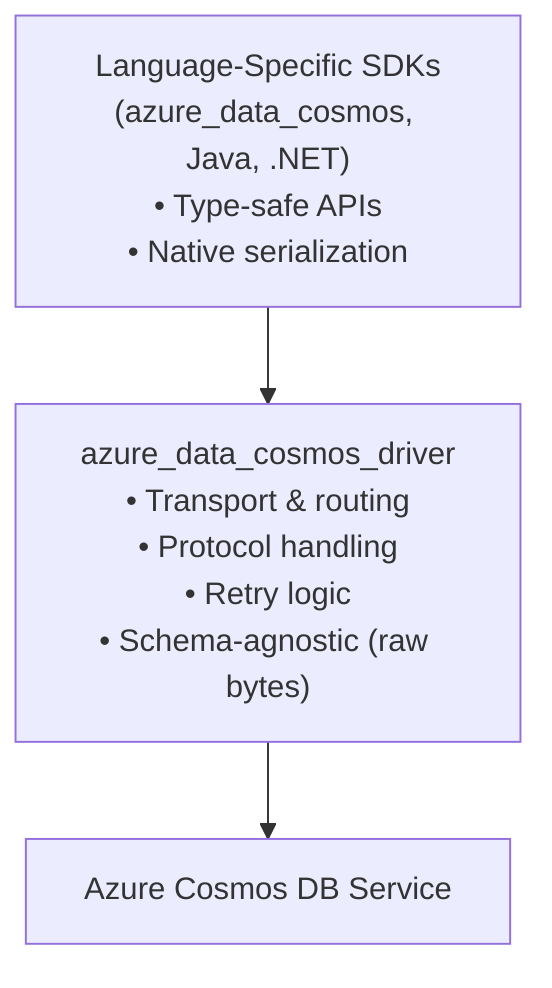

# Azure Cosmos DB Driver

Core implementation layer for Azure Cosmos DB, providing transport, routing, and protocol handling.

See the [Cosmos SDK project documentation] for project, architecture,
specification, and decision records.

## Purpose

The Azure Cosmos DB Driver is a foundational library that implements the core transport, routing, and protocol handling for Azure Cosmos DB. It is designed to be used by language-specific SDKs (e.g., `azure_data_cosmos`) which provide type-safe, idiomatic APIs and handle serialization/deserialization of Cosmos DB resources.

## Support Model

**Applications which use an SDK built on the driver** (e.g., `azure_data_cosmos`) are **fully covered** by Microsoft Support SLAs,
even when issues are ultimately traced to the driver layer. The driver is an implementation detail of the SDK and is supported as part of the overall SDK support.

The Cosmos DB Driver is an internal component shared across several SDKs and is not intended for direct use by most developers.
Applications which use the driver **directly** are **not covered by Microsoft Support SLAs** and receive only community support through GitHub issues and pull requests.
Any driver APIs which are re-exported through the public SDK (e.g., `azure_data_cosmos`) are considered part of the supported public API and are covered by Microsoft Support SLAs when used through the SDK. However, direct usage of the driver APIs that are not re-exported by the SDK is not supported.

## Key Features

### Change feed workload bootstrap

The `change_feed_processor::bootstrap` function initializes a logical workload
without starting change consumption. It binds the change feed mode to the source
account endpoint origin, container RID, and processor name within the lease store.
The lease container must use `/id` partitioning and `defaultTtl: -1`; configure it
before calling bootstrap. Multi-write-region lease accounts are rejected.

The versioned namespace contains a durable mode definition, a create-only initial
range plan, an initialization marker, and per-range processing leases. A separate
30-second TTL lock elects an initializer. Attempts are bounded to 25 seconds and
the default total timeout is two minutes. Lock expiry permits recovery after a
crash but does not fence every delayed write; retries validate existing records
and never replace processing leases. Persisted records use a driver-owned format,
not the Java or .NET lease format.

New leases have no owner or continuation. Bootstrap does not read change feed
pages or interpret `Now`, start times, or initial continuations. Readers retain
those settings and apply them only when saved lease progress is absent. Completed
workloads normally take a read-only path; optional restart verification recreates
missing initial leases without changing existing progress. Topology repair,
processing ownership, checkpoint writes, and callbacks are separate layers.

The Rust SDK's `ChangeFeedProcessor::start()` delegates bootstrap to this driver
before starting coordination. Bootstrap alone does not mark the SDK processor as
started or invoke its callback.

### Change feed processing

`change_feed_processor::Processor` consumes the existing bootstrap range leases.
It uses Java's default equal-balancing strategy: target the ceiling of leases
divided by observed active owners, apply configured min/max counts, prefer
unowned or expired leases, and steal at most one lease per balancing cycle.
Acquisition, renewal, and expiration defaults are 13, 17, and 60 seconds.
Processing leases do not expire through TTL deletion: ownership timestamps
govern takeover, while the durable lease and checkpoint remain.

The driver owns scheduling, metadata writes, and feed requests. It reuses the
existing planner and operation pipelines, including range-scoped composite
continuations and topology recovery. Saved progress takes precedence over initial
start options. An initial continuation must match the lease scope; a container-wide
token is not automatically distributed among leases.

Consumers call `next_batch()`, deserialize the returned payload, and invoke their
application callback. Only after success do they call the batch receipt's
`checkpoint()`. A lease does not poll another page until that write succeeds.
Dropping the receipt abandons the lease without acknowledging the batch.
Conditional writes validate an acquisition-specific incarnation as well as the
owner, rejecting late acknowledgments even after the same instance name reacquires
the lease. Renewal and checkpoint mutations are serialized per lease.

Balancing and renewal run independently of application callbacks. The progress
watchdog abandons a lease after 25 renewal intervals without a successful feed
response, including callback wait time. Lease/feed failures are logged and isolated;
failed workers can be reacquired in a later balancing cycle. Transport retries and
topology repair remain in the existing driver pipelines. A 304 is local idleness,
not processor completion; changed idle continuations can be saved without
an application callback.

There is one outstanding batch per active lease session, without read-ahead.
Memory therefore scales with owned leases; page-size hints are not byte limits.
Foreign callers may retain completed payloads beyond acknowledgment and must
manage that memory themselves. Stealing cannot cancel external application
effects. A crash between callback success and checkpoint persistence can cause
replay, so applications need idempotent handling rather than an exactly-once
assumption.

The bootstrap tests exercise independent driver runtimes against the in-memory
emulator. TTL recovery tests simulate service deletion of an abandoned lock; the
in-memory emulator does not run a TTL sweeper. A separate opt-in test launches
concurrent worker processes against the local hosted emulator. Set
`COSMOS_BOOTSTRAP_TEST_ENDPOINT` to its loopback HTTP account endpoint, then run
`cargo test -p azure_data_cosmos_driver --all-features --lib hosted_concurrent_processes -- --ignored`.
That test creates and deletes its own database and does not accept remote endpoints.

The opt-in `live_concurrent_processes_and_ttl_recovery` test reuses these assertions
against a real account and exercises service-side TTL recovery after an initializer
process exits without releasing its claim. It requires
`COSMOS_BOOTSTRAP_ALLOW_LIVE=true`, `COSMOS_BOOTSTRAP_LIVE_ENDPOINT`,
`COSMOS_BOOTSTRAP_LIVE_KEY`, and `COSMOS_BOOTSTRAP_LIVE_DATABASE`. Provision a dedicated
database whose name starts with `cfp-bootstrap-` and containers named `source` and
`leases`; the latter must use `/id` and `defaultTtl: -1`. Set credentials in the
process environment, never in source or command arguments. Run
`cargo test -p azure_data_cosmos_driver --all-features --lib live_concurrent_processes_and_ttl_recovery -- --ignored --nocapture`.
This test writes only to the supplied test containers; the operator owns resource
provisioning and cleanup. Do not point it at application containers.

### Live processor workload tests

The Rust SDK's opt-in `cfp_live_mixed` tests ingest creates, both new-item and
existing-item upserts, explicit deletes, and a transactional batch containing
create, upsert, and delete operations. They verify exact distinct callback events
and stored item state, allowing duplicate delivery. A final callback is held open
to check that its lease continuation stays unchanged, then released to verify a
durable checkpoint follows.

| Mode | Initial position | Page-size hints |
| --- | --- | --- |
| Latest version | Now | 1, 64 |
| Latest version | Beginning | 2 |
| Latest version | Point in time | 2 |
| All versions and deletes | Now | 1, 64 |

Now tests wait for every planned lease to have an owner and saved initial
progress before starting the workload. Beginning includes a pre-existing seed.
The time-based case uses service timestamps and seeds on both sides of the
boundary, checking that only the later seed arrives. Updates are separated by
callback observation so latest-version coalescing cannot invalidate the expected
revision set. Latest-version tests do not expect delete events; all-versions tests
require delete metadata for both standalone and batch deletes. Page size remains
a hint, not an assertion that every callback contains at most that many items.

Use an isolated, pre-provisioned database and the bootstrap environment variables
described above. The source must use `/pk`, and the lease container must use `/id`
with `defaultTtl: -1` in a single-write-region account. All-versions cases also
require continuous backup and the applicable change feed retention configuration;
unsupported accounts fail rather than silently skipping those assertions.

After explicitly authorizing this workload, set both
`COSMOS_BOOTSTRAP_ALLOW_LIVE=true` and `COSMOS_POLLING_ALLOW_LIVE=true`, then run:

```powershell
cargo test -p azure_data_cosmos --all-features --test live cfp_live_mixed -- --ignored --nocapture --test-threads=1
```

Each case uses unique item, partition, and processor identities. It stops its
processor before removing only its own source items and lease metadata, and
reports cleanup failures. It does not create or delete databases or containers.

Local validation uses the same workload for supported latest-version starts:

```powershell
cargo test -p azure_data_cosmos --all-features --test live change_feed_processor::workload
```

The real-account cases remain ignored in this command. The in-memory emulator
does not model full version/delete history or latest-version time filtering.
Local checks verify time-header forwarding and full-fidelity assertion handling,
but do not substitute for running those service behaviors against a real account.

### Backlog completeness, ordering, and worker handoff

The `cfp_live_backlog` tests require a source with at least two actual feed
ranges. They discover the ranges and select two logical partition keys in each;
a single-range source fails explicitly rather than silently reducing coverage.
They preload append-only creates, new-item upserts, and transactional creates,
so latest-version coalescing cannot hide missing events.

The observer retains callback arrival batches and first-application order,
including worker and lease identity. It rejects a first delivery from an earlier
transaction group within a key, permits permutations inside one transaction,
and does not impose a global order across keys. Known duplicate events remain
visible in the replay log but are applied idempotently.

| Scenario | Assertions |
| --- | --- |
| Drain with page hint 1 | Every expected event across all selected keys arrives; ordering holds; each key's final fence is followed by a durable checkpoint. |
| Restart with page hint 2 | A callback applies a page and blocks before returning; stop does not save that page's position; restarting with Now resumes saved progress, replays the held items, and drains the remainder. |
| Scale-out/down with page hint 4 | A blocked callback does not prevent renewal or other ranges progressing; another worker steals its lease; ownership loss cancels the old callback; stopping a worker with a blocked tail batch lets the remaining worker recover every lease and drain the tail. |

Final fences are submitted only after the finite producer finishes. The test
handles each fence callback independently and verifies its checkpoint before
counting that fence as durable. Neither one range's 304 nor an arrival count is
treated as proof that the whole workload is drained. These scenarios exercise
graceful stop/cancellation and stealing, not operating-system process termination.

Run the real-account scenarios with the same authorization settings:

```powershell
cargo test -p azure_data_cosmos --all-features --test live cfp_live_backlog -- --ignored --nocapture --test-threads=1
```

The corresponding local multi-range scenarios and adversarial ordering checks
run without Azure credentials:

```powershell
cargo test -p azure_data_cosmos --all-features --test live change_feed_processor::backlog
```

### Schema-Agnostic Data Plane

The driver is intentionally ignorant of document/item schemas. Data plane operations:

- Accept raw bytes (`&[u8]`) for request bodies
- Return buffered responses (`Vec<u8>`) for items (≤16MB payload limit)
- Support both UTF-8 JSON and Cosmos DB binary encoding (detected automatically)

**Serialization is handled by the consuming SDK** using native language APIs.

### Independent Versioning

This crate follows **strict semantic versioning** but can move to new major versions more frequently than `azure_data_cosmos`. Breaking changes in the driver do not force SDK version bumps because the SDK uses adapter patterns to maintain backward compatibility.

### Error Backtraces

`CosmosError` can carry a stack backtrace captured at construction. Capture is **opt-in** (matching idiomatic Rust): off by default, on whenever the stdlib `RUST_LIB_BACKTRACE` / `RUST_BACKTRACE` environment variables ask for it, and always overridable programmatically. When enabled, two independent rolling-1-second limiters keep the cost predictable under error storms — so unlike `RUST_BACKTRACE=1` (process-wide, unconditional, all-or-nothing) the driver can be left with backtraces *on* in production without paying the cost on every error.

**Two-tier cost model.**

- **Capture** runs on every `CosmosError` constructed while the capture throttle has budget, and is microseconds — only the call-stack instruction pointers are recorded. Symbols are not resolved at this point. When capture is disabled (no env var asking for it and no programmatic override), the stack is never walked and no IP vector is allocated.
- **Symbol resolution** (turning an IP into `module::function (file:line)`) is deferred until the first call to `error.backtrace()` → `Display`. Resolved frames are cached process-wide by IP, so repeat captures of the same call site only pay the resolution cost once per process lifetime.

**Two production-safety knobs (independent rolling-1-second limiters).**

| Knob              | `BacktraceOptions` field     | Env var                                         | Default when backtraces enabled | Default when disabled | What it bounds                                                                                              |
| ----------------- | ---------------------------- | ----------------------------------------------- | ------------------------------- | --------------------- | ----------------------------------------------------------------------------------------------------------- |
| Capture throttle  | `max_captures_per_second`    | `AZURE_COSMOS_BACKTRACE_CAPTURES_PER_SECOND`    | `1_000`                         | `0` (disabled)        | Hard ceiling on stack walks per second, regardless of cache state.                                          |
| Resolution budget | `max_resolutions_per_second` | `AZURE_COSMOS_BACKTRACE_RESOLUTIONS_PER_SECOND` | `5`                             | `0` (disabled)        | How many backtraces may perform *fresh* symbol resolution per second. Cache hits do **not** consume budget. |

Both fields take `u32`. Setting either to `0` fully disables that limiter; setting both to `0` fully disables backtrace capture.

**Configuration precedence (highest priority first).**

For each of the two knobs the active value is resolved from the first source below that provides a value:

1. **Programmatic** — the most recent call to `azure_data_cosmos_driver::error::set_backtrace_options(BacktraceOptions { … })`. Last-writer-wins; later calls replace earlier ones. **This always wins, including over an env var that explicitly disables backtraces** — e.g. `RUST_BACKTRACE=0` plus a non-zero programmatic call gives you backtraces, and a non-zero `RUST_BACKTRACE` plus a programmatic call with `max_captures_per_second: 0` disables them.
2. **Cosmos-specific env var** — `AZURE_COSMOS_BACKTRACE_CAPTURES_PER_SECOND` / `AZURE_COSMOS_BACKTRACE_RESOLUTIONS_PER_SECOND`. **Trumps `RUST_BACKTRACE` / `RUST_LIB_BACKTRACE` in both directions** — set them when the stdlib env vars do not match what you want for the Cosmos SDK specifically (e.g. `RUST_BACKTRACE=0` but `AZURE_COSMOS_BACKTRACE_CAPTURES_PER_SECOND=1000` → you get Cosmos backtraces capped at 1000/s).
3. **Stdlib `RUST_LIB_BACKTRACE` / `RUST_BACKTRACE`-keyed default** — when neither of the above is supplied, the SDK consults the stdlib env vars using stdlib precedence (`RUST_LIB_BACKTRACE` takes priority over `RUST_BACKTRACE`; for each, anything other than unset / empty / `"0"` enables). When enabled, the defaults from the "enabled" column above apply; otherwise both caps are `0`.

The env-var-derived default is computed lazily on the first error construction and is suppressed once any programmatic call to `set_backtrace_options` has run.

**When to adjust which.**

- **Resolution budget** — raise when you want richer backtraces in development or when investigating a specific recurring failure (resolved frames are cached forever, so a one-time spike costs nothing long-term). Lower (or set to `0`) when symbol resolution is dominating CPU during incident debugging; backtraces will still capture and can be resolved later once the budget is restored.
- **Capture throttle** — lower (or set to `0`) when profiling shows raw stack-walk cost is dominating during a same-call-site error storm (e.g. a sustained 429 storm where every backtrace is a cache hit and the resolution limiter is never consulted). Raise (or leave at the generous default) when you want maximum diagnostic coverage and capture cost is not a concern.

When the resolution budget is exhausted but the cache covers every frame, backtraces render at full fidelity for free. When the budget is exhausted *and* there is a cache-missed frame, the render returns `None` — partial / `<unresolved> @ 0xIP` renders are never produced.

**Tuning programmatically.**

```rust,ignore
use azure_data_cosmos_driver::error::{set_backtrace_options, BacktraceOptions};

// Start from the env-var-derived default (`RUST_LIB_BACKTRACE` /
// `RUST_BACKTRACE`-keyed) and only override the fields you care about.
let mut opts = BacktraceOptions::default();
opts.max_captures_per_second = 500;     // cap raw captures
opts.max_resolutions_per_second = 50;   // richer rendering budget
set_backtrace_options(opts);

// Or fully disable, overriding any env var that asked for backtraces:
set_backtrace_options(BacktraceOptions {
    max_captures_per_second: 0,
    max_resolutions_per_second: 0,
    ..BacktraceOptions::default()
});
```

**Reading a backtrace.**

```rust,ignore
if let Err(err) = driver.execute_operation(op, options).await {
    if let Some(bt) = err.backtrace() {
        eprintln!("{bt}");
    }
}
```

## Architecture



## Usage

```rust,no_run
use azure_data_cosmos_driver::{CosmosDriverRuntime, options::DriverOptions};
use azure_data_cosmos_driver::models::AccountReference;
use azure_identity::DeveloperToolsCredential;
use url::Url;

#[tokio::main]
async fn main() -> Result<(), Box<dyn std::error::Error>> {
    // Use logged-in developer credentials (Azure CLI, azd, etc.)
    let credential = DeveloperToolsCredential::new(None)?;

    let account = AccountReference::with_credential(
        Url::parse("https://myaccount.documents.azure.com:443/").unwrap(),
        credential,
    );

    // Create the runtime
    let runtime = CosmosDriverRuntime::builder().build().await?;

    // Get or create a driver for the account (singleton per endpoint)
    let driver = runtime.create_driver(DriverOptions::builder(account).build()).await?;

    // Driver operations work with raw bytes
    // let response = driver.execute_operation(operation, options).await?;

    Ok(())
}
```

## Module Organization

- **`diagnostics`**: Operational telemetry (RU consumption, retry counts, timing information)
- **`driver`**: Core transport, routing, and protocol handling
- **`models`**: Resource types, partition keys, status codes, and request metadata
- **`options`**: Configuration types (driver options, connection pool settings, diagnostics)
- **`system`**: System-level utilities (CPU/memory monitoring, VM metadata)

Internal modules (pipeline, routing, handlers) have `pub(crate)` visibility.

## Contributing

This project welcomes contributions and suggestions. Most contributions require you to agree to a Contributor License Agreement (CLA) declaring that you have the right to, and actually do, grant us the rights to use your contribution. For details, visit [https://cla.microsoft.com](https://cla.microsoft.com).

When you submit a pull request, a CLA-bot will automatically determine whether you need to provide a CLA and decorate the PR appropriately (e.g., label, comment). Simply follow the instructions provided by the bot. You'll only need to do this once across all repos using our CLA.

This project has adopted the [Microsoft Open Source Code of Conduct](https://opensource.microsoft.com/codeofconduct/). For more information, see the [Code of Conduct FAQ](https://opensource.microsoft.com/codeofconduct/faq/) or contact [opencode@microsoft.com](mailto:opencode@microsoft.com) with any additional questions or comments.

[Cosmos SDK project documentation]: https://github.com/Azure/azure-sdk-for-rust/blob/main/sdk/cosmos/docs/README.md
