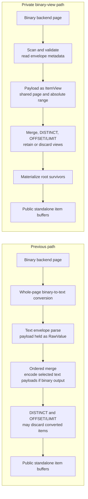
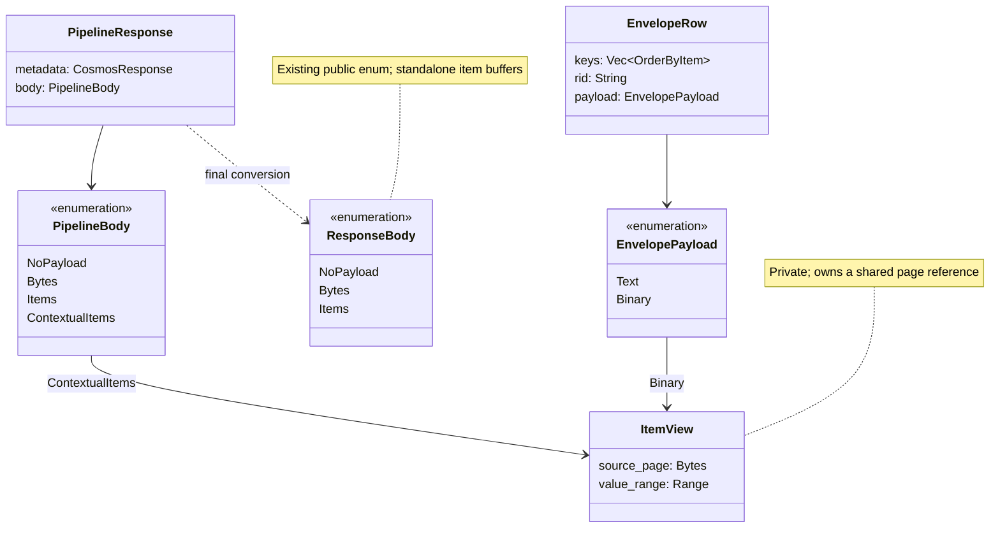
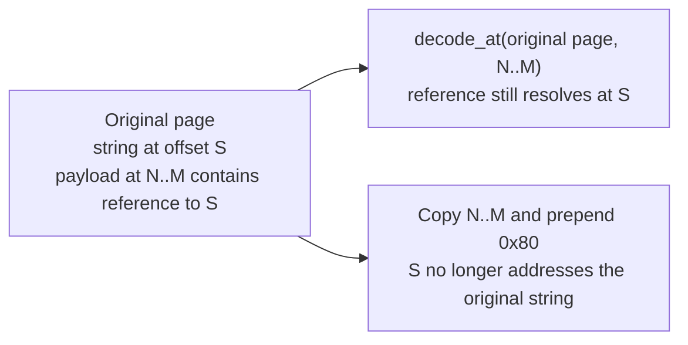
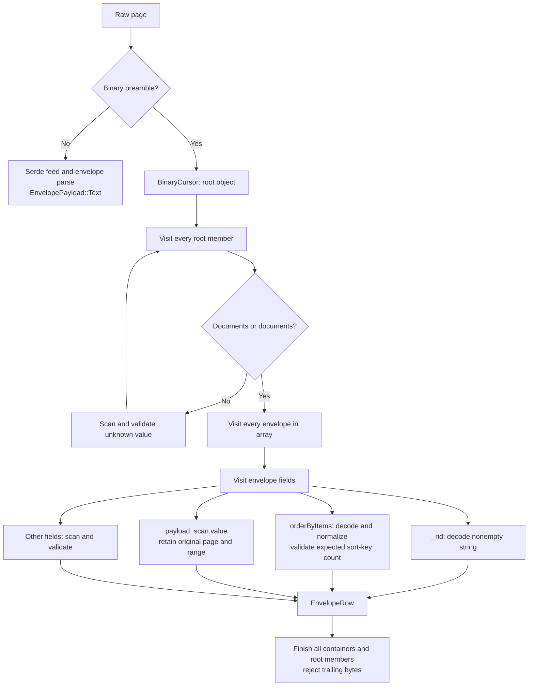
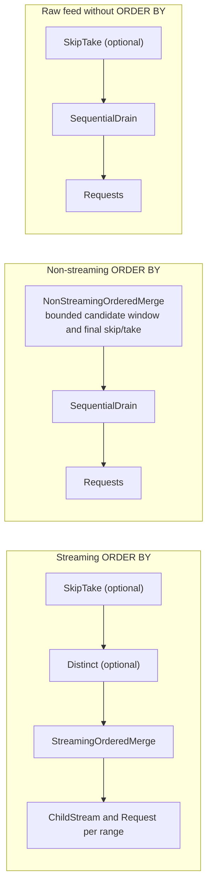
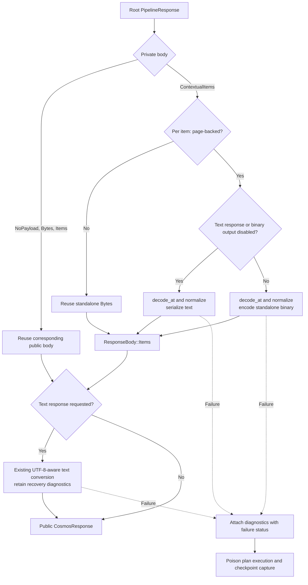
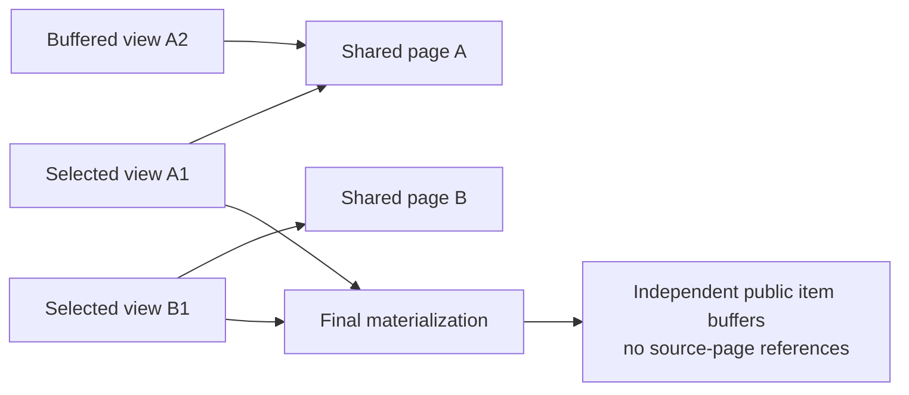

# Binary-aware ORDER BY envelopes

> **Status:** Implemented in PR; pending merge
> **Owners:** Cosmos DB Rust SDK team
> **Target:** `azure_data_cosmos_driver`
> **Tracking:** [Issue #5283](https://github.com/Azure/azure-sdk-for-rust/issues/5283),
> [PR #5409](https://github.com/Azure/azure-sdk-for-rust/pull/5409)

## 1. Overview and scope

Keep binary `ORDER BY` payloads in their original response pages while the query
pipeline sorts and filters them. Instead of repeatedly converting documents
between binary and text, the pipeline carries private views consisting of shared
page `Bytes` and a page-absolute value range. Only the root pipeline's surviving
binary payloads are materialized into independent public item buffers.

The public Rust response-body API and native ABI are unchanged.
`ResponseBody` retains exactly `NoPayload`, `Bytes`, and `Items`. Callers never
receive buffers that need an undisclosed source page to decode.

### Goals

- Avoid whole-page binary-to-text conversion when parsing `ORDER BY` envelopes
  under the default strict UTF-8 decoding mode.
- Preserve binary views through streaming and non-streaming ordered merges,
  `DISTINCT`, and pagination windows.
- Validate all fetched payloads, including rows later discarded, without building
  a JSON tree for every document.
- Preserve query results, ordering, diagnostics, continuation safety, and
  existing standalone-buffer ownership contracts.

### Non-goals

This design does not add query shapes, change continuation-token formats,
introduce public page-view APIs, or optimize the raw-feed splitter outside
`ORDER BY`. It does not remove semantic decoding required by `DISTINCT`, eliminate
final output encoding, or guarantee a latency or RU reduction.

Opt-in lossy UTF-8 recovery preserves its existing behavior: the request executor
transcodes successful child responses to text before the query pipeline parses
them. Those pages take the text path, not the binary-view optimization.

## 2. Relationship to existing designs

Document paths in this table are relative to `sdk/cosmos/docs`.

| Document | Relationship |
| --- | --- |
| `specs/0012-feed-operations-and-dataflow.md` | Defines pipeline nodes, paging, and continuation ownership. |
| `specs/0013-query-engine.md` | Defines planning, ordered merge, DISTINCT, and bounded-window admission. |
| `specs/0014-binary-encoding-high-level-design.md` | Describes negotiation and encoding boundaries; this document details its ORDER BY optimization. |
| `specs/0015-binary-encoding.md` | Defines binary markers, reference offsets, and codec behavior. |
| `specs/0018-diagnostics-contract.md` | Defines aggregation and error diagnostics retained across conversion. |
| `specs/0029-native-feed-cursor.md` | Defines native result ownership and lifetime, which remain unchanged. |

This is a feature specification, not a new cross-cutting architecture decision.
The driver continues to process wire encodings and query operators without
binding payloads to application-specific schemas.

## 3. Before and after

The previous path converted a binary page to text, parsed the text envelopes,
and re-encoded merge output when binary output was negotiated. A later
`DISTINCT` or `OFFSET`/`LIMIT` stage could then discard already-converted rows.
These are multiple processing passes, not a claim of a threefold speedup.



| Work | Previous path | Binary-view path |
| --- | --- | --- |
| Page parsing | Convert every document to text before parsing envelopes | Validate the page and locate payload ranges without constructing document trees |
| Sort metadata | Parse `_rid` and `orderByItems` from text | Decode `_rid` and `orderByItems` from the original page |
| DISTINCT | Decode values for semantic hashing | Still decode values for semantic hashing; retain selected views |
| Binary output | Re-encode text payloads selected by the merge | Decode and encode only binary payloads that survive the root pipeline |
| Discarded payloads | May already have been decoded and re-encoded | Still validated; not materialized into standalone buffers |

The scanner is not an allocation-free decoder. It reads member names and uses
existing decoder validation for some compact scalar forms. The optimization
avoids constructing and transcoding entire payload documents merely to locate
them. `DISTINCT` may decode a row even if a later window discards it.

## 4. Private data model and page ownership



`PipelineResponse` retains status, headers, routing metadata, and diagnostics in
a `CosmosResponse` whose public body is empty. Its actual body is private.
`RequestExecutor`, `PipelineNode`, and the dataflow operators exchange this
private representation; it does not cross the driver boundary.

An `ItemView` is either:

- **Page-backed:** `value_range.start != 0`; the range identifies one value inside
  the complete binary page, after its preamble.
- **Standalone:** range `0..buffer.len()`; the buffer is independently decodable.

`PipelineBody::from_item_views` produces `ContextualItems` if any item is
page-backed. Otherwise it collapses the collection to `Items(Vec<Bytes>)`.
Mixed pages can therefore contain both standalone items and page-backed views.

### Why retaining the whole page is necessary

Binary reference strings (`STR_R1` through `STR_R4`) use absolute offsets within
the original page. A payload can reference a string outside its own range,
including a string in another document.



Re-prefixing a slice can silently return the wrong string if the displaced offset
happens to address another valid string marker. `ItemView::decoded_value` instead
calls `binary_json::reader::decode_at` with the complete page and original range,
then applies integral-float normalization. The range-aware Serde helper
`de::from_slice_at` is not the page-view decoding path.

## 5. Envelope parsing and validation

`parse_envelope_page` accepts raw `PipelineBody::Bytes`, or `NoPayload` as no rows.
Already-split `Items` and `ContextualItems` are invalid inputs to this parser.
Text pages retain the existing Serde/`RawValue` path.



The diagram summarizes field handling, not an early return after the first row.
The parser completes all containers before accepting the page. It rejects missing
or duplicate required fields, invalid envelope shapes, mismatched key counts, and
duplicate `Documents` members.

`BinaryCursor::scan_value` checks container lengths and counts, nesting limits,
scalar validity, references, and truncation even for ignored fields or payloads
that a later operator will discard. Declared lengths are not permission to skip
validation. Codec failures produce `SERIALIZATION_RESPONSE_BODY_INVALID`;
envelope-contract failures use `SERVICE_ORDER_BY_ENVELOPE_INVALID` and existing
query validation statuses.

## 6. Pipeline flow

### 6.1 Component boundaries and query shapes

`CosmosDriver::execute_plan` calls `execute_plan_once`, which pulls the root through
`Pipeline::next_page`. Request leaves delegate to `DriverRequestExecutor` and the
existing operation/transport pipelines. Successful responses become private
`PipelineResponse` values. At the end of the pull, `finalize_plan_response` converts
the root result back to a public `CosmosResponse`.

Arrows below show parent-to-child pulls. Optional operators depend on the
admitted query shape; this does not add support for previously rejected shapes.



The non-streaming merge retains candidate `EnvelopePayload` values within the
existing finite-window limit, then prepares its selected output. The raw-feed
splitter still transcodes binary envelopes to text and encodes surviving items;
the private response plumbing does not optimize that path.

### 6.2 One streaming page with DISTINCT and a window

This sequence shows a successful binary page under strict decoding. A root pull
may consume multiple child pages, and DISTINCT may suppress all-duplicate pages
while retaining their charge and diagnostics.

```mermaid
sequenceDiagram
    autonumber
    participant C as SDK or native cursor
    participant D as CosmosDriver
    participant W as SkipTake
    participant U as Distinct
    participant M as StreamingOrderedMerge
    participant R as Child streams and request leaves
    participant S as Cosmos service

    C->>D: execute_plan(plan)
    D->>W: next_page()
    W->>U: next_page()
    U->>M: next_page()
    M->>R: Fill active child streams
    R->>S: Rewritten query requests
    S-->>R: Binary envelope pages
    R->>R: Parse sort metadata and payload views
    R-->>M: Buffered EnvelopeRows
    loop Until output cap or no rows
        M->>M: Select heap winner
        M->>M: Prepare item view before record_emission()
        M->>M: Advance resume boundary
        opt More output needed and winning child empty
            M->>R: Replenish child; defer fetch errors after output
        end
    end
    M-->>U: ContextualItems
    U->>U: Decode for hashing; keep survivor views
    U-->>W: Selected views
    W->>W: Drop skipped or excess views
    W-->>D: Root survivors
    D->>D: Materialize standalone output; apply text-response mode
    alt Conversion succeeds
        D-->>C: CosmosResponse with ResponseBody::Items
    else Conversion fails after progress
        D->>D: Poison execution and continuation capture
        D-->>C: Error with diagnostics
    end
```

### 6.3 Merge preparation and downstream operators

`PageAggregator::encode_item` clones a binary view without decoding its payload.
For a text payload it copies the text into a standalone buffer, or transcodes it
to standalone binary when the negotiated operation emits binary. The output
encoding follows the operation, not the format of an individual backend page.
The binary-view optimization does not defer these existing text-path conversions.

In the streaming merge, preparation occurs **before** `record_emission`. If
preparation fails, the row returns to its child buffer. An empty output returns
the error immediately; a partial output is delivered and the error is deferred.
This is distinct from failure during final root materialization.

Both DISTINCT and SkipTake handle child body shapes as follows:

| Child body | Input to operator | Output handling |
| --- | --- | --- |
| `Items` | Wrap standalone buffers as views | Keep selected buffers without re-encoding |
| `ContextualItems` | Use existing views | Keep selected views without materialization |
| `Bytes` | Split raw feed into text items | Encode selected items if the operation emits binary |
| `NoPayload` | Empty item list | Preserve existing empty-page behavior |

DISTINCT calls `decoded_value` for semantic hashing; it does not deduplicate on
binary byte equality. SkipTake applies its generic window operation without
decoding already-split items.

## 7. Public boundary and failure safety



Each surviving page-backed item is decoded and encoded once at this boundary.
Text-response mode serializes it directly to text rather than first creating a
binary buffer to transcode again. Existing standalone buffers continue through
the existing text conversion when requested.

`PipelineResponse::into_response` receives the plan's text-response flag, binary
output flag, and resolved UTF-8 mode. These decisions are fixed by the plan, not
reselected from later page-call options. Lossy recovery happens before envelope
parsing in the request executor; final text conversion also preserves recovery
diagnostics for responses reaching the boundary.

The root has already committed progress when final conversion runs. On failure,
the driver attaches diagnostics with the effective error status and poisons the
plan. Later `execute_plan` calls fail with
`SERIALIZATION_RESPONSE_BODY_INVALID`; checkpoint capture fails with
`CLIENT_CONTINUATION_TOKEN_AFTER_TRANSCODE_FAILURE`. Returning a later page or
token would silently skip the undelivered page.

Public output preserves **values, not the service's exact binary representation**.
The SDK uses existing typed decoding APIs. Native cursor completions borrow the
standalone buffers owned by their response; they do not materialize another copy.
Their lifetime still ends when the completion is freed, not when the cursor is
advanced or released. No native page/range accessors are introduced.

## 8. Retention and alternatives



A buffered view pins its entire source page. Multiple views into the same page
share one allocation, but output views, newly fetched pages, and non-streaming
candidates can retain additional pages. There is no general one-page-per-partition
memory bound. Materialization releases the output views' references; a page is
freed only after all other buffered views and owners release it.

Test-only retention instrumentation counts unique page-buffer lengths across
buffered children, newly fetched pages, and in-flight output without retaining
additional ownership. It does not measure total heap usage, transport buffers,
decoded metadata, or process peak memory. The characterization in
`specs/0014-binary-encoding-high-level-design.md` documents that narrower measure.

| Alternative | Reason not selected |
| --- | --- |
| Continue whole-page transcoding | Preserves simplicity but pays conversion costs for documents later discarded. |
| Expose contextual items in public `ResponseBody` | Adds a variant to an exhaustive released enum and changes ownership/decoding contracts. |
| Add native page/range accessors | Expands the ABI instead of preserving the existing standalone result contract. |
| Slice payload bytes and prepend a preamble | Breaks absolute references and can silently corrupt values. |
| Materialize every item at the merge boundary | Keeps operators simpler but converts rows that DISTINCT or a window may discard. |

The selected private representation trades internal plumbing and page retention
for fewer payload conversions without requiring callers to adopt a new API.

## 9. Validation strategy

| Concern | Coverage |
| --- | --- |
| Envelope/codec parity | Parsing regressions and deterministic scanner/decoder differential fuzzing over valid vectors, malformed values, truncation, container boundaries, and ignored fields |
| Absolute references | Width boundaries, forward and cross-document references, and rejection of invalid references, chains, and cycles |
| Query composition | Streaming/non-streaming order, DISTINCT, windows, mixed text/binary pages, and buffer-only pages |
| Resume and topology | Reference-backed resume, split replacements, ties, and exact ordered results without omissions or duplicates |
| Materialization and ownership | Counters assert only root survivors are materialized; standalone output remains decodable after source/pipeline release |
| Error behavior | Final conversion failures retain diagnostics and prevent further paging/checkpoints; strict/lossy UTF-8 tests retain recovery semantics |
| Compatibility | Exhaustive public-enum matching, unchanged API artifacts/native header, released-baseline SemVer checks, and native completion lifetime regressions |
| Live correctness | Opt-in text/binary comparison across query shapes, page-size hints, populated physical ranges, and repeated/fresh-runtime checkpoints |

Deterministic differential tests are not a coverage-guided fuzz target. Live
service runs cannot guarantee emission of every compact marker, so synthetic
codec and reference vectors remain necessary.

The [historical performance and real-split report](https://github.com/Azure/azure-sdk-for-rust/pull/5409#issuecomment-6181610024)
records timing, RU, wire-byte, and continuation observations with their scope and
limitations. It is not a universal speedup claim or a guarantee about future
service behavior. Ordered DISTINCT's separately reproduced service pagination
issue is not fixed by this encoding change.

## 10. Implementation map

Paths are relative to `sdk/cosmos`; they are navigation hints, not public APIs.

| Area | File |
| --- | --- |
| Private views, final conversion, ownership tests | `azure_data_cosmos_driver/src/driver/dataflow/response.rs` |
| Envelope parsing and item preparation | `azure_data_cosmos_driver/src/driver/dataflow/query_response.rs` |
| Scanner and page-range value decoding | `azure_data_cosmos_driver/src/binary_json/reader.rs` |
| Streaming and bounded non-streaming merges | `azure_data_cosmos_driver/src/driver/dataflow/streaming_ordered_merge.rs`, `azure_data_cosmos_driver/src/driver/dataflow/non_streaming_ordered_merge.rs` |
| DISTINCT and window composition | `azure_data_cosmos_driver/src/driver/dataflow/distinct.rs`, `azure_data_cosmos_driver/src/driver/dataflow/skip_take.rs` |
| Unchanged raw-feed split/encode path | `azure_data_cosmos_driver/src/driver/dataflow/skip_take_page.rs` |
| Request conversion and final plan poisoning | `azure_data_cosmos_driver/src/driver/cosmos_driver.rs` |
| Parsing and resume regressions | `azure_data_cosmos_driver/src/driver/dataflow/query_response_parsing_tests.rs`, `azure_data_cosmos_driver/src/driver/dataflow/integration_tests/order_by_resume.rs` |
| Live correctness harness | `azure_data_cosmos/tests/live_tests/binary_order_by.rs` |
