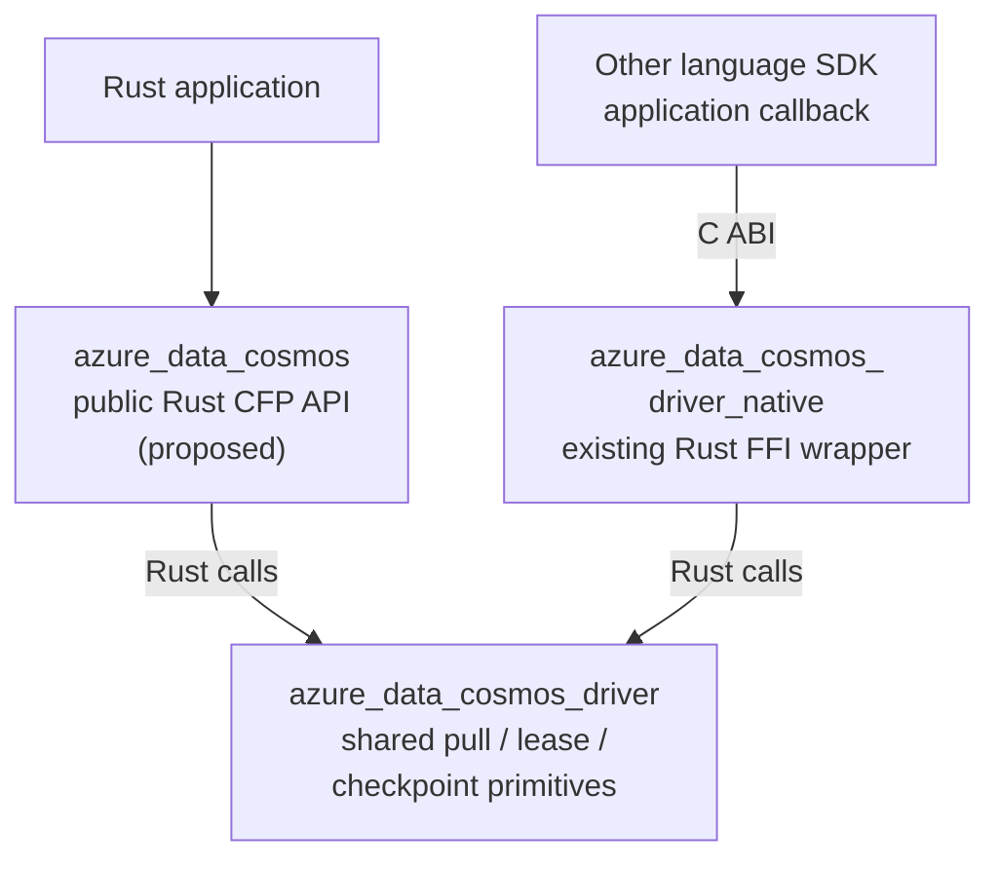

<!-- cspell:ignore checkpointing lockstep -->

# Change Feed Processor Package Boundaries

**Status:** Draft; package decision requested, not repository consensus
**Date:** 2026-10-06
**Updated:** 2026-10-12
**Authors:** Not specified

## Table of Contents

- [1. Proposed Baseline](#1-proposed-baseline)
- [2. Package Responsibilities](#2-package-responsibilities)
- [3. Public Rust API Placement and Type Reuse](#3-public-rust-api-placement-and-type-reuse)
- [4. Callback Completion and Checkpointing](#4-callback-completion-and-checkpointing)
- [5. Prepared Feed Resources and Lease Stores](#5-prepared-feed-resources-and-lease-stores)
- [6. Deployment and Release](#6-deployment-and-release)
- [7. Remaining Boundary Decisions](#7-remaining-boundary-decisions)

## 1. Proposed Baseline

Reuse `azure_data_cosmos_driver` for shared change-feed pull, lease, and
checkpoint primitives, and `azure_data_cosmos_driver_native` as the existing
Rust FFI wrapper. Each consuming SDK reads changes, invokes its application's
callback, and coordinates checkpointing through these primitives.

Evaluate the public Rust API inside `azure_data_cosmos` first. This can reuse
existing event types, prepared client state, request options, and diagnostics.
A companion `azure_data_cosmos_change_feed_processor` remains an open
distribution option, not a required new package.

This replaces the earlier proposal for a separate
`azure_data_cosmos_change_feed_processor_driver` and
`azure_data_cosmos_change_feed_processor_native`. The draft baseline does not
add a second driver or native artifact, or automatically put the complete CFP
lifecycle in `azure_data_cosmos_driver`. New lease/checkpoint interfaces and
their native bindings are proposed, not already available or approved.

This document covers package responsibilities and compatibility. Detailed
polling algorithms, scheduling, state machines, FFI protocols, and behavioral
test plans are outside scope.

## 2. Package Responsibilities

The diagram shows the in-SDK option to evaluate first; Rust API placement remains
open. The shared cross-language baseline is independent of that choice.



| Package or extension | Responsibility |
| --- | --- |
| Public Rust API in `azure_data_cosmos`, or an optional companion | Read batches, deserialize the change-feed response body, invoke and await `handleChanges`, then invoke and await the conditional checkpoint operation. Coordinate the processor's SDK-side lifecycle and surface failures. |
| `azure_data_cosmos_driver` | Reuse feed/dataflow execution, request authentication, retries, routing, and metadata caches. Add shared lease/pull/checkpoint primitives that validate authority, associate progress with the owned work, and report persistence outcomes. |
| `azure_data_cosmos_driver_native` | Expose C-compatible bindings to the same shared primitives. Other language SDKs retain application decoding, callback invocation, and host-runtime coordination. |
| Prepared lease-store provider (proposed extension point) | Supply conditional lease ownership and checkpoint persistence. A built-in Cosmos implementation uses prepared Cosmos resources; another store supplies equivalent authority/persistence guarantees and its own authentication. |

The Rust FFI wrapper must not depend on Rust application types or the typed
public SDK. Adding CFP inside `azure_data_cosmos` does not reverse the existing
dependency from `azure_data_cosmos` to `azure_data_cosmos_driver`.

## 3. Public Rust API Placement and Type Reuse

| Placement | Benefits | Costs and decisions |
| --- | --- | --- |
| Inside `azure_data_cosmos` (evaluate first) | Reuse `ChangeFeedItem<T>`, metadata, request options, decoder semantics, client state, and diagnostics without a new public package boundary. | CFP follows the SDK's release and compatibility contract. Decide its opt-in footprint and public surface. |
| Companion `azure_data_cosmos_change_feed_processor` (open) | Separate release cadence and explicit opt-in dependency. It may reuse SDK types through a dependency on `azure_data_cosmos`. | Private client state is not directly accessible across crates. Define supported resource access and compatible SDK/driver versions; exposed SDK types couple public compatibility. |

Prefer reusing current event models and decoder semantics rather than selecting
duplicate public models by default. A companion's dependency on
`azure_data_cosmos` for type reuse is technically valid and does not place typed
decoding in the shared driver or native path. Moving genuinely shared types to
`azure_data_cosmos_driver` and re-exporting them is a possible compatibility
design, not a completed migration; changed API shapes may need wrappers.

Ordinary Cargo diamond dependencies are supported. Repeated paths to the same
resolved package do not inherently duplicate Rust types, clients, or runtime
instances. Different resolved versions or sources can produce distinct type
identities. Exposing SDK-owned types makes their compatibility part of the
companion's public API and constrains upgrades. Cargo has no "types-only
dependency": `default-features = false` does not make the SDK a models-only
package, and other dependency paths may enable features.

If duplication is necessary, it carries decoder-maintenance costs and distinct
Rust type identities; it is not a guarantee of independent versioning.
`serde` and `serde_json` already serve the Rust layers. This proposal does not
ban them or require replacing Rust application serialization.

Raw driver payloads remain application-schema-agnostic, not necessarily text
JSON or byte-for-byte untouched. Each consuming SDK owns application typing;
`azure_data_cosmos_driver` may decode wire formats and process service
envelopes. SDK-side binary decoding and direct-buffer deserialization require
performance evidence and safe lifetimes before adoption. This draft neither
promises zero-copy nor makes the internal binary codec a new public API.

## 4. Callback Completion and Checkpointing

The outer SDK owns the processing sequence; shared lease/store primitives
enforce authority and persistence. For the initial per-batch policy:

```text
SDK reads batch using an owned lease
    -> deserialize and await handleChanges
    -> if successful and still authorized, invoke conditional checkpoint
    -> await confirmed persistence
    -> only then read/deliver the next batch for that lease
```

`azure_data_cosmos_driver` supplies the shared primitives through Rust
interfaces; other SDKs access them through `azure_data_cosmos_driver_native`.
No separate processing-success acknowledgement followed by an independently
controlled checkpoint protocol is selected. No extra process, message broker,
or speculative FFI batch-handle protocol is required.

Lease renewal remains independent of a slow callback. Callback failure does
not authorize checkpoint progress. A successful callback followed by an
ambiguous checkpoint result requires persistence reconciliation, not treating
the callback as failed. This is at-least-once, lockstep coordination, not a
transaction with arbitrary application effects: a crash after those effects
but before checkpoint confirmation can cause replay.

Less-frequent checkpoints are an extension to explore: they reduce lease writes
but increase replay and change the per-batch guarantee above. No checkpoint
interval or lease-renewal default is selected. Application code currently owns
dead-letter handling; native dead-letter support remains open pending demand.

## 5. Prepared Feed Resources and Lease Stores

Account, credential, and container preparation happens **before CFP
construction**, using the application's existing clients. The proposed CFP
inputs are a prepared, credential-bound feed resource and a prepared lease-store
provider, not endpoints and credentials for a CFP builder to authenticate.

```text
Application prepares clients/resources with their credentials
    -> prepared feed resource ------------------+
    -> prepared lease-store provider -----------+-> public CFP API
                                                    -> reuse existing primitives
```

Feed and Cosmos lease resources may use the same or different accounts and
identities. Reuse each resource's correct credential-bound context and existing
credential provider/refresh; do not substitute credentials merely because
endpoints match. A non-Cosmos lease store owns its own authentication.
Preparation is not perpetual authorization, and successful metadata resolution
does not prove permission for every later lease write.

In the current SDK, `ContainerClient`'s resource/context fields are private;
`ClientContext` and its driver handle are crate-internal. An in-SDK CFP can
integrate with that state inside `azure_data_cosmos`. A companion must use
supported public APIs or a deliberately designed bridge; this proposal does
not invent an existing driver-extraction API or require exposing private state.
Retained client/runtime lifetimes and shutdown responsibilities must be defined
without shutting down resources the application still uses.

## 6. Deployment and Release

One existing `azure_data_cosmos_driver` implementation and
`azure_data_cosmos_driver_native` library can serve multiple configured
client/resource instances, normally within the application process. Separate
crates do not create process isolation, contain panics, or provide high
availability. Availability requires coordination between workers, not another
package or native binary.

An in-SDK API follows the `azure_data_cosmos` release lifecycle; a companion
allows its own cadence but must specify compatible public SDK/driver versions
and publishable dependencies. Compare opt-in footprint rather than assuming
either placement is cheaper. Existing native library/header distribution and
ABI compatibility must cover any added primitives. No release approval, new
service, binary, or native artifact is implied.

## 7. Remaining Boundary Decisions

These are bounded follow-up decisions, not a complete operational specification.

| Concern | Boundary to settle |
| --- | --- |
| API placement and resource lifetime | In-SDK versus companion; public resource access, caller-owned client/runtime lifetime, and shutdown that leaves shared resources usable. |
| Completion and capacity | Distinguish callback failure from ambiguous checkpoint persistence; bound concurrent callbacks, outstanding batches, and buffered memory while preserving independent renewal. |
| Lease compatibility and identity | Lease-document/continuation compatibility across rolling upgrades and rollback; stable workload identity across routing changes and correct source/mode association. |
| Custom lease stores | Explore a provider contract with atomic conditional ownership/checkpoint and fencing semantics, not CRUD alone; do not imply all backends ship initially. |
| Diagnostics and supported scope | Surface feed, callback, lease, checkpoint, and shutdown errors through existing diagnostics; define supported modes, starts, and topology transitions without exposing credentials or document contents. |
