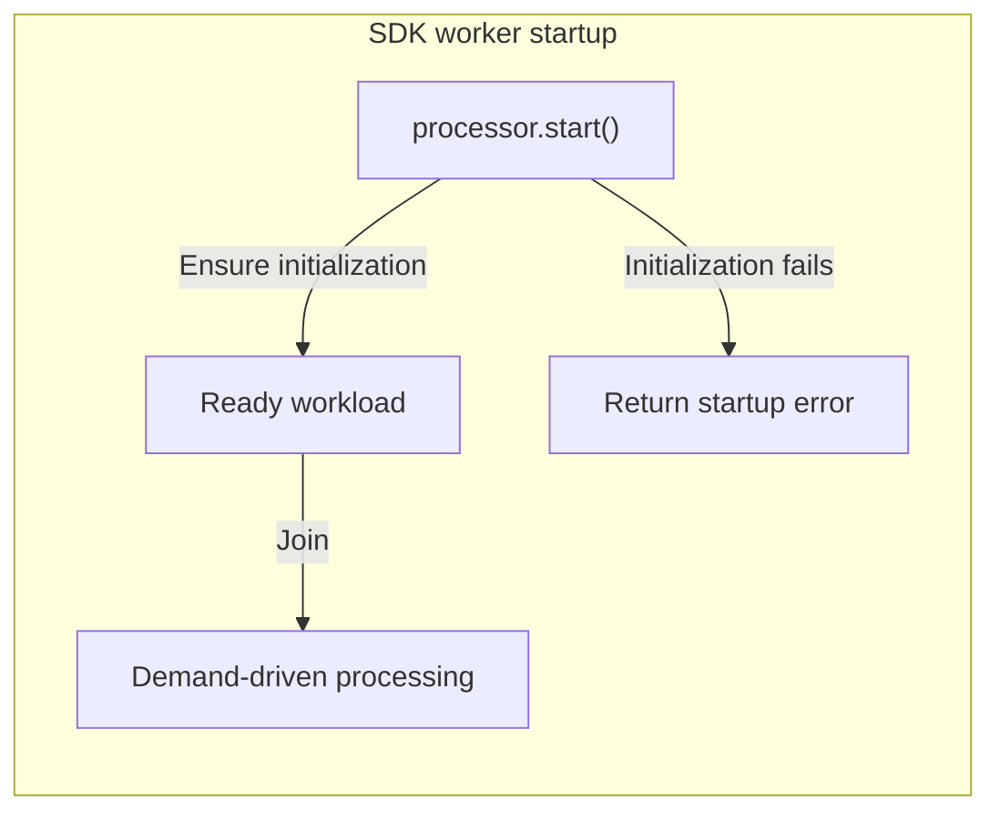
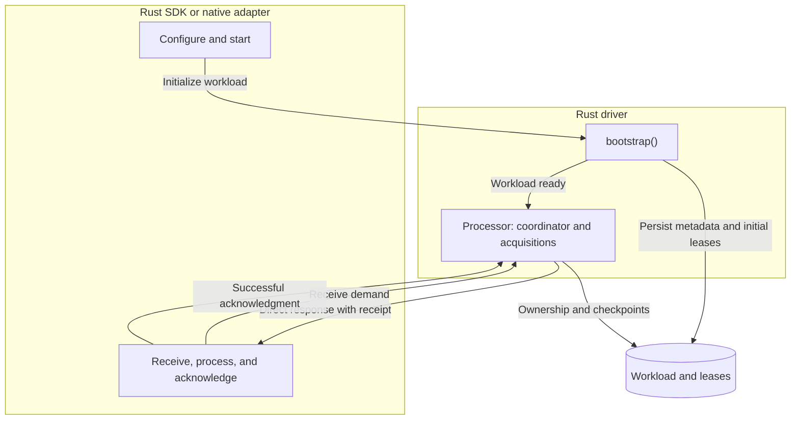
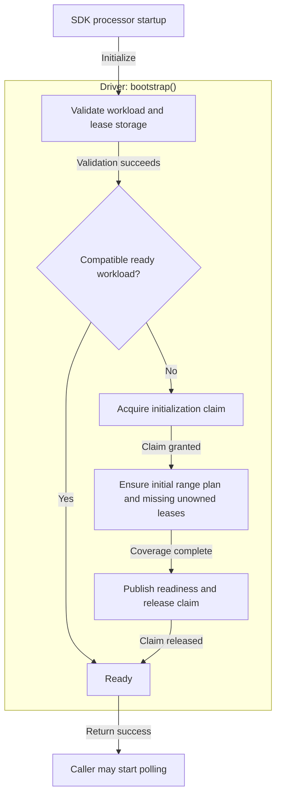
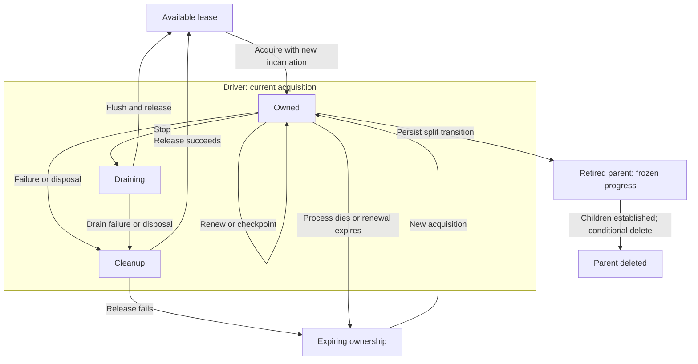
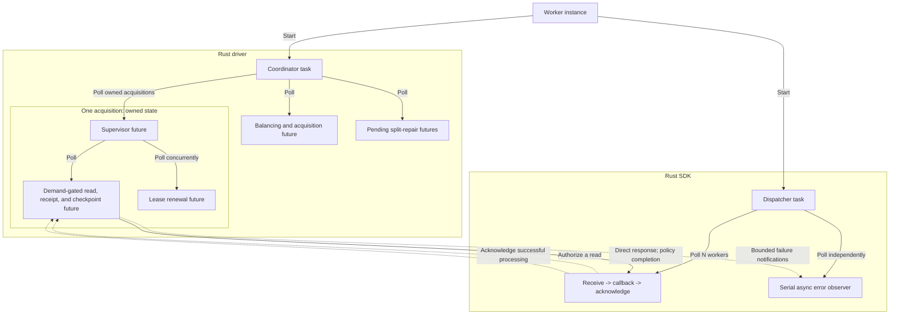
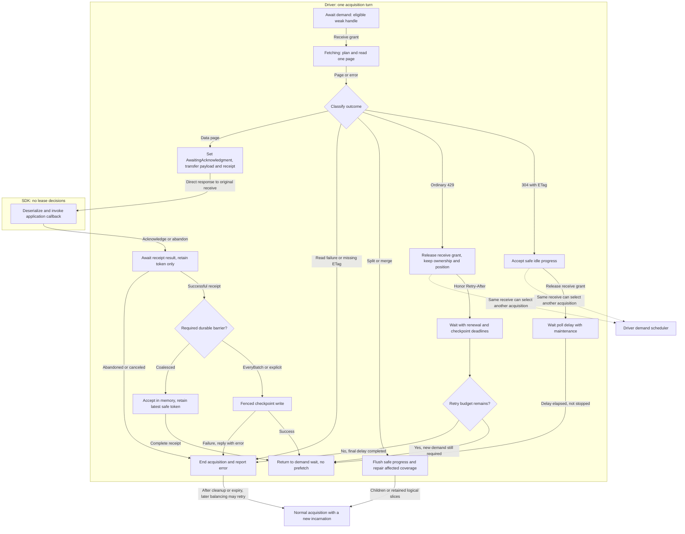
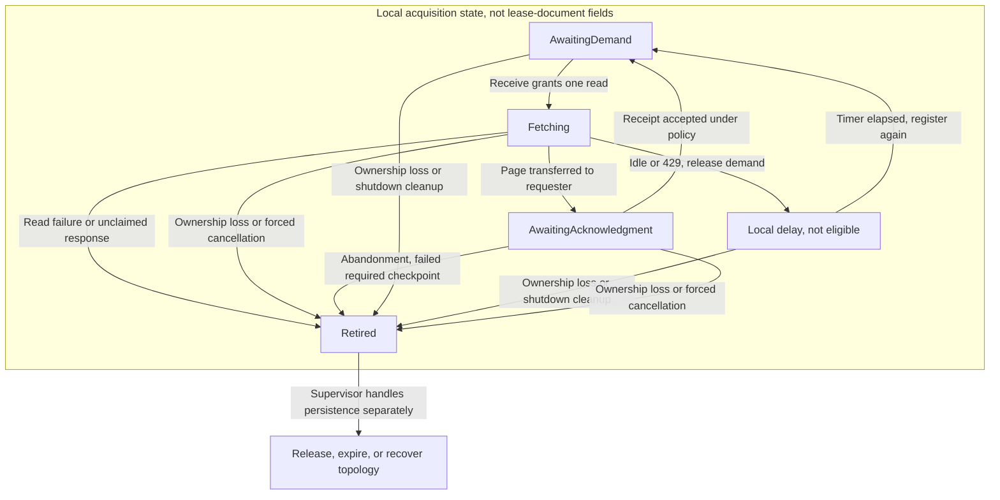
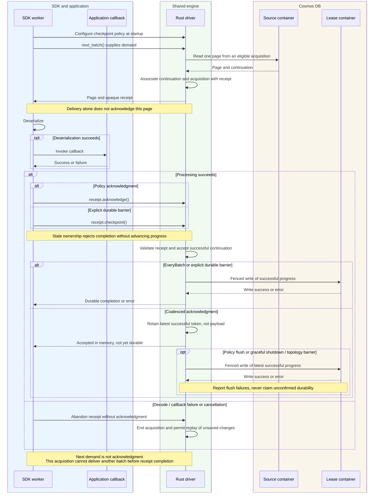
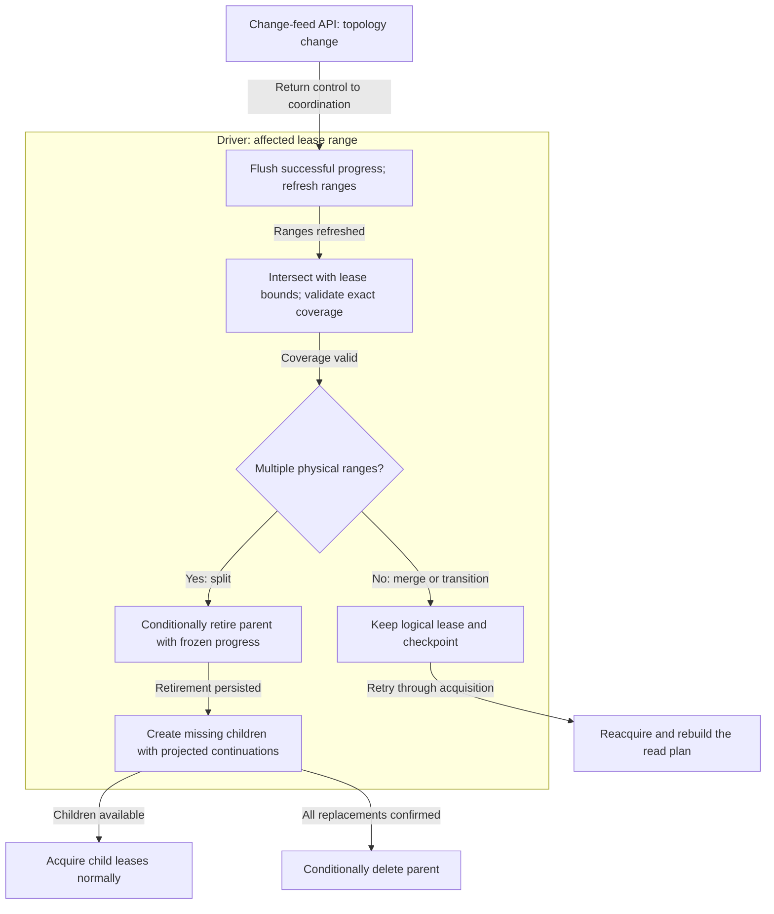

# Rust change feed processor: design proposal

<!-- cspell:ignore bootstrapper checkpointing -->

**Status:** Implementation-backed draft

**Updated:** 2026-11-10

## Table of contents

1. [Public API](#1-public-api)
2. [Goals and architecture](#2-goals-and-architecture)
3. [Startup and bootstrap](#3-startup-and-bootstrap)
4. [Lease liveness and coordination](#4-lease-liveness-and-coordination)
5. [Feed polling and callback dispatch](#5-feed-polling-and-callback-dispatch)
6. [Checkpointing pipeline](#6-checkpointing-pipeline)
7. [Shutdown and topology recovery](#7-shutdown-and-topology-recovery)
8. [Validation and live workload](#8-validation-and-live-workload)
9. [Compatibility and rollout](#9-compatibility-and-rollout)
10. [Open questions](#10-open-questions)

---

## 1. Public API

`processor.start()` automatically initializes or resumes the workload before
processing begins. Initialization failure fails startup. Usage examples use
authenticated `source`/`leases` clients and an async `handle` callback;
implementation excerpts below show the actual Rust types and functions, with
their surrounding module imports omitted.



### 1.1 Automatic bootstrap in start

```rust
let processor = ChangeFeedProcessorBuilder::new(
    ChangeFeedMode::LatestVersion,
    source,
    leases,
    "order-projection",
    "worker-01",
)
.with_start_from_now()
.handle_change_feed(handle)
.build()?;

processor.start().await?; // Ensure workload is ready, then start polling.

// Application runs; stop during application shutdown.
processor.stop().await?;
```

### 1.2 Configuration surface

| Scope | Settings |
| --- | --- |
| Workload | Source, lease storage, processor name, feed mode. |
| Worker | Unique instance name, start policy/continuation, callback, max concurrency, error observer, page hint, poll delay, checkpoint policy, lease counts. |
| Defaults | One worker; no error observer; `Now`; page hint 100; idle delay 5s; read turn at most 5s; `EveryBatch`; min/max leases 0/0 (uncapped). |
| Validation | Names neither empty nor whitespace-only; beginning/time only in latest-version mode; continuation matches source/mode/ranges. Local checks at construction; service checks at startup. |
| Lifecycle | Reject duplicate start; `is_started()` is local only. |
| Callback | `Send + 'static` future returning Cosmos `Result<()>`; acknowledgment follows success. |

```rust
let processor = builder
    .with_max_concurrency(std::num::NonZeroU32::new(4).unwrap())
    .with_checkpoint_policy(ChangeFeedCheckpointPolicy::coalesced()) // Five minutes.
    .handle_error(on_error) // async fn(Option<ChangeFeedProcessorContext>, CosmosError) -> ()
    .handle_change_feed(on_changes)
    .build()?;
```

**Open:** callback capture.

The SDK checkpoint policy and its five-minute constructor are defined in
`azure_data_cosmos/src/change_feed_processor.rs`:

```rust
#[derive(Clone, Copy, Debug, Default, PartialEq, Eq)]
#[non_exhaustive]
pub enum ChangeFeedCheckpointPolicy {
    /// Persists each successful callback before reading its lease's next batch.
    #[default]
    EveryBatch,
    /// Coalesces successful callbacks until the interval since the first
    /// unpersisted success elapses. Idle reads do not trigger persistence.
    ///
    /// Successful callbacks can replay after a crash or ownership loss. Graceful
    /// shutdown and topology recovery flush without waiting for the interval.
    /// The interval schedules a write, not a storage-availability guarantee.
    Coalesced {
        /// Positive maximum interval for deferring persistence of successful progress.
        max_interval: Duration,
    },
}

impl ChangeFeedCheckpointPolicy {
    /// Coalesces successful progress for up to five minutes.
    ///
    /// Use [`Self::Coalesced`] to select a different interval. Graceful cleanup
    /// and explicit checkpoints can persist progress earlier.
    pub fn coalesced() -> Self {
        Self::Coalesced {
            max_interval: Duration::from_secs(300),
        }
    }
}
```

### 1.3 Batch diagnostics

`ChangeFeedProcessorContext::diagnostics()` returns
`Option<Arc<DiagnosticsContext>>`. Batch callbacks carry the completed read
diagnostics; error notifications carry diagnostics when their error provides them.
The context also exposes the opaque lease identifier for correlation.

```rust
#[derive(Clone, SafeDebug)]
pub struct ChangeFeedProcessorContext {
    lease_token: String,
    #[safe(false)]
    diagnostics: Option<Arc<DiagnosticsContext>>,
}

impl ChangeFeedProcessorContext {
    /// Returns the opaque identifier of the lease associated with this batch.
    ///
    /// This is not a continuation token or a physical partition identifier.
    /// Treat it as meaningful within the processor's lease namespace.
    pub fn lease_token(&self) -> &str {
        &self.lease_token
    }

    /// Returns operation diagnostics associated with this notification.
    ///
    /// For change callbacks, these describe the read that produced the batch,
    /// not subsequent callback execution or checkpoint writes. Error notifications
    /// may have no diagnostics. Retaining this handle does not retain the batch
    /// payload, and does not render or log the diagnostics.
    pub fn diagnostics(&self) -> Option<Arc<DiagnosticsContext>> {
        self.diagnostics.clone()
    }
}
```

- **Scope:** diagnostics for the read that produced the batch: status, latency,
  request charge, attempts, and available request correlation. Not the entire
  processor history or later callback, acknowledgment, and checkpoint outcomes.
- **Lifetime:** Rust retains diagnostics independently of the batch payload.
  Applications may retain the handle after the callback and processor shutdown.
  A future Go CFP adapter must copy diagnostics into Go-owned memory before
  releasing the native completion, following the existing operation adapter.
- **Emission:** applications choose whether to inspect or log the diagnostics;
  no automatic logging or eager JSON serialization.
- **Before delivery:** read/deserialization failures still use the error observer
  with diagnostics when available; there may be no batch callback or completed
  read to attach them to.

**Checks:** retained callback diagnostics survive processor shutdown; malformed
document errors retain read diagnostics; batch callbacks receive diagnostics in
both modes and checkpoint policies. Accessing the handle does not render JSON.

### 1.4 Debuggability: exploratory design

**Logging decision:** driver logs and SDK/application logs may coexist through
their own configured sinks. No driver-to-SDK log export or FFI log-forwarding
bridge is required. Shared correlation identifiers and centralized collection
connect the streams. Operation diagnostics and error notifications remain
separate data contracts, not log forwarding.

**Exploratory; API details open.** Build on those logging pipelines with an optional
lease-status snapshot and richer context on the existing error hook, rather than
a new monitoring service.
`current_state()` currently returns `NotImplemented`; a Go equivalent through
Rust FFI would also need implementation.

- **Snapshot:** include unowned leases; owner/acquisition, state and waiting
  reason, state age, separate last renewal/read/processed-batch times, pending
  checkpoint age, last checkpoint outcome, and last failure. Distinguish an
  empty successful read from successful batch processing.
- **Failures:** correlate lease + acquisition + failed stage + error, retaining
  status/substatus and activity ID when available. Status explains absent
  progress; errors explain failed operations.
- **Viewing:** customers configure native driver and SDK/application logging,
  then search by workload and lease. Centralized collection provides the fleet
  view; no new application polling loop or SDK dashboard. Applications may also
  print snapshots or expose them through an existing internal diagnostics endpoint.

#### Log-first end-to-end diagnostics

Proposed correlated stages:

```text
discover -> acquire -> read -> decode -> callback -> acknowledge -> checkpoint
```

Driver logs cover ownership, renewal, reads, checkpoints, and recovery. Rust/Go
adapters log decoding and callback outcomes through their own logging pipelines.
Correlation metadata may cross FFI with batches or diagnostics; log records need
not cross it. Include workload, lease, acquisition, batch identity when applicable,
stage, outcome, reason, duration, and next action. Identify source versus lease-store
failures; retain status/substatus, retry timing, and activity ID when available.

| Log evidence | Customer interpretation |
| --- | --- |
| Unowned lease summary + acquisition failure or eligibility reason | Lease not picked up; investigate permissions, capacity, or coordination. |
| Renewals continue + prolonged callback wait | Ownership is healthy; application processing is not completing. |
| Read retry + next retry time | Throttling or another retryable failure, not unexplained inactivity. |
| Acknowledged in memory + checkpoint deferred | Processing succeeded; durability is pending, so replay remains possible. |
| Checkpoint failure + recovery action | Persistence failed; distinguish retry from release/reacquisition. |

Log failures and lifecycle transitions, plus periodic summaries of prolonged
waits and worker health; a stuck operation may never return an error. Rate-limit
repeated records while retaining counts; make per-batch success traces opt-in.
Missing or sampled logs are not proof that a change was never processed.

Live phase details are local. For other workers, expose persisted lease metadata
and observation timestamps; unavailable phase details remain unknown. Keep phase
state in memory, without lease-store writes for every transition.

Snapshots and bounded error notifications are not a delivery audit. Suspected
missed changes may require application event/version IDs and reconciliation;
callback success should mean durable handling of the whole batch. Avoid logging
raw payloads or continuation tokens.

---

## 2. Goals and architecture

### 2.1 Goals and design principles

The processor distributes change-feed work across application instances and
resumes from durable progress after failures. One driver engine provides these
mechanics for language SDKs, in both latest-version and all-versions-and-deletes
modes.

- **Separate application processing from coordination.** The SDK owns typed
  callbacks; the driver owns leases, service interaction, and recovery.
- **Read only on demand.** A free SDK worker requests work; the driver does not
  prefetch batches for busy callbacks.
- **Separate acknowledgment from durability.** Callback success makes progress
  eligible for checkpointing. The policy determines when it is persisted.
- **Keep failures local where possible.** An idle or throttled acquisition yields
  demand to other eligible work. Maintenance continues independently.

Exactly-once application side effects, a global payload-memory limit, and a
monitoring service are not goals of this design.

### 2.2 Ownership boundary

**The SDK owns application processing; the driver owns lease coordination and
durable progress.** The SDK requests batches, not particular leases.

| Concern | SDK responsibility | Driver responsibility |
| --- | --- | --- |
| Configuration and startup | Expose language-specific options and invoke startup. | Validate the workload, perform bootstrap, and begin lease coordination. |
| Demand and concurrency | Run N receive -> callback -> acknowledgment workers; request another batch only when a worker is free. | Select an eligible acquisition for each receive; do not start feed reads without demand. |
| Empty reads and read failures | Await the next deliverable batch; do not select leases or implement service retries. | Handle idle responses, retry budgets, and lease-local cooldown waits; let other eligible acquisitions serve demand. Report failures and manage acquisition cleanup. |
| Batch processing | Deserialize into application types and invoke the callback. Report failures; abandon the receipt on unsuccessful processing. | Deliver the page with an opaque receipt; allow replay when the receipt is abandoned. Never invoke the application callback. |
| Checkpointing | Acknowledge the receipt after successful processing; select the configured policy or request an explicit durable checkpoint. | Track contiguous successful progress and persist according to policy. Reject stale receipts; acknowledgment is not necessarily durable. |
| Lease liveness | Pass configuration and opaque diagnostic identifiers; do not acquire, renew, steal, rebalance, or release leases. | Own those operations and their timers, ownership fencing, and serialized mutations. Ownership changes preserve stored checkpoints. |
| Splits and merges | Continue consuming batches without topology-specific application logic. | Repair affected coverage, project safe continuations, and clean up split parents. Preserve independent logical leases on merges. |
| Shutdown | Request stop; finish issued callbacks and settle receipts during graceful drain, or cancel on forced shutdown. | Stop new read admission, maintain ownership during drain, flush safe progress when permitted, and release leases. |
| Diagnostics and logging | Expose batch-read diagnostics through the callback context and log SDK/callback outcomes. | Produce read diagnostics and log driver activity. Driver log records need not be forwarded to the SDK. |

Rust calls the driver directly. The native wrapper adapts handles, completions,
and memory ownership for other SDKs; it adds no lease policy. The same split is
intended for Go through FFI; the Go CFP adapter is deferred. SDK public types
remain separate from driver types.

### 2.3 Architectural overview

The boundary carries configuration, receive demand, batches with receipts, and
processing outcomes. Lease selection and continuation persistence stay inside
the driver.



The implementation follows this call sequence. Spawning coordination and SDK
workers creates concurrent task trees; returning a processor handle does not
mean every lease has already been acquired.

```text
ChangeFeedProcessor::start
  -> execution::start
     -> ContainerClient::start_change_feed_processor
        -> Processor::start
           -> validate options
           -> bootstrap: definition -> claim -> plan -> leases -> ready
           -> optional lease verification
           -> spawn run: balance -> acquire -> supervise
                                  supervise polls poll and renew concurrently
     -> spawn SDK worker pool
        -> consume
           -> Processor::next_batch -> BatchDistributor::next_batch
              -> grant demand -> poll_feed -> execute_plan
              -> AcquisitionDelivery::deliver
           -> dispatch -> application callback
           -> BatchReceipt::acknowledge
              -> poll_feed accepts progress -> optional Context::flush

ChangeFeedProcessor::stop
  -> execution::stop -> Processor::stop
     -> close admission -> settle issued receipts
     -> poll flushes safe progress -> supervise releases
     -> run joins acquisitions and finishes cleanup
  -> finish SDK dispatch/error reporting -> return
```

### 2.4 Component state model

A **lease** survives the process. An **acquisition** is one owner's temporary
right to process it. These are separate lifetimes, even though the implementation
may keep persisted and non-serialized fields in the same Rust aggregate.

The actual `Lease` flattens the bootstrap `ProcessingLease` record, which contains
workload identity, range, owner, and continuation. `serde(skip)` separates the
runtime-only renewal clock and pending checkpoint from persisted fields:

```rust
#[derive(Clone, Serialize, Deserialize)]
struct Lease {
    #[serde(flatten)]
    base: ProcessingLease,
    #[serde(default, skip_serializing_if = "Option::is_none")]
    incarnation: Option<String>,
    #[serde(default, skip_serializing_if = "Option::is_none")]
    renewed_at: Option<i64>,
    #[serde(default, skip_serializing_if = "Option::is_none")]
    last_processed_at: Option<i64>,
    #[serde(default, skip_serializing_if = "Option::is_none")]
    processing_deadline: Option<i64>,
    #[serde(default, skip_serializing_if = "Option::is_none")]
    children: Option<Vec<FeedRange>>,
    #[serde(skip)]
    renewed: Option<Instant>,
    #[serde(default)]
    split_complete: bool,
    #[serde(skip)]
    pending: Option<PendingCheckpoint>,
}

#[derive(Clone)]
struct PendingCheckpoint {
    token: ContinuationToken,
    since: Instant,
    handled_changes: u64,
    failed: bool,
}
```

Delivery is a separate local state machine. Its request slot contains a one-shot
demand sender, not a batch payload:

```rust
#[derive(Default, PartialEq, Eq)]
enum DeliveryPhase {
    #[default]
    AwaitingDemand,
    Fetching,
    AwaitingAcknowledgment,
    Retired,
}

#[derive(Default)]
struct AcquisitionState {
    phase: DeliveryPhase,
    request: Option<oneshot::Sender<ReadDemand>>,
}

#[derive(Default)]
struct Delivery {
    state: Mutex<AcquisitionState>,
}
```

The acquisition also owns its read plan, retry budget, cancellation signals, and
receipt channel. The latest stored ETag accompanies the lease snapshot for
conditional writes. The scheduler owns only weak eligible handles; the requesting
receive owns the delivered response and receipt.

There are three different positions:

| Position | Meaning | Restart authority? |
| --- | --- | --- |
| Read-plan position | Position reached by the source read, possibly before the callback succeeds. | No. Never persist an unacknowledged data page from this position. |
| Pending successful position | Latest contiguous acknowledged progress, or safe progress from an empty response. | No. It is local until a checkpoint succeeds. |
| Persisted continuation | Last confirmed lease-store checkpoint. | Yes. A replacement acquisition starts from stored progress. |

Tokens are opaque: these are causal stages, not values to sort or compare
numerically. At most one data page per acquisition awaits acknowledgment, which
prevents out-of-order callback completion within that acquisition.

Owned writes use this internal mutation enum; selecting a variant does not itself perform I/O:

```rust
enum Update<'a> {
    Acquire,
    Renew,
    Checkpoint(&'a ContinuationToken),
    Release,
    Split(&'a [FeedRange]),
    CompleteSplit,
}
```

---

## 3. Startup and bootstrap

Bootstrap makes a workload safe to join. Its inputs are the source, lease storage,
processor identity, and feed mode; its output is compatible metadata and lease
coverage. It does not choose starting feed positions.

**Original bootstrap retained:** readiness means metadata and coverage, not a
container-wide feed snapshot.

### 3.1 SDK startup and worker-pool construction

The SDK maps its public options into driver options and awaits driver startup.
Only then does it spawn N consumer futures and the serial error dispatcher:

```rust
pub(super) async fn start<T, H, Fut>(processor: &ChangeFeedProcessor<T, H>) -> crate::Result<()>
where
    T: DeserializeOwned + Send + 'static,
    H: Fn(ChangeFeedProcessorContext, Vec<ChangeFeedItem<T>>) -> Fut + Send + Sync + 'static,
    Fut: Future<Output = crate::Result<()>> + Send + 'static,
{
    let mut running = processor.running.lock().await;
    if processor.is_started() {
        return Err(CosmosError::builder()
            .with_status(CosmosStatus::new(StatusCode::Conflict))
            .with_message("Change feed processor is already running.")
            .build());
    }
    let config = &processor.configuration;
    let (errors, notifications, error_canceled) =
        ErrorReporter::new(config.error_handler.is_some());
    let mode = match config.mode {
        ChangeFeedMode::LatestVersion => DriverMode::Incremental,
        ChangeFeedMode::AllVersionsAndDeletes => DriverMode::FullFidelity,
    };
    let mut options = ProcessorOptions::new(mode, &config.processor_name, &config.instance_name)
        .with_lease_verification_enabled_on_restart(config.lease_verification_on_restart_enabled)
        .with_checkpoint_policy(match config.checkpoint_policy {
            ChangeFeedCheckpointPolicy::EveryBatch => CheckpointPolicy::EveryBatch,
            ChangeFeedCheckpointPolicy::Coalesced { max_interval } => {
                CheckpointPolicy::Coalesced { max_interval }
            }
        })
        .with_max_item_count(config.max_item_count)
        .with_poll_delay(config.feed_poll_delay)
        .with_lease_counts(config.min_scale_count, config.max_scale_count);
    options = match &config.start_from {
        ProcessorStartFrom::Now => options.with_start(ChangeFeedStartFrom::Now),
        ProcessorStartFrom::Beginning => options.with_start(ChangeFeedStartFrom::Beginning),
        ProcessorStartFrom::PointInTime(time) => {
            options.with_start(ChangeFeedStartFrom::PointInTime(*time))
        }
        ProcessorStartFrom::Continuation(token) => options.with_continuation(token.clone()),
    };
    if config.error_handler.is_some() {
        let errors = errors.clone();
        options = options.with_error_observer(move |lease, error| {
            errors.report(lease, error);
        });
    }
    let driver = config
        .monitored_container
        .start_change_feed_processor(&config.lease_container, options)
        .await?;
    let dispatcher = driver.clone();
    let container = config.monitored_container.clone();
    let handler = config.handler.clone();
    let started = processor.started.clone();
    let concurrency = config.max_concurrency.get();
    let error_handler = config.error_handler.clone();
    let reporting = errors.clone();
    started.store(true, Ordering::Release);
    let (done, stopped) = oneshot::channel();
    let task = get_async_runtime().spawn(Box::pin(async move {
        let processing = async {
            let dispatching = async {
                let mut workers = FuturesUnordered::new();
                for _ in 0..concurrency {
                    workers.push(consume::<T, H, Fut>(
                        dispatcher.clone(),
                        container.clone(),
                        handler.clone(),
                        reporting.clone(),
                    ));
                }
                while workers.next().await.is_some() {}
            };
            let result = AssertUnwindSafe(dispatching)
                .catch_unwind()
                .await
                .map_err(|_| {
                    dispatcher.request_stop();
                    reporting.cancel();
                    CosmosError::builder()
                        .with_status(CosmosStatus::new(StatusCode::InternalServerError))
                        .with_message("Change feed dispatcher panicked.")
                        .build()
                });
            if let Err(err) = dispatcher.stop().await {
                tracing::debug!(error = %err, "Processor shutdown completed with an error");
            }
            reporting.close();
            result
        };
        let (result, ()) = futures::join!(
            processing,
            report_errors(error_handler, notifications, error_canceled),
        );
        started.store(false, Ordering::Release);
        let _ = done.send(result);
    }));
    drop(task);
    *running = Some(Running {
        driver,
        errors,
        stopped: async move {
            stopped.await.map_err(|_| {
                CosmosError::builder()
                    .with_status(CosmosStatus::new(StatusCode::InternalServerError))
                    .with_message("Change feed dispatcher did not complete.")
                    .build()
            })?
        }
        .boxed()
        .shared(),
    });
    Ok(())
}
```

### 3.2 Driver startup

The implemented entry point is `Processor::start`. It validates local options,
awaits the shared bootstrap routine, optionally verifies lease coverage, and only
then spawns coordination. It does not start application callbacks:

```rust
pub async fn start(
    source_driver: Arc<CosmosDriver>,
    source: ContainerReference,
    lease_driver: Arc<CosmosDriver>,
    leases: ContainerReference,
    options: ProcessorOptions,
) -> Result<Self> {
    if (options.max_leases > 0 && options.min_leases > options.max_leases)
        || (options.mode == ChangeFeedFactoryMode::FullFidelity
            && options.continuation.is_none()
            && !matches!(options.start, ChangeFeedStartFrom::Now))
        || options
            .continuation
            .as_ref()
            .is_some_and(|t| t.as_str().trim().is_empty())
    {
        return Err(error(
            StatusCode::BadRequest,
            "Invalid processor start or lease-count configuration.",
        ));
    }
    azure_core::time::Duration::try_from(options.poll_delay)
        .map_err(|_| error(StatusCode::BadRequest, "Poll delay is not representable."))?;
    options.checkpoint_policy.validate()?;
    bootstrap(
        &source_driver,
        &source,
        &lease_driver,
        &leases,
        options.mode,
        &options.processor_name,
        &options.instance_name,
    )
    .await?;
    let identity = Identity {
        version: SCHEMA_VERSION,
        account: source.account().endpoint().origin().ascii_serialization(),
        container_rid: source.rid().to_owned(),
        processor_name: options.processor_name.clone(),
        mode: options.mode,
    };
    let context = Arc::new(Context {
        namespace: namespace(&identity)?,
        identity,
        source_driver,
        source,
        lease_driver,
        leases,
        options,
    });
    if context.options.verify_leases_on_restart {
        context.verify_leases().await?;
    }
    let state = Arc::new(SharedState {
        error_observer: context.options.error_observer.clone(),
        ..Default::default()
    });
    let (stop, stopping) = signal();
    let (force, forced) = signal();
    let (done, stopped) = oneshot::channel();
    let owner = Arc::new(Owner {
        stop: StdMutex::new(Some(stop)),
        force: StdMutex::new(Some(force)),
        stopped: async move {
            stopped.await.map_err(|_| {
                error(
                    StatusCode::InternalServerError,
                    "Processor task did not complete.",
                )
            })?
        }
        .boxed()
        .shared(),
        state: state.clone(),
    });
    // The task holds shared state, not Owner, so the last handle closes stop.
    let task = azure_core::async_runtime::get_async_runtime().spawn(Box::pin(async move {
        let result = AssertUnwindSafe(run(context, state.clone(), stopping, forced))
            .catch_unwind()
            .await
            .unwrap_or_else(|_| {
                let err = error(StatusCode::InternalServerError, "Processor task panicked.");
                state.failed(None, err.clone());
                Err(err)
            });
        state.distributor.close();
        let _ = done.send(result);
    }));
    drop(task);
    Ok(Self { owner })
}
```

### 3.3 Bootstrap initialization flow



### 3.4 Persisted bootstrap state

Lease container: `/id`, `defaultTtl = -1`. Shared document identity:

```json
{
  "workload": {
    "account": "<source-account-origin>",
    "containerRid": "<source-container-rid>",
    "processorName": "order-projection",
    "mode": "latestVersion"
  }
}
```

Separate record fragments; shared identity/schema/service fields omitted:

```json
[
  { "id": "<namespace>.definition", "ttl": -1 },
  {
    "id": "<namespace>.lock",
    "owner": "initializer-01",
    "attempt": "<attempt-id>",
    "ttl": 30
  },
  {
    "id": "<namespace>.plan",
    "ttl": -1,
    "ranges": [
      { "Range": { "min": "", "max": "FF", "isMinInclusive": true, "isMaxInclusive": false } }
    ]
  },
  {
    "id": "<namespace>.lease.-FF",
    "ttl": -1,
    "range": { "Range": { "min": "", "max": "FF", "isMinInclusive": true, "isMaxInclusive": false } }
  },
  { "id": "<namespace>.info", "ttl": -1 }
]
```

### 3.5 Idempotency and recovery

| Boundary | Contract |
| --- | --- |
| Identity | Namespace = account origin + container RID + processor name; records bind mode/schema. Incompatibility fails. |
| Fresh lease | No owner/continuation. Acquisition adds owner/incarnation/renewal; requested reads establish positions. |
| Retry | Reuse initial plan; create missing leases only; validate existing records; conditionally release claims. Never reset progress. |
| Restart | Completion marker skips inventory. Optional verification accepts replacement coverage; never recreate deleted parents over descendants. Partial coverage fails. |
| Start policy | Not persisted/enforced by bootstrap; configure workers consistently. No feed probes. Unpinned `Now` may move on retry; no global snapshot. |
| Concurrent callers | Shared compatible attempts; independent bounded deadlines. Canceling one waiter preserves others; sent requests may finish. |

**Checks:** concurrent/crashed initialization preserves plan/progress; fresh leases
lack continuations; delayed `Now` resolves on reads; restart resumes checkpoints;
startup initializes or resumes a compatible workload before processing.

---

## 4. Lease liveness and coordination

Driver-owned acquisition, renewal, rebalancing, and release. Ownership mutations
preserve stored checkpoints; flushing follows the [checkpointing pipeline](#6-checkpointing-pipeline).

A lease is the persisted coordination record. An acquisition is one ownership
incarnation of that lease, with its own cancellation and delivery state. A worker
may own several acquisitions; callback workers are not permanently assigned to
them.

Owned writes validate owner, incarnation, and ETag. Renewal, checkpoint, and
release mutations serialize so an old acquisition cannot overwrite a new owner.

### 4.1 Coordinator loop

The driver polls balancing and owned-acquisition futures together. Completed
acquisitions leave the local ownership set; stop joins issued work before retrying
unreleased ownership. This is the actual `run` function:

```rust
async fn run(
    context: Arc<Context>,
    state: Arc<SharedState>,
    stop: Signal,
    force: Signal,
) -> Result<bool> {
    let mut workers = FuturesUnordered::<BoxFuture<'static, String>>::new();
    let mut owned = HashSet::new();
    let mut balancing = balance(
        context.clone(),
        state.clone(),
        owned.clone(),
        Duration::ZERO,
        stop.clone(),
        force.clone(),
    )
    .boxed();
    loop {
        futures::select! {
            _ = force.clone().fuse() => break,
            _ = stop.clone().fuse() => break,
            id = async {
                if workers.is_empty() {
                    futures::future::pending().await
                } else {
                    workers.next().await
                }
            }.fuse() => {
                if let Some(id) = id { owned.remove(&id); }
            },
            leases = balancing.as_mut().fuse() => {
                for lease in leases {
                    let id = lease.value.base.record.id.clone();
                    if owned.insert(id.clone()) {
                        let context = context.clone();
                        let state = state.clone();
                        let stop = stop.clone();
                        let force = force.clone();
                        workers.push(supervise(context, state, lease, stop, force).map(move |()| id).boxed());
                    }
                }
                balancing = balance(context.clone(), state.clone(), owned.clone(), context.options.acquire_interval(), stop.clone(), force.clone()).boxed();
            },
        }
    }
    // Finish acquisition writes and retain every acquired lease for cleanup.
    for lease in balancing.await {
        let context = context.clone();
        let state = state.clone();
        let stop = stop.clone();
        let force = force.clone();
        let id = lease.value.base.record.id.clone();
        workers.push(
            supervise(context, state, lease, stop, force)
                .map(move |()| id)
                .boxed(),
        );
    }
    while workers.next().await.is_some() {}
    let unreleased =
        std::mem::take(&mut *state.unreleased.lock().unwrap_or_else(|e| e.into_inner()));
    for observed in unreleased.into_values() {
        let result = async {
            let Some(mut current) = context
                .store()
                .read::<Lease>(&observed.base.record.id)
                .await?
            else {
                return Ok(());
            };
            context.validate(&current.value)?;
            if current.value.children.is_none()
                && current.value.base.owner == observed.base.owner
                && current.value.incarnation == observed.incarnation
            {
                context.update(&mut current, Update::Release).await?;
            }
            Ok(())
        }
        .await;
        if let Err(err) = result {
            state.failed(Some(&observed.base.record.id), err);
        }
    }
    match state
        .failure
        .lock()
        .unwrap_or_else(|e| e.into_inner())
        .take()
    {
        Some(err) => Err(err),
        None => Ok(state.forced.load(Ordering::Acquire)),
    }
}
```

### 4.2 Balancing and acquisition

`balance` reads current leases, schedules unfinished topology repair, and attempts
the leases selected by the balancing policy. Acquisition races do not become SDK
retry decisions:

```rust
async fn balance(
    context: Arc<Context>,
    state: Arc<SharedState>,
    owned: HashSet<String>,
    delay: Duration,
    stop: Signal,
    force: Signal,
) -> Vec<Stored<Lease>> {
    futures::select! {
        _ = sleep(delay).fuse() => {},
        _ = stop.fuse() => return Vec::new(),
        _ = force.fuse() => return Vec::new(),
    }
    if state.stopping.load(Ordering::Acquire) {
        return Vec::new();
    }
    let result = async {
        let (pending, active): (Vec<_>, Vec<_>) = context
            .list()
            .await?
            .into_iter()
            .partition(|lease| lease.children.is_some());
        let mut acquired = Vec::new();
        for parent in pending {
            if state.stopping.load(Ordering::Acquire) {
                break;
            }
            let id = &parent.base.record.id;
            if owned.contains(id) {
                continue;
            }
            match context.store().read::<Lease>(id).await {
                Ok(Some(parent)) if parent.value.children.is_some() => acquired.push(parent),
                Ok(Some(_)) => {}
                Ok(None) => tracing::warn!(lease = %id, "Unfinished split parent is missing"),
                Err(err) => {
                    tracing::warn!(lease = %id, error = %err, "Failed to read unfinished split");
                    state.notify(Some(id), err);
                }
            }
        }
        let selected = balancing::select(&active, &context.options, now_millis());
        for index in selected {
            if state.stopping.load(Ordering::Acquire) {
                break;
            }
            if owned.contains(&active[index].base.record.id) {
                continue;
            }
            match context.acquire_tracked(&active[index], Some(&state)).await {
                Ok(lease) => acquired.push(lease),
                Err(err) if err.status().is_precondition_failed() => {
                    tracing::debug!(error = %err, "Lease acquisition lost a race");
                }
                Err(err) => state.failed(Some(&active[index].base.record.id), err),
            }
        }
        Ok::<_, crate::CosmosError>(acquired)
    }
    .await;
    match result {
        Ok(acquired) => acquired,
        Err(err) => {
            state.failed(None, err);
            Vec::new()
        }
    }
}
```

| Event | Rule |
| --- | --- |
| Renewal | Expiration 60s; renewal 1/3; acquisition 1/6. Checkpoints refresh renewal; transient retries stay within budget. |
| Rebalancing | Balance lease counts across workers within configured min/max limits; max 0 is uncapped. |
| Stealing | Acquire directly with a new owner/incarnation; no intermediate unowned state. |
| Ownership loss | Cancel old receipts; never mutate replacement ownership. |

Processing inactivity can also make a lease stealable while renewal is healthy.
Each acquisition persists a fresh `processing_deadline`: ten minutes for
`EveryBatch`, or twice the owner's configured coalescing interval. Other workers
use that stored deadline, not their own checkpoint policy.

Acknowledgment of a nonempty batch updates local `last_processed_at` and the
deadline. Renewal/checkpoint/release writes publish those values while preserving
fresh stored progress and newer activity. Idle responses, absent demand, and
cooldown periods do not refresh the clock; takeover is not proof of worker failure.
An owner still counts its own expired-but-held leases toward its scale limit.

Published activity can lag local processing until the next lease write. A
takeover based on an expired snapshot is rejected if the fresh record shows
processing recovery and healthy renewal. Ownership changes fence old writes and
give the new acquisition a full grace period. Legacy records without a processing
deadline remain governed by renewal until reacquired. Drain and upgrade workers
together; old writers do not preserve the new activity fields.

The deadline calculation is `CheckpointPolicy::processing_deadline`; it uses
milliseconds in the persisted record and rejects overflow:

```rust
fn processing_deadline(self, now: i64) -> Result<i64> {
    let duration = match self {
        Self::EveryBatch => Some(Duration::from_secs(600)),
        Self::Coalesced { max_interval } => max_interval.checked_mul(2),
    };
    duration
        .and_then(|duration| i64::try_from(duration.as_nanos().div_ceil(1_000_000)).ok())
        .and_then(|millis| now.checked_add(millis))
        .ok_or_else(|| {
            error(
                StatusCode::BadRequest,
                "Processing inactivity interval is not representable.",
            )
        })
}
```

`balancing::select` determines which observed leases to attempt. It treats another
owner's expired processing deadline as availability, retains the current owner's
held leases in its scale count, and otherwise balances from a donor with excess leases:

```rust
pub(super) fn select(leases: &[Lease], options: &ProcessorOptions, now: i64) -> Vec<usize> {
    let mut owners = BTreeMap::new();
    let mut available = Vec::new();
    for (index, lease) in leases.iter().enumerate() {
        match (&lease.base.owner, lease.renewed_at) {
            (Some(owner), Some(updated))
                if !owner.is_empty()
                    && now.saturating_sub(updated) <= options.expiration.as_millis() as i64
                    && (owner == &options.instance_name
                        || lease
                            .processing_deadline
                            .is_none_or(|deadline| now < deadline)) =>
            {
                *owners.entry(owner.as_str()).or_insert(0usize) += 1;
            }
            _ => available.push(index),
        }
    }
    let mine = *owners.entry(options.instance_name.as_str()).or_insert(0);
    if leases.is_empty() {
        return Vec::new();
    }
    let mut target = leases.len().div_ceil(owners.len()).max(1);
    if options.max_leases != 0 {
        target = target.min(options.max_leases as usize);
    }
    target = target.max(options.min_leases as usize);
    let needed = target.saturating_sub(mine);
    if !available.is_empty() {
        let mut take = if options.max_leases == 0 {
            needed.max(1)
        } else {
            needed
        };
        if owners.len() > 1 {
            take = take.min(1);
        }
        available.shuffle(&mut rand::rng());
        available.truncate(take);
        return available;
    }
    if needed == 0 {
        return Vec::new();
    }
    let Some((donor, count)) = owners.iter().max_by_key(|(_, count)| **count) else {
        return Vec::new();
    };
    if *count > target - usize::from(needed > 1) {
        return leases
            .iter()
            .position(|lease| lease.base.owner.as_deref() == Some(*donor))
            .into_iter()
            .collect();
    }
    Vec::new()
}
```

### 4.3 Owned mutations and fencing



| Event | Rule |
| --- | --- |
| Release | Clear owner through a fenced write; leave the stored continuation unchanged. |
| Graceful stop | Close admission -> drain with renewal -> flush -> release. Incomplete drain/cleanup returns errors. |
| Stop waiter canceled | Cleanup continues. Drop requests cancellation without waiting. No implicit callback/drain timeout; cancellation cannot undo external effects. |
| Ambiguous acquire/failed release | Track for cleanup; process death recovers through expiration/checkpoints. |

All acquisition and owned lease mutations share `Context::modify_lease`. It reads
fresh state, verifies owner/incarnation, preserves newer activity, applies only the
requested field changes, and writes conditionally with the freshly read ETag.
Acquisition races fail immediately; owned write conflicts have a bounded retry:

```rust
async fn modify_lease(
    &self,
    observed: &Lease,
    update: Update<'_>,
    acquisition_state: Option<&SharedState>,
) -> Result<Stored<Lease>> {
    let id = &observed.base.record.id;
    let retry_conflicts = !matches!(update, Update::Acquire);
    let attempts = if retry_conflicts { 5 } else { 1 };
    for _ in 0..attempts {
        let mut current = self.store().read::<Lease>(id).await?.ok_or_else(lost)?;
        self.validate(&current.value)?;
        if (current.value.children.is_some() && !matches!(update, Update::CompleteSplit))
            || current.value.base.owner != observed.base.owner
            || current.value.incarnation != observed.incarnation
        {
            return Err(lost());
        }
        if matches!(update, Update::Acquire)
            && observed
                .processing_deadline
                .is_some_and(|deadline| now_millis() >= deadline)
            && current
                .value
                .processing_deadline
                .is_some_and(|deadline| now_millis() < deadline)
            && current.value.renewed_at.is_some_and(|renewed| {
                now_millis().saturating_sub(renewed)
                    <= self.options.expiration.as_millis() as i64
            })
        {
            return Err(error(
                StatusCode::PreconditionFailed,
                "Lease processing resumed before acquisition.",
            ));
        }
        current.value.pending = observed.pending.clone();
        if !matches!(update, Update::Acquire) {
            current.value.last_processed_at = current
                .value
                .last_processed_at
                .max(observed.last_processed_at);
            current.value.processing_deadline = current
                .value
                .processing_deadline
                .max(observed.processing_deadline);
        }
        match update {
            Update::Acquire => {
                current.value.base.owner = Some(self.options.instance_name.clone());
                current.value.incarnation = Some(Uuid::new_v4().to_string());
                current.value.last_processed_at = None;
                current.value.processing_deadline = Some(
                    self.options
                        .checkpoint_policy
                        .processing_deadline(now_millis())?,
                );
            }
            Update::Renew => {}
            Update::Checkpoint(token) => {
                current.value.base.continuation = Some(token.clone());
                current.value.pending = None;
            }
            Update::Release => {
                current.value.base.owner = None;
                current.value.pending = None;
            }
            Update::Split(children) => {
                if current.value.pending.is_some() {
                    return Err(error(
                        StatusCode::Conflict,
                        "Split requires durable progress.",
                    ));
                }
                topology::validate_children(&current.value.base.range, children)?;
                let checkpoint = self.checkpoint(&current.value, &current.value.base.range)?;
                current.value.base.continuation = Some(checkpoint);
                current.value.base.owner = None;
                current.value.incarnation = None;
                current.value.children = Some(children.to_vec());
            }
            Update::CompleteSplit => {
                if current.value.children.is_none() {
                    return Err(error(
                        StatusCode::Conflict,
                        "Processing lease is not retired.",
                    ));
                }
                if current.value.split_complete {
                    return Ok(current);
                }
                current.value.split_complete = true;
            }
        }
        current.value.renewed_at = Some(now_millis());
        current.value.renewed = Some(Instant::now());
        let key = (id.clone(), current.value.incarnation.clone());
        if let Some(state) = acquisition_state {
            state
                .unreleased
                .lock()
                .unwrap_or_else(|e| e.into_inner())
                .insert(key.clone(), current.value.clone());
        }
        match self.store().replace(id, &current.value, current.etag).await {
            Ok(updated) => {
                if let Some(state) = acquisition_state {
                    state
                        .unreleased
                        .lock()
                        .unwrap_or_else(|e| e.into_inner())
                        .remove(&key);
                }
                return Ok(updated);
            }
            Err(err) if retry_conflicts && err.status().is_precondition_failed() => continue,
            Err(err) => return Err(err),
        }
    }
    Err(error(
        StatusCode::PreconditionFailed,
        "Lease update conflicts exhausted the retry budget.",
    ))
}
```

### 4.4 Acquisition supervision and renewal

Two tasks; per-acquisition futures, not per-lease threads/tasks.



When either acquisition child ends, the supervisor cancels the peer, joins both,
and attempts conditional release.

`supervise` shows both the incomplete-split repair path and the normal pair of
processing/renewal futures. Cleanup reports failed releases and retains them for
later shutdown handling:

```rust
async fn supervise(
    context: Arc<Context>,
    state: Arc<SharedState>,
    mut lease: Stored<Lease>,
    stop: Signal,
    force: Signal,
) {
    if lease.value.children.is_some() {
        if state.stopping.load(Ordering::Acquire) {
            return;
        }
        let token = lease.value.base.record.id.clone();
        let repair = context.ensure_children(&mut lease).fuse();
        futures::pin_mut!(repair);
        futures::select! {
            result = repair => {
                if let Err(err) = result {
                    tracing::warn!(error = %err, "Child lease creation failed; retrying on the next cycle");
                    state.notify(Some(&token), err);
                }
            },
            _ = stop.fuse() => {},
            _ = force.fuse() => {},
        }
        return;
    }
    let token = lease.value.base.record.id.clone();
    let session = state
        .distributor
        .acquire(token.clone(), lease.value.incarnation.clone());
    let lease = Arc::new(Mutex::new(lease));
    let (cancel, cancelled) = signal();
    let mut cancel = Some(cancel);
    let result = match session {
        Ok(session) => {
            let processing = poll(
                context.clone(),
                state.clone(),
                &session,
                lease.clone(),
                cancelled.clone(),
                stop,
                force,
            )
            .boxed()
            .fuse();
            let renewing = renew(context.clone(), lease.clone(), cancelled).fuse();
            futures::pin_mut!(processing, renewing);
            futures::select! {
                result = processing => {
                    drop(cancel.take());
                    let renewed = renewing.await;
                    result.and(renewed)
                },
                result = renewing => {
                    drop(cancel.take());
                    let processed = processing.await;
                    result.and(processed)
                },
            }
        }
        Err(err) => Err(err),
    };
    drop(cancel);
    if let Err(err) = result {
        tracing::warn!(lease = %token, error = %err, "Lease processing stopped");
        state.failed(Some(&token), err);
    }
    let mut lease = lease.lock().await;
    if lease.value.children.is_some() {
        return;
    }
    if let Err(err) = context.update(&mut lease, Update::Release).await {
        tracing::warn!(lease = %token, error = %err, "Lease release failed; ownership will expire");
        state.failed(Some(&token), err);
        state
            .unreleased
            .lock()
            .unwrap_or_else(|e| e.into_inner())
            .insert(
                (token, lease.value.incarnation.clone()),
                lease.value.clone(),
            );
    }
}
```

`renew` runs independently of demand and callback completion. Successful
checkpoint writes also refresh the renewal clock, so the loop recalculates its
delay from the last successful lease mutation:

```rust
async fn renew(
    context: Arc<Context>,
    lease: Arc<Mutex<Stored<Lease>>>,
    stopped: Signal,
) -> Result<()> {
    let interval = context.options.renew_interval();
    loop {
        let delay = {
            let lease = lease.lock().await;
            interval.saturating_sub(
                lease
                    .value
                    .renewed
                    .map(|updated| updated.elapsed())
                    .unwrap_or_default(),
            )
        };
        futures::select_biased! {
            _ = stopped.clone().fuse() => return Ok(()),
            _ = sleep(delay).fuse() => {},
        }
        let mut lease = lease.lock().await;
        if stopped.clone().now_or_never().is_some() {
            return Ok(());
        }
        let elapsed = lease
            .value
            .renewed
            .map(|updated| updated.elapsed())
            .unwrap_or(context.options.expiration);
        if elapsed < interval {
            continue;
        }
        if elapsed >= context.options.expiration {
            return Err(error(
                StatusCode::RequestTimeout,
                "Lease renewal budget expired.",
            ));
        }
        match context.update(&mut lease, Update::Renew).await {
            Ok(()) => {}
            Err(err) if err.status().is_precondition_failed() || err.status().is_not_found() => {
                return Err(err)
            }
            Err(err) => {
                tracing::warn!(error = %err, "Lease renewal failed; retrying within the expiration budget");
                drop(lease);
                futures::select_biased! {
                    _ = stopped.clone().fuse() => return Ok(()),
                    _ = sleep(interval).fuse() => {},
                }
            }
        }
    }
}
```

---

## 5. Feed polling and callback dispatch

The poller connects SDK demand to one acquired lease at a time. Its output is a
page plus a one-use receipt, not a checkpoint. Only successful receipt completion
can authorize progress for a delivered page.

The following implementation excerpts use the actual types, signatures, and
branches in the current Rust SDK and driver. No `ReadOutcome` enum or generic
`maintained` helper is assumed: the code shows where responses are classified,
which futures remain alive, and where errors leave an acquisition.

### 5.1 SDK receive loop

Each SDK worker receives, processes, and settles one receipt before asking for
more work. It does not choose a lease, maintain retry counters, or write a token.

The SDK's `consume` function in
`azure_data_cosmos/src/change_feed_processor/execution.rs` issues demand.
The `dispatch` call is expanded after the driver read and handoff below:

```rust
async fn consume<T, H, Fut>(
    driver: Processor,
    container: ContainerClient,
    handler: Arc<H>,
    errors: Arc<ErrorReporter>,
) where
    T: DeserializeOwned + Send + 'static,
    H: Fn(ChangeFeedProcessorContext, Vec<ChangeFeedItem<T>>) -> Fut + Send + Sync + 'static,
    Fut: Future<Output = crate::Result<()>> + Send + 'static,
{
    while let Some(batch) = driver.next_batch().await {
        dispatch::<T, H, Fut>(container.clone(), handler.clone(), batch, &errors).await;
    }
}
```

`dispatch` catches callback panics, skips the callback for an empty
decoded collection, and reports success only after all application processing
finishes. It races processing against receipt cancellation; there is no implicit
callback timeout. Enqueuing an error does not await the application's error hook.

Run N such worker futures for configured concurrency N, default one. A slow
cooperative callback occupies one slot; other slots remain usable. A blocking
callback can stall their shared dispatcher. Go would implement this application
loop around native completions; its CFP adapter is deferred.

`None` means delivery has ended, not that a read was empty or no lease is currently
owned. Another receive is new demand, **never implicit acknowledgment**.

### 5.2 Demand selection and read authorization

```text
SDK worker 1: next_batch() ---------------------------------------+
SDK worker 2: next_batch() ------------------------+              |
                                                  v              v
                                 Driver scheduler: eligible acquisitions
                                 FIFO weak handles, no batch payload queue
                                      |                     |
                                  grant R2              grant R1
                                      v                     v
                                Acquisition A          Acquisition B
                                read -> receipt        read -> receipt
                                renew independently    renew independently
                                      |                     |
                                      +--> original requesting SDK worker
```

Each receive authorizes only one acquisition read at a time. If A returns idle or
enters a throttle cooldown, it releases that grant; the **same pending receive**
can select B. A waits locally before becoming eligible again. It cannot start a
read just because its delay elapsed.

```text
Receive R1 -> A: read -> 429 -> release grant -> R1 selects B -> deliver B
                         |
                         +-> A waits Retry-After, with renewal/checkpoint work
                                      |
                                      +-> eligible again, still needs demand
```

No eligible acquisition means the receive sleeps on a scheduler notification,
not an empty-result spin loop. No demand means no new feed planning or reads.
Lease acquisition, renewal, checkpoint deadlines, and cleanup remain active.

The driver implements that contract in `BatchDistributor::next_batch`, in
`azure_data_cosmos_driver/src/change_feed_processor/processing/distribution.rs`. The
receiver mutex serializes selection, not the subsequent read. Dropping a demand
sender on an idle/error turn wakes the same receive to select again:

```rust
pub(super) async fn next_batch(&self) -> Option<ChangeFeedBatch> {
    loop {
        let received = {
            // Only queue selection is serialized, not the authorized reads.
            let _receiver = self.receiver.lock().await;
            poll_fn(|cx| {
                self.waker.register(cx.waker());
                let mut scheduler = self.scheduler();
                if scheduler.closed || scheduler.stopping {
                    return Poll::Ready(None);
                }
                while let Some(available) = scheduler.available.pop_front() {
                    let Some(delivery) = available.upgrade() else {
                        continue;
                    };
                    let mut state = delivery.state();
                    let Some(request) = state.request.take() else {
                        continue;
                    };
                    let (response, received) = oneshot::channel();
                    state.phase = DeliveryPhase::Fetching;
                    if request.send(ReadDemand { response }).is_ok() {
                        return Poll::Ready(Some(received));
                    }
                    state.phase = DeliveryPhase::AwaitingDemand;
                }
                Poll::Pending
            })
            .await
        };
        let received = received?;
        // Idle reads and ended acquisitions drop the sender; try another acquisition.
        if let Ok(batch) = received.await {
            let scheduler = self.scheduler();
            if !scheduler.closed && !scheduler.forced && !batch.receipt.sender.is_canceled() {
                return Some(batch);
            }
        }
    }
}
```

### 5.3 Acquisition read loop

The loop below belongs to **one acquisition**, not the whole processor. Errors
returned here go to its supervisor for reporting and cleanup; they do not
instruct the SDK to terminate all workers.

Read `poll_feed` in five stages:

1. Register demand and check shutdown/cancellation.
2. Plan lazily and execute one bounded read turn.
3. Handle throttle and idle results without invoking the application.
4. Transfer a data response and wait for its one-use receipt.
5. Accept successful progress, enforce the checkpoint policy, and complete the
   receipt before the acquisition becomes eligible again.

The full `poll_feed` function in
`azure_data_cosmos_driver/src/change_feed_processor/processing.rs` makes the
ordering explicit:

```rust
async fn poll_feed(
    context: Arc<Context>,
    state: Arc<SharedState>,
    session: &AcquisitionDelivery,
    lease: Arc<Mutex<Stored<Lease>>>,
    cancelled: Signal,
    stop: Signal,
    force: Signal,
) -> Result<()> {
    if state.stopping.load(Ordering::Acquire) {
        return Ok(());
    }
    let initial = lease.lock().await.value.clone();
    let operation = context
        .operation(&initial.base.range)
        .with_max_item_count(context.options.page_size);
    let checkpoint = context.checkpoint(&initial, &initial.base.range)?;
    let plan_options = PlanOptions {
        change_feed_processor: true,
        ..Default::default()
    };
    let (mut retry, read_options, read_timeout) = ReadRetry::for_driver(&context.source_driver);
    let mut planning_options = operation_options();
    planning_options.end_to_end_latency_policy = Some(read_timeout.into());
    let mut plan = None;
    loop {
        if cancelled.clone().now_or_never().is_some() {
            return Err(lost());
        }
        if state.stopping.load(Ordering::Acquire) {
            return Ok(());
        }
        let Some(Some(demand)) = context
            .wait_with_checkpoint(&lease, &cancelled, &force, session.wait_for_demand())
            .await?
        else {
            return Ok(());
        };
        if state.stopping.load(Ordering::Acquire) {
            return Ok(());
        }
        if demand.is_canceled() {
            continue;
        }
        let deadline = Instant::now() + read_timeout;
        if plan.is_none() {
            plan = context
                .wait_with_checkpoint(
                    &lease,
                    &cancelled,
                    &force,
                    ReadRetry::bounded(
                        deadline,
                        context.source_driver.plan_operation(
                            operation.clone(),
                            &planning_options,
                            Some(&checkpoint),
                            &plan_options,
                        ),
                    ),
                )
                .await?;
        }
        let Some(plan) = plan.as_mut() else {
            return Ok(());
        };
        if state.stopping.load(Ordering::Acquire) {
            return Ok(());
        }
        if demand.is_canceled() {
            continue;
        }
        let response = context
            .wait_with_checkpoint(
                &lease,
                &cancelled,
                &force,
                ReadRetry::bounded(
                    deadline,
                    context.source_driver.execute_plan(
                        plan,
                        Some(context.source.clone()),
                        read_options.clone(),
                    ),
                ),
            )
            .await;
        let response = match response {
            Err(err) if ReadRetry::is_throttled(&err) => {
                let cooldown = retry.cooldown(
                    err.response()
                        .and_then(|response| response.headers().retry_after_ms),
                    Instant::now(),
                )?;
                let failure = (!cooldown.retry).then_some(err);
                drop(demand);
                tracing::debug!(lease = %initial.base.record.id, retry = cooldown.retry,
                    delay_ms = cooldown.until.saturating_duration_since(Instant::now()).as_millis(),
                    "Deferring throttled change feed acquisition");
                let waiting = async {
                    futures::select_biased! {
                        _ = stop.clone().fuse() => Ok(false),
                        _ = sleep(cooldown.until.saturating_duration_since(Instant::now())).fuse() => Ok(true),
                    }
                };
                if context
                    .wait_with_checkpoint(&lease, &cancelled, &force, waiting)
                    .await?
                    != Some(true)
                {
                    return Ok(());
                }
                if let Some(err) = failure {
                    return Err(err);
                }
                continue;
            }
            result => result?,
        };
        let Some(response) = response else {
            return Ok(());
        };
        let response = response.ok_or_else(|| {
            error(
                StatusCode::InternalServerError,
                "Change feed unexpectedly drained.",
            )
        })?;
        retry.reset();
        if state.stopping.load(Ordering::Acquire) {
            return Ok(());
        }
        if response.headers().etag.is_none() {
            return Err(error(
                StatusCode::InternalServerError,
                "Change feed response has no checkpoint ETag.",
            ));
        }
        let idle = response.status().status_code() == StatusCode::NotModified;
        let token = plan.to_continuation_token()?;
        if idle {
            drop(response);
            let mut stored = lease.lock().await;
            if stored
                .value
                .base
                .continuation
                .as_ref()
                .map(ContinuationToken::as_str)
                != Some(token.as_str())
            {
                stored.value.acknowledge(token, 0);
                if context.options.checkpoint_policy == CheckpointPolicy::EveryBatch {
                    context.flush(&mut stored).await?;
                }
            }
            drop(stored);
            drop(demand);
            let waiting = async {
                futures::select! {
                _ = sleep(context.options.poll_delay).fuse() => {},
                _ = stop.clone().fuse() => {},
                }
                Ok(())
            };
            if context
                .wait_with_checkpoint(&lease, &cancelled, &force, waiting)
                .await?
                .is_none()
            {
                return Ok(());
            }
            continue;
        }
        let handled_changes = match response.body() {
            ResponseBody::NoPayload => 0,
            ResponseBody::Items(items) => items.len() as u64,
            ResponseBody::Bytes(body) => split_feed_envelope(body)?.len() as u64,
        };
        let (sender, received) = oneshot::channel();
        if !session.deliver(
            demand,
            response,
            BatchReceipt {
                sender,
                cancelled: cancelled.clone(),
            },
        )? {
            return Ok(());
        }
        let acknowledgment = context
            .wait_with_checkpoint(&lease, &cancelled, &force, async {
                received.await.map_err(|_| {
                    error(
                        StatusCode::Conflict,
                        "Batch was abandoned without successful processing.",
                    )
                })
            })
            .await?;
        let Some(acknowledgment) = acknowledgment else {
            return Ok(());
        };
        let mut lease = lease.lock().await;
        if cancelled.clone().now_or_never().is_some() || state.forced.load(Ordering::Acquire) {
            return Err(lost());
        }
        lease.value.acknowledge(token, handled_changes);
        if handled_changes > 0 {
            lease
                .value
                .processed(context.options.checkpoint_policy, now_millis())?;
        }
        let result = if acknowledgment.durable
            || context.options.checkpoint_policy == CheckpointPolicy::EveryBatch
        {
            context.flush(&mut lease).await
        } else {
            Ok(())
        };
        let result = result.and_then(|()| session.acknowledged());
        let failed = result.is_err();
        let _ = acknowledgment.result.send(result);
        if failed {
            return Err(error(
                StatusCode::ServiceUnavailable,
                "Checkpoint failed; abandoning the lease.",
            ));
        }
    }
}
```

The important implementation boundaries are:

- **Read:** resolve saved lease continuation, then supplied continuation, then
  configured start. Never replace a failed resume with fresh `Now`. Planning
  plus the page read is bounded to five seconds or a shorter configured driver
  deadline. The page-size setting is an item-count hint, not a byte limit.
- **Classify:** retain errors and require a valid continuation/ETag. A missing
  ETag or unexpected end of a change-feed plan is a failure, not an idle page.
  The ordinary-429 check currently examines the shared wait result; read and
  maintenance errors are not separate result variants.
- **Hand off:** move response ownership directly to the original receive and
  set `AwaitingAcknowledgment`. Failed transfer/abandoned receipt ends the
  acquisition without accepting the page. There is no retained ready-batch slot.
- **Accept:** check acquisition cancellation/ownership, then update pending
  successful progress. Flush for `EveryBatch` or an explicit durable receipt;
  otherwise accept in memory. Report a required flush failure to the receipt
  waiter and supervisor. Only policy success makes delivery eligible again.
- **Wait:** keep the same read or receipt future pinned across checkpoint timer
  events; do not cancel/restart it on each renewal or flush. Graceful stop also
  interrupts idle/cooldown waits.

Source reads and application callbacks do not hold the lease-mutation lock.
Renewal, checkpoint, and release writes do serialize through it. Concurrently
polled maintenance is not a promise that a slow lease-store write cannot delay
another mutation of that same lease.

### 5.4 Read outcomes and control-flow decisions

The normal driver pipeline still handles transport/routing retries. CFP adds
lease-local ordinary-429 cooldown and takes control of topology recovery.
CFP plans disable transparent topology repair: multi-partition plans and topology
errors return to [lease recovery](#73-splits-and-merges), not application callbacks.



An idle response does not prove that the whole container or every lease is
caught up. A `200` response with
an empty decoded collection may still take the receipt path: skip the application
callback, but settle the receipt. Do not equate an empty collection with `None`.

Changed idle tokens become safe pending progress. `EveryBatch` persists them;
coalescing waits for its deadline or an explicit/lifecycle barrier, including
for the initial position. Neither an idle response nor a complete idle round
forces a coalesced write. Until a first checkpoint succeeds, a restart with
unpinned `Now` can resolve a later starting position; a supplied continuation
avoids choosing a new start.

Retry exhaustion ends an acquisition only after its final cooldown. A later
balancing cycle may reacquire it. This is not a poison-document skip policy.
**Open:** repeated deterministic failures need an explicit suspension/backoff
policy; automatic release/reacquisition alone can repeat the same failure.

**Implementation gap:** `wait_with_checkpoint` can return a checkpoint error
through the same result used for a source read. Because the following throttle
check is status-based, a checkpoint 429 can enter the read-cooldown branch.
Stage-specific error classification is not implemented; the excerpts preserve
this distinction between current code and the intended failure boundary.

### 5.5 Response handoff and delivery phases

The persisted lease remains owned while local delivery moves through the cycle:



`Local delay` is a reason for ineligibility, not a fifth delivery enum variant:
the current implementation retains `Fetching` until demand is registered again.
Similarly, local `Retired` does **not** mean the persisted lease became a retired
split parent.

These transitions are made by `AcquisitionDelivery`. Eligibility stores a weak
handle, delivery moves the response to its original requester, and receipt
completion changes the phase without writing the lease:

```rust
impl AcquisitionDelivery {
    pub(super) async fn wait_for_demand(&self) -> Result<Option<ReadDemand>> {
        let received = {
            let mut scheduler = self.distributor.scheduler();
            if scheduler.stopping || scheduler.closed {
                return Ok(None);
            }
            let mut state = self.delivery.state();
            if state.phase == DeliveryPhase::Retired {
                return Err(lost());
            }
            if state.request.is_some()
                || !matches!(
                    state.phase,
                    DeliveryPhase::AwaitingDemand | DeliveryPhase::Fetching
                )
            {
                return Err(error(
                    StatusCode::Conflict,
                    "Acquisition already has pending demand or an outstanding batch.",
                ));
            }
            let (request, received) = oneshot::channel();
            state.phase = DeliveryPhase::AwaitingDemand;
            state.request = Some(request);
            scheduler
                .available
                .push_back(Arc::downgrade(&self.delivery));
            received
        };
        self.distributor.waker.wake();
        match received.await {
            Ok(demand) => Ok(Some(demand)),
            Err(_) if self.distributor.scheduler().stopping => Ok(None),
            Err(_) => Err(lost()),
        }
    }

    pub(super) fn deliver(
        &self,
        demand: ReadDemand,
        response: CosmosResponse,
        receipt: BatchReceipt,
    ) -> Result<bool> {
        let scheduler = self.distributor.scheduler();
        if scheduler.stopping && !scheduler.closed {
            return Ok(false);
        }
        let mut state = self.delivery.state();
        if scheduler.closed || state.phase == DeliveryPhase::Retired {
            return Err(lost());
        }
        if state.phase != DeliveryPhase::Fetching {
            return Err(error(
                StatusCode::Conflict,
                "Acquisition already has an outstanding batch.",
            ));
        }
        let batch = ChangeFeedBatch {
            lease_token: self.lease_token.clone(),
            response,
            receipt,
        };
        state.phase = DeliveryPhase::AwaitingAcknowledgment;
        let sent = demand.response.send(batch);
        if sent.is_err() {
            state.phase = DeliveryPhase::Retired;
        }
        drop(state);
        drop(scheduler);
        sent.map_err(|_| {
            error(
                StatusCode::Conflict,
                "Batch receive was canceled before delivery; abandoning the acquisition.",
            )
        })?;
        Ok(true)
    }

    pub(super) fn acknowledged(&self) -> Result<()> {
        let mut state = self.delivery.state();
        match state.phase {
            DeliveryPhase::AwaitingAcknowledgment => {
                state.phase = DeliveryPhase::AwaitingDemand;
                Ok(())
            }
            DeliveryPhase::Retired => Err(lost()),
            _ => Err(error(
                StatusCode::Conflict,
                "Acquisition has no delivered batch to acknowledge.",
            )),
        }
    }

    fn retire(&self) {
        let pending = {
            let mut scheduler = self.distributor.scheduler();
            let delivery = Arc::downgrade(&self.delivery);
            scheduler.available.retain(|ready| !ready.ptr_eq(&delivery));
            self.delivery.retire()
        };
        drop(pending);
        self.distributor.waker.wake();
    }
}
```

Graceful stop closes admission but lets already-issued batches settle while
renewal continues. A read may be discarded if delivery has not occurred before
stop. Forced cancellation or ownership loss ends receipt waits; stale receipts
cannot affect a replacement acquisition.

### 5.6 SDK callback dispatch

`dispatch` owns application-facing decoding, callback execution, and receipt
completion. Errors are reported independently of demand; the SDK does not select
leases or retry service requests:

```rust
async fn dispatch<T, H, Fut>(
    container: ContainerClient,
    handler: Arc<H>,
    batch: ChangeFeedBatch,
    errors: &ErrorReporter,
) where
    T: DeserializeOwned + Send + 'static,
    H: Fn(ChangeFeedProcessorContext, Vec<ChangeFeedItem<T>>) -> Fut + Send + Sync + 'static,
    Fut: Future<Output = crate::Result<()>> + Send + 'static,
{
    let (lease_token, response, receipt) = batch.into_parts();
    let diagnostics = response.diagnostics();
    let work = async {
        let items = container.deserialize_processor_batch::<T>(response)?;
        if !items.is_empty() {
            handler(
                ChangeFeedProcessorContext {
                    lease_token: lease_token.clone(),
                    diagnostics: Some(diagnostics),
                },
                items,
            )
            .await?;
        }
        Ok::<_, CosmosError>(())
    };
    let result = {
        let work = AssertUnwindSafe(work).catch_unwind().fuse();
        let cancelled = receipt.cancelled().fuse();
        futures::pin_mut!(work, cancelled);
        futures::select! {
            result = work => Some(result),
            _ = cancelled => None,
        }
    };
    match result {
        Some(Ok(Ok(()))) => {
            if let Err(err) = receipt.acknowledge().await {
                tracing::warn!(lease = %lease_token, error = %err, "Callback succeeded but acknowledgment failed");
                errors.report(Some(lease_token), err);
            }
        }
        Some(Ok(Err(err))) => {
            tracing::warn!(lease = %lease_token, error = %err, "Change feed callback or deserialization failed; batch will be replayed");
            drop(receipt);
            errors.report(Some(lease_token), err);
        }
        Some(Err(_)) => {
            tracing::error!(lease = %lease_token, "Change feed callback panicked; batch will be replayed");
            drop(receipt);
            errors.report(
                Some(lease_token),
                CosmosError::builder()
                    .with_status(CosmosStatus::new(StatusCode::InternalServerError))
                    .with_message("Change feed callback panicked.")
                    .build(),
            );
        }
        None => {
            tracing::debug!(lease = %lease_token, "Change feed callback canceled with its lease")
        }
    }
}
```

### 5.7 Retry and maintenance boundaries

`ReadRetry`, in
`azure_data_cosmos_driver/src/change_feed_processor/processing/retry.rs`,
holds the effective source-driver retry budget across turns. It
disables transparent ordinary-429 retries only for CFP page reads, preserves
positive Retry-After delays, and bounds the planning/read turn:

```rust
const READ_TURN_TIMEOUT: Duration = Duration::from_secs(5);

pub(super) struct ReadRetry {
    state: ThrottleRetryState,
}

pub(super) struct Cooldown {
    pub until: Instant,
    pub retry: bool,
}

impl ReadRetry {
    pub fn for_driver(driver: &CosmosDriver) -> (Self, OperationOptions, Duration) {
        let mut options = operation_options();
        let view = driver.operation_options_view(&options);
        let throttling = view.throttling_retry_options();
        let state = ThrottleRetryState::with_limits(
            throttling
                .max_retry_count()
                .copied()
                .unwrap_or(DATA_PLANE_MAX_THROTTLE_ATTEMPTS),
            throttling
                .max_retry_wait_time()
                .copied()
                .unwrap_or(DATA_PLANE_MAX_THROTTLE_WAIT),
            DATA_PLANE_MAX_PER_RETRY_DELAY,
        );
        let timeout = view
            .end_to_end_latency_policy()
            .map(|policy| policy.timeout().min(READ_TURN_TIMEOUT))
            .unwrap_or(READ_TURN_TIMEOUT);
        // Only CFP page reads defer throttling; metadata and lease writes keep their retries.
        options.throttling_retry_options = Some(ThrottlingRetryOptions {
            max_retry_count: Some(0),
            ..Default::default()
        });
        options.end_to_end_latency_policy = Some(timeout.into());
        (Self { state }, options, timeout)
    }

    pub fn is_throttled(error: &CosmosError) -> bool {
        error.status().is_throttled()
            && error.status().sub_status() != Some(SYSTEM_RESOURCE_UNAVAILABLE)
    }

    pub fn cooldown(&mut self, retry_after_ms: Option<u64>, now: Instant) -> Result<Cooldown> {
        let delay = match retry_after_ms.filter(|delay| *delay > 0) {
            Some(delay) => Duration::from_millis(delay),
            None => {
                let mut fallback = self.state.clone();
                fallback.attempt_count = fallback.attempt_count.min(32);
                fallback
                    .fallback_delay()
                    .min(DATA_PLANE_MAX_PER_RETRY_DELAY)
            }
        };
        let delay_ms = u64::try_from(delay.as_millis())
            .map_err(|_| {
                error(
                    StatusCode::BadRequest,
                    "Change feed retry delay is not representable.",
                )
            })?
            .max(1);
        let delay = Duration::from_millis(delay_ms);
        let until = now.checked_add(delay).ok_or_else(|| {
            error(
                StatusCode::BadRequest,
                "Change feed retry delay is not representable.",
            )
        })?;
        // Cooldown does not occupy receive demand, so do not shorten a service Retry-After.
        let mut policy = self.state.clone();
        policy.max_per_retry_delay = delay;
        let next = policy
            .cumulative_delay
            .checked_add(delay)
            .and_then(|_| policy.next_throttle_retry(Some(delay_ms)));
        let retry = next.is_some();
        if let Some((_, next)) = next {
            self.state = next;
        }
        Ok(Cooldown { until, retry })
    }

    pub fn reset(&mut self) {
        self.state.attempt_count = 0;
        self.state.cumulative_delay = Duration::ZERO;
    }

    pub async fn bounded<T>(deadline: Instant, work: impl Future<Output = Result<T>>) -> Result<T> {
        let work = work.fuse();
        let elapsed = sleep(deadline.saturating_duration_since(Instant::now())).fuse();
        futures::pin_mut!(work, elapsed);
        futures::select_biased! {
            _ = elapsed => Err(CosmosError::builder()
                .with_status(CosmosStatus::from_parts(
                    StatusCode::RequestTimeout, Some(status_codes::substatus::CLIENT_OPERATION_TIMEOUT),
                ))
                .with_message("Change feed read turn timed out.")
                .build()),
            result = work => result,
        }
    }
}
```

`Context::wait_with_checkpoint` pins the supplied future once. Timer events can
flush earlier accepted progress while that future is pending. Forced cancellation
and known ownership loss take priority over a due timer:

```rust
async fn wait_with_checkpoint<T>(
    &self,
    lease: &Mutex<Stored<Lease>>,
    cancelled: &Signal,
    force: &Signal,
    work: impl Future<Output = Result<T>>,
) -> Result<Option<T>> {
    let work = work.fuse();
    futures::pin_mut!(work);
    loop {
        let delay = lease
            .lock()
            .await
            .value
            .checkpoint_delay(self.options.checkpoint_policy, Instant::now());
        let deadline = async {
            match delay {
                Some(delay) => sleep(delay).await,
                None => futures::future::pending().await,
            }
        }
        .fuse();
        futures::pin_mut!(deadline);
        futures::select_biased! {
            _ = force.clone().fuse() => return Ok(None),
            _ = cancelled.clone().fuse() => return Err(lost()),
            _ = deadline => {
                let mut lease = lease.lock().await;
                if force.clone().now_or_never().is_some() {
                    return Ok(None);
                }
                if cancelled.clone().now_or_never().is_some() {
                    return Err(lost());
                }
                self.flush(&mut lease).await?;
            },
            result = work => return result.map(Some),
        }
    }
}
```

| Boundary | Contract |
| --- | --- |
| Throttle scope | CFP page reads only; 429/3092 retains routing recovery. Bootstrap and ordinary requests unchanged. |
| Delay | Honor positive Retry-After; missing/zero uses bounded exponential backoff with jitter. |
| Budget | Inherit driver retry-count/wait limits; retain across turns; reset after successful read. |
| Maintenance | Renewal and prior-success checkpoint deadlines continue during demand, I/O, receipt, and delay waits. |
| Errors | Report failures with available lease/operation diagnostics; cleanup is driver-owned. Structured stage/acquisition fields remain proposed in section 1.4. SDK error observers do not decide recovery. |
| Error observer | Async, serial, bounded queue; overflow and observer panics logged. Graceful stop drains reports; forced stop/drop cancels them. Never await processor stop inside the observer. |
| Memory | No shared driver batch-count/heap limit. HTTP and requested-result handoff memory remain. Page hints do not bound bytes; consumers may retain payloads. |
| Native | Data capacity bounds concurrent requests; independent control admission keeps acknowledgment/stop usable. Drain issued work during stop. |
| Diagnostics | `ChangeFeedProcessor` user-agent tag; no indiscriminate credential/payload/token logging. |

Processing activity is a separate clock from renewal. The owner publishes it
through existing lease writes, not an extra write on every acknowledgment;
see section 4.

---

## 6. Checkpointing pipeline

The driver receives a one-use receipt completion, not an arbitrary continuation
chosen by the SDK. It validates the acquisition before accepting the associated
page's progress.

**Invariant:** only contiguous successful progress is eligible. A checkpoint
cannot commit atomically with application side effects.

### 6.1 Policy contract

The table describes the current implementation.

| | `EveryBatch` | `Coalesced { max_interval }` |
| --- | --- | --- |
| Selection | Default. | Opt-in; `coalesced()` selects five minutes, or configure a positive, representable interval explicitly. |
| Acknowledgment | Persist before next batch. | In-memory acceptance; persistence deferred. |
| `checkpoint()` | Durable barrier. | Durable barrier, including latest success. |
| Flush | Every success. | Deadline; explicit barrier; before graceful release/topology recovery. Not ordinary idle reads. |
| Retained state | No unpersisted success. | Token, original dirty time, diagnostic count, failure state; no payloads. |

Coalescing is time-only. No `max_batches` limit; replay exposure depends on traffic
since the last durable checkpoint. The five-minute constructor does not change
the default `EveryBatch` policy. Initial `Now` positioning is also deferred under
coalescing, so a crash before any checkpoint may choose a new `Now` on restart.

### 6.2 Receipt completion

The receipt carries a one-shot acknowledgment channel, not a caller-selected
continuation. `checkpoint()` requests a durable barrier; `acknowledge()` follows
the configured policy:

```rust
struct Acknowledgment {
    result: oneshot::Sender<Result<()>>,
    durable: bool,
}

/// A delivery receipt tied to one batch and one acquisition of its lease.
///
/// Dropping this receipt without acknowledging it abandons the lease without
/// acknowledging this batch. It cannot authorize arbitrary continuations.
pub struct BatchReceipt {
    sender: oneshot::Sender<Acknowledgment>,
    cancelled: Signal,
}

impl BatchReceipt {
    /// Persists this batch's progress after the application callback succeeds.
    ///
    /// Consumes the receipt. The next poll for this lease remains blocked until
    /// persistence succeeds. Delivery is at least once: callback effects cannot
    /// be committed atomically with this write.
    ///
    /// # Errors
    ///
    /// Returns an error for lost ownership, shutdown, or a failed checkpoint.
    /// An error does not prove that a timed-out service write was not committed.
    pub async fn checkpoint(self) -> Result<()> {
        self.complete(true).await
    }

    /// Acknowledges successful processing according to the checkpoint policy.
    ///
    /// Consumes the receipt and permits the next batch after acknowledgment.
    /// With [`CheckpointPolicy::Coalesced`], success can mean only in-memory
    /// acceptance, not persistence. Multiple successful batches may replay.
    /// Use [`checkpoint()`](Self::checkpoint) to require durable persistence.
    ///
    /// # Errors
    ///
    /// Returns an error if the lease session ends or a required checkpoint fails.
    pub async fn acknowledge(self) -> Result<()> {
        self.complete(false).await
    }

    async fn complete(self, durable: bool) -> Result<()> {
        let (tx, rx) = oneshot::channel();
        self.sender
            .send(Acknowledgment {
                result: tx,
                durable,
            })
            .map_err(|_| lost())?;
        rx.await.map_err(|_| lost())?
    }

    /// Waits until this lease session ends, including ownership loss or forced shutdown.
    ///
    /// Consumers can race their callback against this signal. Cancellation
    /// cannot undo application side effects already performed.
    pub async fn cancelled(&self) {
        self.cancelled.clone().await;
    }
}
```

### 6.3 Local progress and lease-write effects

`Lease::acknowledge` updates pending progress, `Lease::processed` updates
processing activity, and `Lease::checkpoint_delay` computes the remaining dirty
interval. None of these methods writes storage. The call site in `poll_feed`
invokes `processed` only for an acknowledged nonempty page:

```rust
impl Lease {
    fn processed(&mut self, policy: CheckpointPolicy, now: i64) -> Result<()> {
        let now = self
            .last_processed_at
            .map_or(now, |previous| previous.max(now));
        self.processing_deadline = Some(policy.processing_deadline(now)?);
        self.last_processed_at = Some(now);
        Ok(())
    }

    fn acknowledge(&mut self, token: ContinuationToken, handled_changes: u64) {
        if let Some(pending) = &mut self.pending {
            pending.token = token;
            pending.handled_changes = pending.handled_changes.saturating_add(handled_changes);
        } else {
            self.pending = Some(PendingCheckpoint {
                token,
                since: Instant::now(),
                handled_changes,
                failed: false,
            });
        }
    }

    fn checkpoint_delay(&self, policy: CheckpointPolicy, now: Instant) -> Option<Duration> {
        match (policy, &self.pending) {
            (CheckpointPolicy::Coalesced { max_interval }, Some(pending)) => {
                Some(max_interval.saturating_sub(now.saturating_duration_since(pending.since)))
            }
            _ => None,
        }
    }
}
```

In-memory acceptance is not a new service-side ownership check. A remote takeover
may first be detected by the next owned write. Every checkpoint reads fresh lease
state, verifies owner/incarnation, and conditionally replaces it using the current
ETag. A rejected or ambiguous write never becomes confirmed durability; the
caller propagates or classifies the error through the branches shown above.
This fences stored progress, not external application effects that already happened.

| Event | In-memory state | Persisted lease effect |
| --- | --- | --- |
| Acquire | Create new acquisition, cancellation signal, and empty delivery state. | Set owner/new incarnation, renewal time, and processing deadline; clear per-acquisition last-processed time; preserve stored continuation. |
| Receive demand | `AwaitingDemand -> Fetching`. | None. |
| Data read succeeds | Plan reaches next token; hand response to SDK; await receipt. | None for this data page. |
| Callback succeeds, coalesced acknowledgment | Replace pending token; preserve the first pending-success time; refresh processing activity for nonempty batches; release payload. | No immediate write. Renewal can publish activity without saving the pending token. |
| Callback succeeds, `EveryBatch` or explicit checkpoint | Accept pending token; keep next delivery blocked until write result. | Conditionally persist successful continuation. |
| Coalesced timer fires | Flush latest safe pending token, even while a later callback is outstanding. | Persist only earlier accepted progress, never the outstanding page. |
| Checkpoint succeeds | Clear the corresponding pending progress; retain confirmed durable position. | Continuation and renewal time updated under owner/incarnation/ETag fencing. |
| Changed idle token | Advance safe empty-response progress, never over an outstanding batch; do not refresh processing activity. | Persist under `EveryBatch`; defer under coalescing until deadline or barrier. |
| 429 or failed data read | Update retry state or end acquisition. | No progress for the failed page. Earlier successes may flush independently. |
| Renewal | Refresh local renewal deadline. | Refresh renewal time and publish latest processing activity; preserve freshest stored continuation. |
| Callback failure/receipt drop | End acquisition; failed page never becomes pending success. | Cleanup may flush earlier successes, not the failed page. |
| Release or steal | Retire old delivery state; new acquisition rejects old receipts. | Change ownership through fenced mutation; preserve stored continuation. |
| Split/merge | End/rebuild the affected plan; retain safe progress. | Follow topology recovery, not ordinary acknowledgment; see section 7. |

These are field-level effects. Ownership mutations currently read fresh state and
conditionally replace the document, so the unchanged continuation may still be
present in the request body. They must never write an older snapshot over newer
stored progress.

A concrete coalesced example, with P0/P1/P2 denoting successive opaque positions:

```text
Event                           Read position    Pending success    Stored
Start from P0                   P0               -                  P0
Read batch 1                    P1               -                  P0
Callback 1 succeeds + ack       P1               P1                 P0
Read batch 2, callback waits     P2               P1                 P0
Checkpoint timer succeeds       P2               -                  P1
Callback 2 fails                P2 discarded     -                  P1
Replacement acquisition         resumes P1       -                  P1
```

The second batch can replay. If the checkpoint write had failed or its outcome
were ambiguous, recovery reads the stored continuation rather than assuming P1.
Renewal during any row must not copy P2 into the lease.

### 6.4 Durable persistence

The storage barrier itself is `Context::flush`. A successful owned write clears
pending progress through `Update::Checkpoint`; a failed write marks the pending
checkpoint as failed and returns the original error:

```rust
async fn flush(&self, lease: &mut Stored<Lease>) -> Result<()> {
    if let Some(pending) = lease.value.pending.clone() {
        if let Err(err) = self.update(lease, Update::Checkpoint(&pending.token)).await {
            if let Some(pending) = &mut lease.value.pending {
                pending.failed = true;
            }
            return Err(err);
        }
        if matches!(
            self.options.checkpoint_policy,
            CheckpointPolicy::Coalesced { .. }
        ) {
            tracing::debug!(
                handled_changes = pending.handled_changes,
                elapsed_ms = pending.since.elapsed().as_millis() as u64,
                "Persisted coalesced checkpoint"
            );
        }
    }
    Ok(())
}
```

### 6.5 End-to-end acknowledgment sequence



The native adapter uses the same receipt. Its shared submission helper in
`azure_data_cosmos_driver_native/src/processor.rs` reserves control admission before
taking the one-use receipt, then publishes distinct durable-checkpoint and
policy-acknowledgment completions:

```rust
fn submit_acknowledgment(
    receipt: *const ProcessorReceipt,
    user_data: isize,
    out: *mut CosmosStatusCode,
    durable: bool,
) -> *mut OperationHandle {
    // SAFETY: caller keeps the receipt handle live during this call.
    let Some(receipt) = (unsafe { receipt.as_ref() }) else {
        pre_error(
            out,
            CosmosErrorCode::CosmosErrorCodeInvalidArgument.as_status_code(),
        );
        return std::ptr::null_mut();
    };
    let prepare = || {
        let queue = receipt
            .queue
            .upgrade()
            .ok_or(CosmosErrorCode::CosmosErrorCodeQueueShutdown)?;
        let mut value = receipt.receipt.lock_recover();
        if value.is_none() {
            return Err(CosmosErrorCode::CosmosErrorCodeInvalidArgument);
        }
        queue.deliveries.reserve_control()?;
        Ok((queue, value.take().expect("receipt checked under lock")))
    };
    let (queue, receipt) = match prepare() {
        Ok(value) => value,
        Err(code) => {
            pre_error(out, code.as_status_code());
            return std::ptr::null_mut();
        }
    };
    pre_error(out, COSMOS_STATUS_SUCCESS);
    launch(queue, user_data, None, true, async move {
        if durable {
            receipt.checkpoint().await?;
            Ok(ResultData::CheckpointSaved)
        } else {
            receipt.acknowledge().await?;
            Ok(ResultData::Acknowledged)
        }
    })
}
```

### 6.6 Failure and replay boundaries

| Boundary | Rule |
| --- | --- |
| Dirty clock | Never reset by acknowledgment/renewal. Deadline stays active during I/O/waits/delays; promises an attempt, not completion. |
| Callback failure | Flush earlier successes only. |
| Flush failure | No durability claim or dirty-age reset. |
| Forced cancellation | No final flush; in-flight writes may finish. All writes fenced. |
| Native completion | Kind 6 = policy acknowledgment; kind 3 = durable checkpoint. Payload ownership independent. |
| Replay | Crash/retry may replay successful callbacks; timed-out writes may have committed. Require idempotent handlers. |
| History | Retention applies; latest-version mode does not guarantee every version/delete. |

---

## 7. Shutdown and topology recovery

Shutdown and topology errors leave the normal read loop. They reuse the same
fenced lease mutations; neither path acknowledges an unsuccessful callback.

### 7.1 SDK shutdown

The SDK requests driver shutdown, then waits for dispatch and error reporting:

```rust
pub(super) async fn stop<T, H>(
    processor: &ChangeFeedProcessor<T, H>,
    force: bool,
) -> crate::Result<()> {
    let running = processor.running.lock().await.as_ref().map(|running| {
        (
            running.driver.clone(),
            running.stopped.clone(),
            running.errors.clone(),
        )
    });
    let Some((driver, stopped, errors)) = running else {
        return Ok(());
    };
    let result = if force {
        errors.cancel();
        driver.abort().await
    } else {
        driver.stop().await
    };
    let dispatched = stopped.await;
    result.and(dispatched)
}
```

### 7.2 Acquisition cleanup and recovery dispatch

The enclosing `poll` function performs final safe-progress flushing and hands
partition-topology errors to recovery:

```rust
async fn poll(
    context: Arc<Context>,
    state: Arc<SharedState>,
    session: &AcquisitionDelivery,
    lease: Arc<Mutex<Stored<Lease>>>,
    cancelled: Signal,
    stop: Signal,
    force: Signal,
) -> Result<()> {
    let result = poll_feed(
        context.clone(),
        state.clone(),
        session,
        lease.clone(),
        cancelled.clone(),
        stop,
        force,
    )
    .await;
    if !state.forced.load(Ordering::Acquire) {
        let mut lease = lease.lock().await;
        if !state.forced.load(Ordering::Acquire)
            && !lease
                .value
                .pending
                .as_ref()
                .is_some_and(|pending| pending.failed)
        {
            if cancelled.clone().now_or_never().is_some() {
                return Err(lost());
            }
            context.flush(&mut lease).await?;
        }
    }
    match result {
        Err(err) if err.status().is_partition_topology_change() => {
            if state.stopping.load(Ordering::Acquire) {
                return Ok(());
            }
            if context.recover(lease).await? {
                Ok(())
            } else {
                // A merge or an unfinished transition re-enters through normal lease acquisition.
                Err(err)
            }
        }
        result => result,
    }
}
```

### 7.3 Splits and merges

Range-local recovery; no bootstrap rerun or worker-wide restart.



- **Split:** reject gaps/overlaps; flush successes before fenced retirement.
  Keep the frozen parent until replacements exist, then delete it. Retry failed
  creation/deletion; never reset children or recreate replaced ancestors.
- **Merge:** independent EPK slices/checkpoints; never min/max opaque tokens.
- **Outstanding batch:** topology never acknowledges it; failure permits replay.

The actual recovery entry point refreshes ranges for the affected lease, validates
coverage, and distinguishes one retained logical slice from a split requiring
child creation. `ensure_children` owns resumable child creation and parent deletion:

```rust
pub(super) async fn recover(&self, lease: Arc<Mutex<Stored<Lease>>>) -> Result<bool> {
    let scope = lease.lock().await.value.base.range.clone();
    let topology = self
        .source_driver
        .resolve_partition_key_ranges_for_feed_range(
            &self.source,
            &scope,
            true,
            operation_options(),
        )
        .await?;
    let mut children = Vec::new();
    for physical in topology.iter() {
        if let Some(range) = intersect_feed_ranges(&scope, physical) {
            children.push(range);
        }
    }
    children.sort_by(|left, right| left.min_inclusive().cmp(right.min_inclusive()));
    validate_exact_coverage(&scope, children.iter())?;
    if children.len() == 1 {
        return Ok(false);
    }
    let mut lease = lease.lock().await;
    self.update(&mut lease, Update::Split(&children)).await?;
    self.ensure_children(&mut lease).await?;
    tracing::info!(lease = %lease.value.base.record.id, children = children.len(), "Created child leases for the retired split range");
    Ok(true)
}
```

**Checks:** parent absent after success; retained on failure; nested splits and
restart verification preserve complete coverage and checkpoints.

**Open:** storage consistency, multi-write routing, clock skew. TTL/ETag alone
does not prove global fencing.

### 7.4 Driver drain result

`Processor::stop` closes admission and awaits coordinator cleanup. Forced shutdown
cannot be mistaken for a successful graceful drain:

```rust
pub async fn stop(&self) -> Result<()> {
    self.owner.state.close(false);
    if let Some(stop) = self
        .owner
        .stop
        .lock()
        .unwrap_or_else(|e| e.into_inner())
        .take()
    {
        let _ = stop.send(());
    }
    if self.owner.stopped.clone().await? {
        return Err(error(
            StatusCode::Conflict,
            "Processor shutdown was forced; batches may replay.",
        ));
    }
    Ok(())
}
```

---

## 8. Validation and live workload

### 8.1 Contract checks

These are contract assertions, not claims of a new test execution:

1. **Demand:** zero new reads without receives; N receives authorize at most N
   acquisition reads concurrently, not N reads per lease.
2. **Isolation:** with N = 1, throttle A and deliver B before A's cooldown ends;
   A becomes readable again only when a receive grants demand.
3. **Receipt:** read P1 but fail/cancel its callback; stored progress cannot
   become P1 because of that page. Canceled/unclaimed handoffs also replay.
4. **Maintenance:** hold a receipt while renewal and an earlier-success
   checkpoint deadline run; neither may acknowledge the held page.
5. **Fencing:** steal/reacquire while an old receipt exists; old renewal,
   acknowledgment, and checkpoint attempts cannot mutate the replacement owner.
6. **Recovery:** honor final throttle cooldown, propagate read deadlines, and
   preserve child coverage/continuations during split and merge recovery.
7. **Shutdown:** graceful drain settles issued receipts and surfaces failed
   cleanup; forced cancellation never fabricates callback success.

Exercise both feed modes and checkpoint policies. Keep local in-memory execution,
compiled-only integration coverage, and real-service validation distinct.

### 8.2 Ten-minute AVAD processor scenario

The opt-in test `cfp_live_avad_fixed_schedule_ten_minutes` runs five
`ChangeFeedProcessor` instances in one local test process, not a pull-reader loop.
They share a workload and lease container, use distinct worker names, and each
own two physical ranges with one SDK consumer. Readiness requires all ten assigned
ranges to have durable initial `Now` positions before ingestion or timing begins.

The workload uses 100 namespaced document identities, ten per selected physical
range, with `EveryBatch` checkpoints:

| Minute | Scheduled mutation |
| --- | --- |
| 0 | Create all 100 at revision 1. |
| 1 | Upsert all to revision 2. |
| 2 | Upsert all to revision 3. |
| 3 | Delete the 50 even-numbered documents. |
| 4 | Upsert those 50 back at revision 4; expect creates. |
| 5 | Upsert all to revision 5. |
| 6 | Delete the 50 odd-numbered documents. |
| 7 | Upsert those 50 back at revision 6; expect creates. |
| 8 | Upsert all to revision 7. |
| 9 | Delete all 100. |
| 10 | Assert collection, then stop workers and clean up this workload. |

An independent per-document oracle requires eight unique changes per identity:
200 creates, 400 replacements, and 200 deletes in total. It checks revision/order,
LSN monotonicity, range placement, and 160 unique changes per worker. Identical
replay duplicates are counted separately; contradictory duplicates, missing
metadata, missing changes, unexpected test identities, or topology changes fail.
Logs record ingestion phases and each drained test event. Existing source data
outside the run's identity prefix is neither mutated nor included in its oracle.

Use the existing explicit live opt-ins and isolated `cfp-bootstrap-*` lease
database. Optional `COSMOS_SCHEDULE_LIVE_SOURCE_DATABASE` and
`COSMOS_SCHEDULE_LIVE_SOURCE_CONTAINER` select a separate approved source; the
defaults are the lease database and `source`. Bootstrap still initializes the
source's full range inventory, even when the five workers own only ten ranges.
An isolated ten-partition source avoids unrelated workload traffic and reduces
startup work.

Setup, final shutdown, and cleanup are outside the 600-second schedule. Local
tests validate the fixed schedule and rejection cases independently of Azure.
The in-memory emulator currently synthesizes create-only AVAD envelopes without
version/delete history or LSNs; it cannot yet validate this full mutation sequence.
Do not present local oracle checks as a passing full-fidelity emulator run.

**Executed live validation, 2026-11-10:** five local CFP instances, two leases
each, drained the complete schedule on an isolated ten-physical-partition source
using AVAD, `Now`, and `EveryBatch`. The run collected 800 unique changes
(200 creates, 400 replacements, 200 deletes), 80 per partition and 160 per worker,
through 146 callbacks over 600.681 seconds, with no replay duplicates or reported
failures. Source and lease stores were independently verified empty before the
temporary database was deleted. An earlier attempt against a 167-partition source
timed out during bootstrap before ingestion; worker lease limits do not reduce
bootstrap's full-container inventory work. This run does not establish coalesced,
process-crash, or regional-failover behavior.

---

## 9. Compatibility and rollout

### 9.1 Upgrade boundary

**Compatibility:** bootstrap, identity, record schema unchanged; SDK concurrency now defaults to one.
Drain/upgrade all workers together: older verification can recreate deleted parents.
**Open:** schema migration/rollback; `c1.`-only readers cannot assume `c2.` support.

### 9.2 Publication gates

Upgrade cooperating workers together and validate both feed modes and checkpoint
policies before rollout. Keep native acknowledgment and durable-completion semantics
distinct. The Go CFP adapter is not implemented; this document does not imply it
is ready to publish.

---

## 10. Open questions

### 10.1 API and diagnostics

- Callback capture, fleet status, and structured stage/acquisition error context remain open.
- Driver and SDK logs may coexist; a general-purpose FFI log-forwarding bridge is not required.

### 10.2 Recovery and validation limits

- Read and maintenance errors share a result path; checkpoint 429 classification still needs a regression and fix.
- Repeated deterministic failures need a defined suspension/backoff policy rather than endless reacquisition.
- Multi-write routing, clock skew, and mixed-version rollback require explicit guarantees and validation.
- The in-memory emulator lacks retained AVAD history; local oracle tests are not full-fidelity service evidence.
