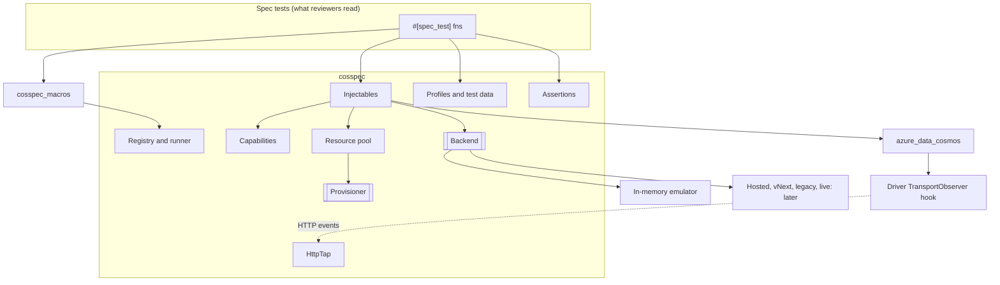

# Cosmos SDK Spec Tests

**Status:** Draft (prototype implemented)
**Date:** 2026-11-11
**Crates:** `cosspec`, `cosspec_macros`,
`azure_data_cosmos` (`__internal_transport_observer`),
`azure_data_cosmos_driver` (`__internal_transport_observer`)

## Purpose

Agents increasingly author and merge SDK changes. Review agents alone can't
guarantee that SDK behavior stays correct, so we need specifications of SDK
behavior that a person can verify by reading them. Spec tests provide them.

A spec test is a short Rust function that:

- states one SDK behavior in its doc comment;
- demonstrates that behavior using the public `azure_data_cosmos` API and a
  small, fixed set of helpers;
- does not depend on which backend runs it: the in-memory emulator, the
  hosted emulator, the vNext or legacy emulator, or a live account; and
- changes only when the SDK's behavior changes, not when its implementation
  is refactored.

The functional end-to-end suite in `specs/0028-functional-e2e-testing.md`
remains in place. Spec tests supersede it over time; nothing in the 0028
catalog or `e2e_test_cases` is retired by this design.

## Goals

- **Reviewability.** A reviewer can read a spec and its helpers and hold the
  whole thing in their head. Specs are short, and the helper vocabulary is
  bounded (see Helper budget).
- **Stability.** Specs use only public SDK APIs plus the spec DSL. Internal
  refactors land in the DSL crate or the backends, never in specs. A diff to a
  spec means a change in behavior.
- **Evidence.** Assertions use observable evidence such as returned data,
  status codes, and HTTP exchanges on the wire, not just diagnostics.
- **Composability.** Each spec runs in every *cell*. A cell is one backend
  combined with one service profile.
- **Honest coverage.** A spec declares the capabilities it needs. A backend
  that lacks a capability skips the spec visibly. A spec that uses a
  capability it didn't declare fails.

## Non-goals

- Replacing unit tests, driver integration tests, or emulator tests.
- Covering every option permutation. Specs state contracts, not parameter
  sweeps.
- Building backends other than the in-process in-memory emulator in the
  prototype.

## Anatomy of a spec

```rust
/// A continuation token taken before a partition split still resumes the query
/// after the split, with no item lost or repeated.
#[spec_test]
#[requires(TopologyControl)]
pub async fn continuation_survives_split(
    #[profile(basic_items)] container: ExclusiveContainer,
) -> SpecResult {
    let client = container.client();
    assert_feed_ranges!(container, 1);

    let mut pages = client
        .query_items::<Item>(BY_ID, FeedScope::full_container(), Some(pages_of(5)))
        .await?
        .into_pages();
    let mut items = pages.next().await.expect("a first page")?.into_items();
    let token = pages.to_continuation_token()?;
    drop(pages);

    container.split().await?;
    assert_feed_ranges!(container, 2);

    let options = pages_of(5).with_continuation_token(token);
    let resumed = client
        .query_items::<Item>(BY_ID, FeedScope::full_container(), Some(options))
        .await?;
    items.extend(resumed.try_collect::<Vec<_>>().await?);

    assert_eq!(items, container.dataset().all());
    Ok(())
}
```

`#[spec_test]` enforces this shape at compile time:

- The function must be `async`.
- It must have a `///` doc comment. The first paragraph is the normative
  statement of behavior and is copied into the generated catalog.
- It must declare a return type, normally `SpecResult`. The body isn't
  rewritten; `?` works on any error that converts into `SpecError`.
- Every parameter must be an injectable type (see Dependency
  injection).
- Service-profile and capability names are checked at compile time. A typo is
  a compile error, not a silently skipped spec.

### Attributes

| Attribute | Meaning |
| --- | --- |
| `#[spec_test]` | Registers the function as a spec. Its ID is `<module>.<fn>`, for example `query.continuation_survives_split`. |
| `#[spec_test(id = "...")]` | Overrides the stable ID. Renaming a spec is a visible ID change in the catalog. |
| `#[service_profiles(all)]`, `#[service_profiles(MultiRead, MultiWrite)]` | Selects the service profiles. The default is `all`. |
| `#[requires(TopologyControl, ...)]` | Declares the capabilities the spec needs. |
| `#[known_issue("reason")]`, `#[known_issue("reason", MultiRead)]` | Records that the SDK doesn't meet the spec yet, optionally only for some profiles. Affected trials are reported as ignored with kind `known-issue`. |
| `#[profile(basic_items)]` (parameter) | Selects the container profile for a container parameter. A bare name resolves to `cosspec::profiles::<name>`; a path is used as written. |

### Identity and naming

- Spec ID: `<module path without the crate>.<fn>`, for example
  `resilience.hedge_races_alternate_region`.
- Trial name: `spec::<module>::<fn>[<service_profile>]`. Standard `libtest`
  filters apply: `cargo test -p cosspec --test spec -- split`.

## Architecture



The design has five layers:

1. **Specs** use only `azure_data_cosmos` public APIs and the DSL. They never
   import the driver, the emulator, or backend internals.
2. **The DSL crate** `cosspec` (`publish = false`) holds the high-level
   specification tests for the Cosmos DB SDK. It is the only adapter between
   specs and internals. Being unpublished, it uses a short name rather than
   the `azure_data_cosmos_*` convention.
3. **The macro crate** `cosspec_macros` (`publish = false`) implements
   `#[spec_test]`.
4. **Backends** implement the `Backend` trait. Each one realizes accounts,
   provisioning, and topology or region demands in whatever way it can.
5. **The product hook** is the driver `TransportObserver` (feature
   `__internal_transport_observer`, forwarded by `azure_data_cosmos`). It is
   the only product-crate change.

### Execution model

The spec binary uses a custom harness (`harness = false`):

- `#[spec_test]` registers a `SpecDescriptor` into a `linkme` distributed
  slice.
- `cosspec::main()` expands each spec into one `libtest-mimic`
  trial per selected service profile.
- One process runs against one backend. Trials run in parallel on a shared
  multi-threaded Tokio runtime.
- Each trial:
  1. obtains the pooled cell;
  2. builds a `SpecContext`;
  3. injects parameters;
  4. runs the body, catching panics;
  5. always runs teardown; and
  6. writes its result file (see [Spec results](#spec-results)).

### Where specs live

Specs live in `sdk/cosmos/cosspec/tests/spec/`, not in
`azure_data_cosmos/tests`. The DSL crate depends on `azure_data_cosmos`. If
`azure_data_cosmos` took the DSL crate as a dev-dependency, Cargo would build
two instances of `azure_data_cosmos` in its test binaries, and their types
would not interoperate. Keeping specs next to the DSL avoids that cycle.

## Dependency injection

A parameter's type determines what the spec receives.

| Type | Lifetime and isolation | Surface |
| --- | --- | --- |
| `SharedContainer` | Pooled container in the cell database. Created and seeded once per run and reused by every spec. Requires `#[profile]`. | `client()`, `client_with_faults(..)`, `dataset()`, `query_all(..)`. Read-only. |
| `ExclusiveContainer` | New container in the pooled cell database. Deleted after the spec. | `client()`, `client_with_faults(..)`, `dataset()`, `query_all(..)`, `split()`, `feed_range_count()` |
| `ExclusiveDatabase` | New database. Deleted (wiped) after the spec. | `client()`, `create_container(profile)` |
| `ExclusiveAccount` | Dedicated account with a new database. Implies `AccountIsolation`. | `client()`, `regions()`, `create_container(profile)`, `take_region_offline(..)`, `bring_region_online(..)` |
| `HttpTap` | One per spec. Every client the framework builds for the spec reports to it. | `records()`, `operation(..)`, `clear()` |

Every spec gets its **own clients**, built on the pooled account. As a result,
the spec's `HttpTap` and faults see only that spec's traffic, even when the
container is shared.

The framework also builds per-spec **harness clients** for work it does on
the spec's behalf: creating and seeding exclusive resources, reading feed
ranges, and teardown. Their requests go to the spec's result file but not to
its `HttpTap`, so harness traffic never shows up in a spec's assertions.

### Shared-container protection

Writes to a `SharedContainer` would corrupt other specs. The framework uses
two layers of protection:

1. The shared container's clients carry fault rules that reject every write
   operation with a synthetic 403 Forbidden before it leaves the process.
2. At teardown, the runner fails any spec whose `HttpTap` shows a write to a
   shared container.

### Faults

Client-side faults use the SDK's fault-injection rules. Faults are fixed when
a client is built, so specs request a separate faulted client:

```rust
let slow_east = faults::delay(Op::ReadItem, Duration::from_secs(2)).in_region(Region::EAST_US);
let client = container.client_with_faults([slow_east]).await?;
```

`faults::delay`, `faults::error`, and `faults::throttle` build a `Fault`.
`.in_region(..)` and `.times(n)` refine it. Server-side faults are a
future `Backend` demand.

## Capabilities

A capability is something a cell can do. A spec declares the capabilities it
needs with `#[requires(..)]`. The declaration has two effects:

- **Filtering.** Before a trial runs, the runner compares the spec's declared
  capabilities with the cell's. If any are missing, the trial is reported as
  ignored with kind `skip`. With `AZURE_COSMOS_SPEC_STRICT=1`, a skip becomes
  a failure, so CI cells that must run everything can't silently skip.
- **Enforcement.** Each demand method calls `SpecContext::demand`. A demand
  for a capability the spec didn't declare fails with `InvalidConfiguration`.
  This is a bug in the spec, not a skip: a spec can never silently depend on
  a capability it doesn't declare. The framework self-test
  `framework.undeclared_capability_is_rejected` covers this.

| Capability | Meaning | Gates |
| --- | --- | --- |
| `TopologyControl` | Partitions can be split on demand. | `ExclusiveContainer::split` |
| `RegionControl` | Regions can be taken offline and brought back. | `ExclusiveAccount::take_region_offline` and `bring_region_online` |
| `MultiRegion` | The account has two or more regions. | Multi-region routing and hedging specs |
| `MultiWrite` | The account accepts writes in more than one region. | Multi-write specs |
| `AccountIsolation` | The backend can create dedicated accounts. | `ExclusiveAccount` |

Planned capabilities include `merge`, `replication_control` (pause and resume
replication), `write_failover`, and `server_faults`. A cost class (`cheap`,
`slow`, `expensive`) per capability is also planned, so cells can filter with
a maximum cost. A live split is `expensive` because it means raising
throughput and polling.

## Profiles and test data

### Service profiles

A service profile describes the shape of an account. It does **not** set a
consistency level: a spec that cares about consistency sets it on its client
or request.

| Profile | Regions | Contributes |
| --- | --- | --- |
| `SingleRegion` | East US | — |
| `MultiRead` | East US (write), West US | `MultiRegion` |
| `MultiWrite` | East US, West US (both writable) | `MultiRegion`, `MultiWrite` |

Because capability filtering removes cells that don't fit, combining `all`
with `#[requires(MultiRegion)]` is idiomatic.

### Container profiles

A `ContainerProfile` is declarative: a name, a partition key path, a number
of physical partitions, and a dataset. Whether a container is shared or
exclusive is decided by the *parameter type*, not by the profile, so the same
profile can back both.

| Profile | Partition key | Physical partitions | Dataset |
| --- | --- | --- | --- |
| `empty` (the default) | `/pk` | 1 | none |
| `basic_items` | `/pk` | 1 | `testdata::items::basic_items()` |

### Datasets

Datasets are deterministic and live in `testdata`. Specs compare results
against datasets, not inline literals. `Item { id, pk, value }` is the shared
model and implements `Ord`. A `Dataset` provides `all()` (sorted by ID),
`take(n)`, and `get(id)`.

## Resource pooling and lifecycle

```text
Account (pooled per cell)
├── spec-<UUIDv7>                  cell database, pooled for the run
│   ├── spec-<UUIDv7>              SharedContainer: created and seeded once
│   └── spec-<UUIDv7>              ExclusiveContainer: deleted after the spec
└── spec-<UUIDv7>                  ExclusiveDatabase: deleted after the spec
Dedicated account (in-memory) or account pool (live)
└── spec-<UUIDv7>                  ExclusiveAccount database
```

- **Naming.** Every database and container the framework creates is named
  `spec-<UUIDv7>`. A UUIDv7 starts with its creation time in milliseconds, so
  any tool can read a leftover resource's age from its name. That makes
  cleanup straightforward in durable environments such as pre-configured
  live accounts. The result file maps each name to its role.

- **Pooling.** One cell per service profile, created lazily through a global
  `OnceCell`. Concurrent trials share creation of the account, the cell
  database, and each shared container.
- **Cleanup.**
  - Exclusive resources are deleted when their spec ends, even if the spec
    panicked.
  - Cell databases are deleted when the run ends.
- **Sweep.** When a cell opens, it deletes `spec-<UUIDv7>` databases whose
  UUID timestamp is more than two hours old. This cleans up after crashed
  runs on long-lived accounts. Databases with other names are never touched.

## Provisioning

Backends provision resources through a `Provisioner` trait: create and delete
databases and containers, and list databases for the sweep. Every method
takes the client to provision through. For a spec's resources, that's a
harness client, so provisioning requests appear in the spec's result file.

- **Now.** `ControlPlaneProvisioner` uses the SDK `control_plane` APIs with
  key authentication. It treats 409 Conflict on create and 404 Not Found on
  delete as success. It sets throughput only when a profile asks for more
  than one physical partition. The in-memory backend overrides container
  creation so it can pin the exact partition count.
- **Soon.** Entra ID–only accounts disable data-plane control operations.
  Planned options for them:
  - an `ArmProvisioner` using the management plane with Entra ID
    credentials; or
  - a provisioner built on the existing `ResourceManager` and
    `AzCliResourceManager` helpers in `azure_data_cosmos_test`.

  Data-plane clients would use Entra ID credentials in that mode. Specs are
  unaffected.

## Backends

```rust
trait Backend: Send + Sync {
    fn name(&self) -> &'static str;
    fn supports(&self, profile: ServiceProfile) -> bool;
    fn capabilities(&self, profile: ServiceProfile) -> Vec<Capability>;
    async fn open_account(&self, profile: ServiceProfile) -> SpecResult<Arc<dyn BackendAccount>>;
}

trait BackendAccount: Send + Sync {
    fn profile(&self) -> ServiceProfile;
    async fn client(&self, options: ClientOptions) -> SpecResult<CosmosClient>;
    fn provisioner(&self) -> &dyn Provisioner;
    fn topology(&self) -> Option<&dyn TopologyControl>;
    fn regions(&self) -> Option<&dyn RegionControl>;
}
```

A backend must advertise only capabilities it can honor. If a demand fails
for an advertised capability, that is a backend bug and is reported as a
failure. `AZURE_COSMOS_SPEC_BACKEND` selects the backend; the default is
`inmemory`.

| Backend | Status | `split()` | Regions | `ExclusiveAccount` |
| --- | --- | --- | --- | --- |
| In-memory emulator (in process) | Prototype | Emulator split API | Virtual regions; offline and online | New in-process emulator |
| Hosted in-memory emulator | Planned | Management REST API | Same as in-memory | New hosted instance |
| vNext and legacy emulators | Planned | Not advertised | Single region | Not advertised |
| Live | Planned | Throughput increase plus polling (`expensive`) | Profile accounts | Small account pool |

## HTTP evidence: `HttpTap`

Diagnostics describe what the SDK *believes* happened. Some contracts need
proof from the wire. For example, hedged requests must actually overlap.

### Driver hook

`azure_data_cosmos_driver::TransportObserver` (feature
`__internal_transport_observer`):

- `on_start(&HttpExchange)` reports the sequence number, a monotonic start
  `Instant`, method, URL, operation, region, and activity ID.
- `on_complete(&HttpExchange, &HttpOutcome)` reports a monotonic end
  `Instant` and the outcome: a response (status and sub-status), a transport
  error, or cancellation.

The observer wraps the transport's HTTP client factory **outside** fault
injection. Injected delays therefore count as wire time, and injected
responses are visible as such. Cancellation is detected when the request
future is dropped, which is how hedging abandons the losing leg.
`CosmosClientBuilder::with_transport_observer` is `#[doc(hidden)]` and exists
only when the feature is on.

### `http_tap` module

`cosspec::http_tap` depends only on the driver hook types and
`std`, so it can later become its own crate. `HttpTap` records every exchange
as an `HttpRecord`. Records support interval math (`overlaps`, `duration`)
and outcome checks (`status`, `was_cancelled`). `labeled_observer(label)`
stamps records with a label so one tap can tell clients apart, and
`fan_out(..)` lets one client report to several taps.

### Future proxy tier

An HTTP and TCP proxy between the SDK and the backend would provide
evidence that is independent of the SDK. That would allow cross-language
specs, live-network fault injection, and Direct-mode TCP once it exists. The
proxy would implement the same record model, so `assert_http_*` macros keep
their meaning. Nothing is built yet.

## Assertions

| Assertion | Purpose |
| --- | --- |
| `assert_eq!` on datasets and models | Exact contents and order |
| `assert_items_unordered!(actual, expected)` | Set equality where order isn't part of the contract |
| `assert_feed_ranges!(container, n)` | Partition topology, read with a new client |
| `assert_status!(result, status[, sub_status])` | Error contract |
| `assert_http_count!(tap, op, n)` | Number of HTTP requests for an operation, including retries |
| `assert_http_regions!(tap, op, [regions])` | Region of each HTTP request, in order |
| `assert_http_overlap!(a, b)` | Two exchanges were in flight at the same time |

## Helper budget

Every item a spec can use is listed in this document:

- the attributes;
- the injectables and their methods;
- the `faults` builders;
- the profiles and datasets; and
- the assertions.

Adding a helper requires updating this document in the same pull request.
The DSL then stays small enough for a reviewer to know all of it. Prefer
plain SDK calls in the body over a new helper, and add a helper only when it
removes setup noise that obscures the behavior under test.

## Generated catalog

The registry produces `CATALOG.md` and `catalog.json` in the
`cosspec` crate directory. For each spec they list the ID, the
behavior (from the doc comment), service profiles, required capabilities,
injected resources, known issues, and source location.

- The trial `catalog::up_to_date` fails if the committed files are out of
  date. Behavior changes therefore show up in pull request diffs as changed
  sentences.
- Run with `AZURE_COSMOS_SPEC_UPDATE_CATALOG=1` to regenerate both files.
- Other language SDKs can consume `catalog.json` as a language-neutral list of
  scenarios. The 0028 JSON catalog is unchanged.

## Spec results

Every executed trial writes one JSON file, `<spec-id>[<profile>].json`, so a
person or a tool can see what happened without rerunning the spec. Results
go to the directory passed with `--results-dir <dir>`, or by default to
`<target>/cosspec-results/<run-id>/`, where the run ID is a UUIDv7. Pass a
unique directory per run to keep runs apart. Trials that are skipped or
ignored don't run, so they don't write a file.

The format is versioned. This is version `1`. Adding fields doesn't change
the version. Removing, renaming, or changing the meaning of a field does.

| Field | Contents |
| --- | --- |
| `version` | Format version, `1` |
| `id`, `test_name`, `summary`, `source` | Spec identity, the doc-comment summary, and `file:line` |
| `service_profile`, `backend`, `requires`, `known_issue` | How the trial was composed |
| `started_at`, `duration_ms` | Wall-clock start (RFC 3339) and duration |
| `status` | `passed` or `failed` |
| `error` | The spec body's error, if it returned one |
| `teardown_error` | A cleanup failure, reported separately from the body |
| `panic` | Message, location, and backtrace if the body panicked |
| `resources` | Each account, database, and container the spec used: `kind`, `origin` (`created` or `pooled`), `name`, and where known `database`, `profile`, and `parameter` |
| `http` | Every HTTP exchange of the spec's clients (`label: "spec"`) and of its harness clients (`label: "harness"`), in start order: method, URL, operation, region, activity ID, `start_ms` from the trial start, `duration_ms`, and `outcome` |

The recording isn't affected by `HttpTap::clear()`. Traffic to set up pooled
resources is shared by many specs, so it isn't attributed to any one of them.
Headers and bodies aren't recorded yet; adding them later is an additive
change.

## Known issues

`#[known_issue]` keeps a spec that the SDK fails today visible without
blocking CI. The prototype found two problems. One is still open, and
two specs are marked for it:

- `resilience.write_fails_over_when_write_region_offline` (`MultiRead`
  only): after the single write region goes offline, the account promotes the
  next region to accept writes, but the SDK keeps sending the write to the
  offline region and surfaces 503. It marks the endpoint unavailable but
  doesn't refresh the account to learn the new write region. The fix belongs
  in the driver's retry policy.
- `resilience.read_fails_over_when_region_offline` (`MultiRead` only): the
  read itself fails over and passes. The spec fails because its teardown
  deletes the database, which is a write and hits the issue above. It's
  marked so it doesn't block CI and should clear with the same fix.

`query.continuation_survives_split` exposed a fidelity bug in the in-memory
emulator, not in the SDK. The emulator's ORDER BY continuations were row
offsets. After a split, the driver forwards the parent's continuation to each
child range, as the Cosmos contract allows. Each child then skipped its own
first N rows, which dropped a page. The emulator now issues position-based
ORDER BY continuations (sort keys, then `_rid`), so the spec passes.

Run them with
`cargo test -p cosspec --test spec -- --include-ignored`.
Remove the attribute in the change that fixes the behavior.

## Running

```sh
cargo test -p cosspec --test spec
```

| Variable | Effect |
| --- | --- |
| `AZURE_COSMOS_SPEC_BACKEND` | Backend name; the default is `inmemory` |
| `AZURE_COSMOS_SPEC_PROFILES` | Comma-separated service profiles to run |
| `AZURE_COSMOS_SPEC_STRICT` | `1` turns capability skips into failures |
| `AZURE_COSMOS_SPEC_UPDATE_CATALOG` | `1` rewrites `CATALOG.md` and `catalog.json` |

Pass `-- --results-dir <dir>` to choose where result files go. See
[Spec results](#spec-results).

## Migration from 0028

1. New behavioral coverage is written as spec tests.
2. Existing 0028 scenarios are ported one area at a time. A port is complete
   when the spec states the same behavior and runs in the same cells.
3. Once the spec-test catalog covers an area, its 0028 scenarios and
   `e2e_test_cases` can be retired in a separate, reviewed change.

The prototype ports the core of three 0028 scenarios: query pagination resume,
cross-region hedging, and the in-memory partition split test. It also adds
CRUD, throttling, region-failover, and framework self-tests.

## Open questions

- Should strict mode be a single environment variable or a per-cell allow
  list of capabilities that may be skipped?
- Should a live `SharedContainer` be reused across runs, identified by a
  dataset fingerprint, to save seeding time?
- Should merge, write failover, and replication pause be backend demands or
  account-level operations?
- Should spec IDs be frozen in a lock file so that renames require explicit
  acknowledgement?
- How should compile-fail tests for `#[spec_test]` diagnostics be added
  without a new `trybuild` dependency?

## Related documents

- Functional E2E testing: `specs/0028-functional-e2e-testing.md`
- In-memory emulator: `specs/0021-in-memory-emulator.md`
- Hosted emulator: `specs/0027-hosted-emulator.md`
- Fault injection: `specs/0024-fault-injection.md`
- Cross-region hedging: `specs/0009-cross-region-hedging.md`
- Feed operations and dataflow: `specs/0012-feed-operations-and-dataflow.md`
