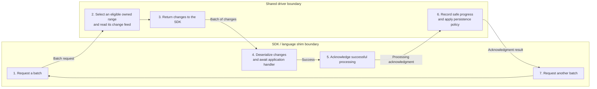
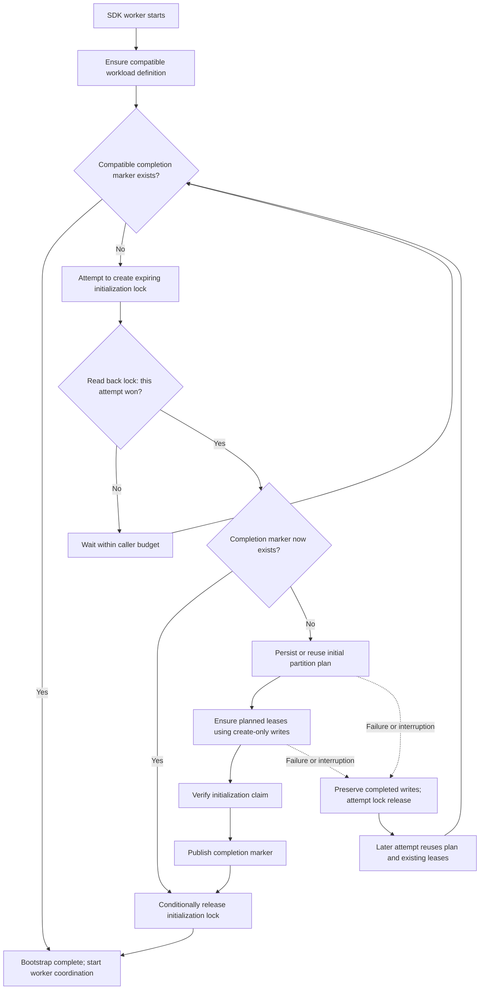
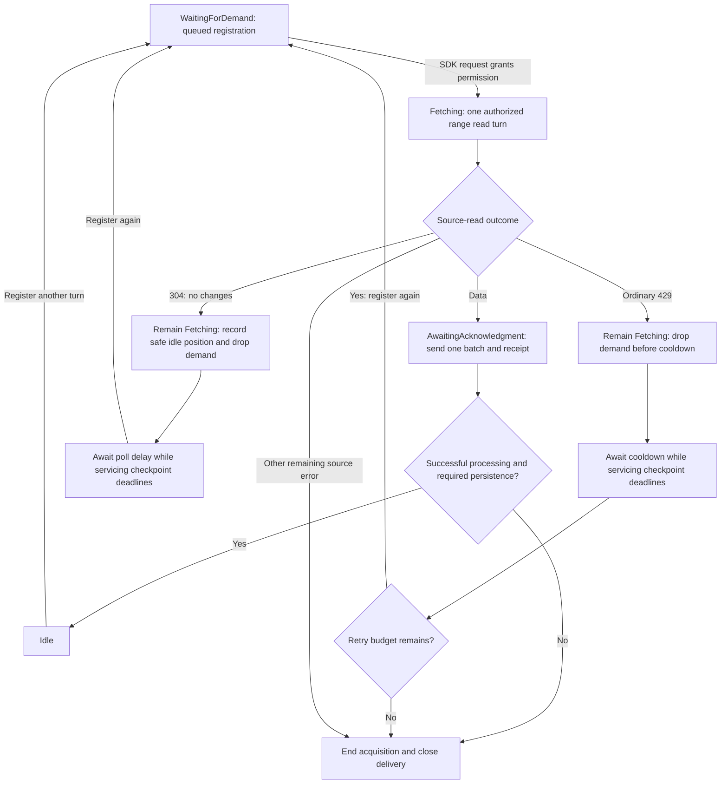
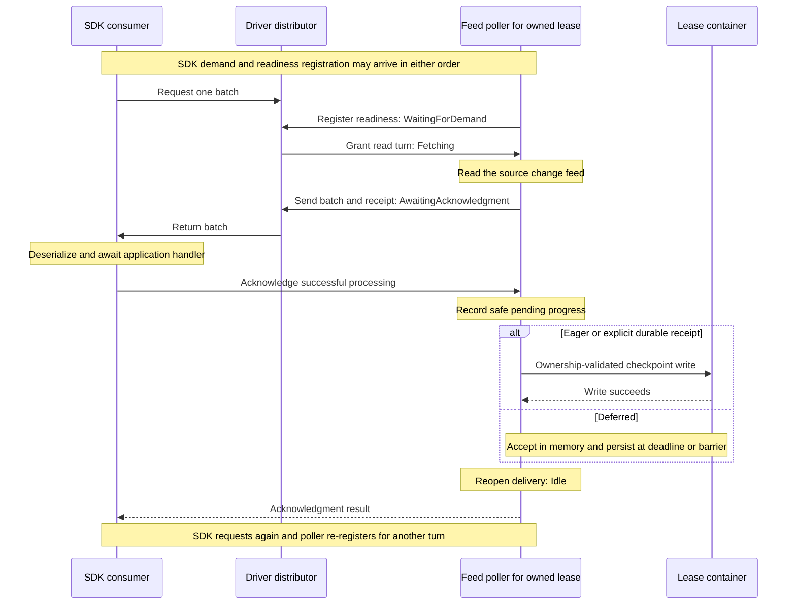
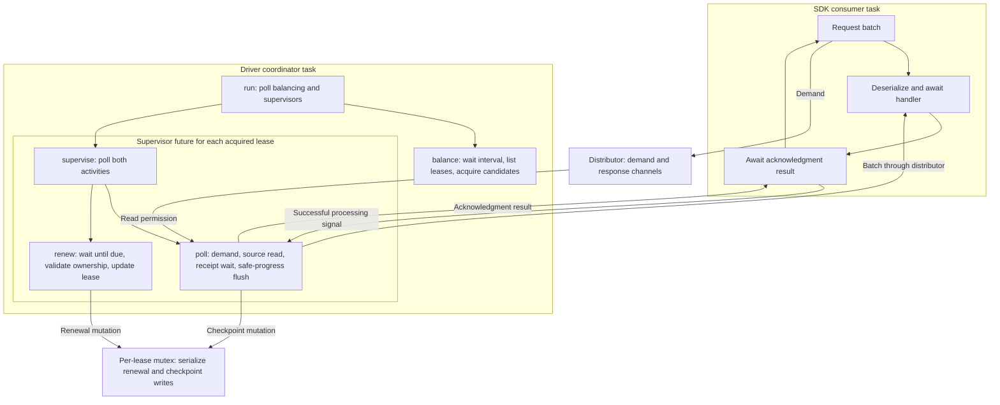

# Rust change feed processor

<!-- cspell:ignore checkpointing -->

> **Status:** Draft
> **Scope:** Rust SDK processing and the shared cross-language driver engine
> **Crates:** `azure_data_cosmos`, `azure_data_cosmos_driver`, `azure_data_cosmos_driver_native`

## Contents

1. [Problem](#1-problem)
2. [Functional requirements](#2-functional-requirements)
3. [Non-functional requirements](#3-non-functional-requirements)
4. [How would SDKs process changes using the shared Rust engine?](#4-how-would-sdks-process-changes-using-the-shared-rust-engine)
5. [How is progress tracked in the Change Feed Processor?](#5-how-is-progress-tracked-in-the-change-feed-processor)
6. [How would a workload be initialized before processing?](#6-how-would-a-workload-be-initialized-before-processing)
7. [How would leases be allocated across workers?](#7-how-would-leases-be-allocated-across-workers)
8. [How would batch requests, delivery, and checkpointing stay coordinated?](#8-how-would-batch-requests-delivery-and-checkpointing-stay-coordinated)
9. [How would partition splits and merges affect processing?](#9-how-would-partition-splits-and-merges-affect-processing)
10. [How would a worker stop and resume processing?](#10-how-would-a-worker-stop-and-resume-processing)
11. [How would failures be handled and exposed to the application?](#11-how-would-failures-be-handled-and-exposed-to-the-application)
12. [How would background tasks coordinate polling, renewal, and balancing?](#12-how-would-background-tasks-coordinate-polling-renewal-and-balancing)
13. [How would an application configure and control the Rust processor?](#13-how-would-an-application-configure-and-control-the-rust-processor)
14. [Open questions and scope limits](#14-open-questions-and-scope-limits)
15. [How would we iterate on and review changes?](#15-how-would-we-iterate-on-and-review-changes)

## 1. Problem

We are building a Rust-based Cosmos DB Change Feed Processor that also provides
a shared engine for language shims to build their own Change Feed Processor
abstractions.

A **language shim** adapts the shared engine to a language's SDK types and
execution model.

The [public Change Feed Processor documentation](https://learn.microsoft.com/azure/cosmos-db/change-feed-processor)
describes its purpose:

> "simplify the process of reading the change feed and distribute the event processing across multiple consumers effectively."

## 2. Functional requirements

- Deliver changes from each physical partition with **at-least-once delivery
  semantics**.
- Monitor **all physical partitions within the configured scope**, including
  replacement partitions after topology changes.

### 2.1 Guarantees to establish

These are required outcomes, not claims that the prototype already provides
them. The code sketches below are illustrative proposed control flow, not
existing or compiling SDK APIs. Prototype excerpts elsewhere explain earlier
mechanisms; the explicit proposed contracts take precedence where they differ.

| Guarantee | Mechanism and code discussion | Observable pass condition |
| --- | --- | --- |
| G1: Distinguish healthy idleness from stalled processing. | Track the active operation and its age separately from ownership renewal and item arrivals; see [liveness](#115-detect-stalls-and-confirm-recovery). | Empty successful reads and waiting for demand are not reported as hung callbacks; an overdue active operation is reported even while renewal succeeds. |
| G2: Attempt recovery and verify useful progress, not just ownership movement. | Cancel failed acquisition work, release conditionally or let ownership expire, and reacquire normally; see the [recovery sketch](#115-detect-stalls-and-confirm-recovery). | With a runnable replacement and available service, an injected worker failure is followed by acquisition and successful processing or a healthy empty read. Repeated failure is visible and subject to bounded recovery policy. |
| G3: Never skip changes by resetting a resume position. | Persist a stable initial anchor and resume saved progress; see [initial anchoring](#104-establish-a-stable-initial-resume-position). | Crash before the first normal checkpoint, restart, and deliver the changes still available from the original start position. An unusable continuation produces failure, not a new `Now`. |
| G4: Persist only safe progress under current ownership. | Await handler success, then acknowledge; serialize conditional writes with the acquisition's cached ETag; see [fencing](#73-preventing-stale-or-competing-ownership-writes) and [checkpointing](#86-tie-successful-processing-to-the-next-delivery). | Handler failure leaves that batch unacknowledged; stale receipts cannot change replacement ownership or continuation; Deferred interruption may replay. |
| G5: Preserve range coverage through topology changes. | Validate replacement coverage, project durable progress, create children before conditional parent deletion; see [topology recovery](#93-ensure-children-before-deleting-the-parent). | Interrupted child creation or parent deletion loses no logical range or saved resume position. |

**No-skipping is bounded by the selected feed mode and service retention.**
Latest Version does not promise every intermediate version or delete event;
All Versions and Deletes is subject to its supported retention. If required
history is no longer available, report that failure rather than pretend
successful recovery. At-least-once delivery permits duplicate callbacks and
does not guarantee exactly-once external effects.

Liveness assumes available service capacity, a runnable worker/runtime, and
application code that yields or can be isolated. It is not a promise of
uninterrupted progress during an outage or automatic repair of a permanently
failing handler. Thresholds, shared settings, and the health-observation surface
are [open design decisions](#14-open-questions-and-scope-limits).

## 3. Non-functional requirements

- Distribute processing load equally across cooperating workers.

## 4. How would SDKs process changes using the shared Rust engine?

The **SDK** is the application-facing library; the **driver** is the shared
engine beneath it. A **workload** is the cooperating processors reading one
source container under a shared workload name.

The **application handler** is the callback supplied by the application to
process a batch of changes. An **internal processing pipeline** is the SDK's
sequence of steps that reads changes, invokes that handler, and records progress.

Here, **progress** means how far the application has successfully processed
the change feed. A **checkpoint** saves a resume position durably; the
**checkpoint policy** determines when that save is required.

A **worker** is one running Change Feed Processor instance. Multiple workers
can cooperate on the same workload; a worker is not necessarily a separate
process, machine, or thread.

A **partition range** is a portion of the source container's partition key
space. Workers divide processing by these ranges; the progress and ownership
records are described in the next sections.

- Existing .NET and Java CFP implementations pass the application handler into
  their internal processing pipelines and invoke it within the same language
  runtime.
- A shared Rust driver cannot directly invoke a Java, Go, or other language's
  callback object using that language's types, exception handling, and async
  execution model.
- Supporting foreign callbacks inside the driver would require an explicit
  foreign-function interface (FFI) adapter for callback lifetime, runtime dispatch, and completion. Callbacks
  can cross FFI, but the Java model cannot be reused unchanged.
- Instead, each SDK or shim invokes its application handler and acknowledges
  successful processing to the shared driver.

### 4.1 Existing callback implementations

The following excerpts show direct handler invocation, not complete methods.

**.NET:** [`ChangeFeedObserverFactoryCore<T>`](https://github.com/Azure/azure-cosmos-dotnet-v3/blob/ab37d0a240f0c2f858d7c2f4bcdb71fa80195361/Microsoft.Azure.Cosmos/src/ChangeFeedProcessor/Observers/ChangeFeedObserverFactoryCore.cs)
invokes the supplied delegate and returns its task:

```csharp
if (this.onChanges != null)
{
    return this.onChanges(context, changes, cancellationToken);
}
```

**Java:** [`DefaultObserver<T>`](https://github.com/Azure/azure-sdk-for-java/blob/0f3b0113dab92249963ee1bb3b1b62433143f80c/sdk/cosmos/azure-cosmos/src/main/java/com/azure/cosmos/implementation/changefeed/common/DefaultObserver.java#L43)
invokes the supplied consumer within the observer:

```java
if (consumer != null) {
    consumer.accept(docs);
} else if (biConsumer != null) {
    biConsumer.accept(docs, new ChangeFeedProcessorContextImpl<>(context));
}
```

These handlers execute inside their SDKs' CFP pipelines, not a separate
cross-language driver.

### 4.2 Shared Rust engine

The SDK owns application callback execution. The shared driver engine owns
lease coordination, feed reads, and checkpoint persistence.

1. **SDK requests work:** request a batch of changes.
2. **Driver reads changes:** select an eligible partition range owned by the
   worker and read its change feed, or wait until a range is eligible.
3. **Driver returns a batch:** deliver changes to the SDK.
4. **SDK processes changes:** deserialize the items, invoke the application
   handler, and wait for it to complete.
5. **SDK acknowledges success:** acknowledge only successfully processed changes.
6. **Driver records progress:** record safe progress and persist it according
   to the checkpoint policy.
7. **SDK requests another batch:** repeat after handling the current batch.



Requests, batches, and acknowledgments cross the SDK/driver boundary.
The application handler does not: it executes inside the SDK or language shim.
The driver performs source reads and persists checkpoint progress in Cosmos DB.

**Parallelism comes from multiple workers running this flow concurrently**,
with the driver coordinating which partition ranges each worker owns. Within
each SDK worker, batch handling remains sequential.

The Rust SDK implements this boundary in
`azure_data_cosmos/src/change_feed_processor/execution.rs`. These are focused
implementation excerpts, not standalone examples.

In these snippets, `T` is the application's document type and `Fut` is its
handler's returned **future**, an object representing asynchronous work.
`.await` waits for that work without blocking an executor thread while it is
pending.

**Request and process a batch:** the SDK waits for one batch from the driver,
then waits for SDK-side processing before requesting another. `read_next_change_feed_batch()`
is the driver's receive method; `dispatch()` handles one returned batch:

```rust
while let Some(batch) = driver.read_next_change_feed_batch().await {
    dispatch::<T, Fut>(&container, handler, batch).await;
}
```

`consume()` owns the container client and awaits each dispatch, so `dispatch()`
borrows that client as `&ContainerClient` instead of cloning a handle per batch.
Dispatch is not separately spawned; the borrow remains valid until it returns.

**Invoke the handler in the SDK:** deserialization converts returned data to
application types. The SDK passes those items and batch context (lease identity
and read diagnostics) to the handler and awaits its completion:

```rust
let items = container.deserialize_processor_batch::<T>(response)?;
if !items.is_empty() {
    handler(
        ChangeFeedProcessorContext {
            lease_token: lease_token.clone(),
            diagnostics,
        },
        items,
    )
    .await?;
}
```

**Acknowledge successful processing:** the batch includes a **receipt**, a
single-use acknowledgment handle, which
lets the SDK report success back to the driver without supplying a callback
or an arbitrary progress position:

```rust
Some(Ok(Ok(()))) => {
    if let Err(err) = receipt.acknowledge().await {
        tracing::warn!(lease = %lease_token, error = %err, "Callback succeeded but acknowledgment failed");
    }
}
```

This match arm runs only after deserialization and handler execution succeed
without an unwinding panic. The persistence sequence is explained in
[delivery and checkpointing](#8-how-would-batch-requests-delivery-and-checkpointing-stay-coordinated);
failure outcomes are collected in [failure handling](#11-how-would-failures-be-handled-and-exposed-to-the-application).

## 5. How is progress tracked in the Change Feed Processor?

**Progress is the position in each partition range's change feed up to which
changes have been successfully processed.**

The processor must:

- Distinguish the **read position** (changes fetched) from the **processed
  position** (changes successfully handled by the application).
- Persist a **saved position** so a restarting or replacement worker knows
  where to resume.
- Never advance the saved position past successfully processed changes.
- Allow the saved position to lag behind processed changes; interruption can
  therefore cause those changes to replay.

A **lease document** stores the range, current worker owner, and saved position
in a separate Cosmos DB **lease container**. This shared record lets workers
coordinate responsibility and resume after restart or ownership change rather
than rely only on a worker's memory.

The following JSON illustrates the proposed acquired lease with saved progress.
It revises the prototype's shape to use acquisition-local ETag fencing without
a separate persisted acquisition identifier. Values are synthetic;
`<encoded-workload-key>` and `<opaque-continuation-token>` are placeholders,
not usable namespace or continuation values. This is a proposed storage
contract, not an API shipped by this PR.

```json
{
  "id": "cfp1.<encoded-workload-key>.lease.-FF",
  "workload": {
    "version": 1,
    "account": "https://example.documents.azure.com",
    "containerRid": "example-container-rid",
    "processorName": "orders",
    "mode": "latestVersion"
  },
  "ttl": -1,
  "range": {
    "Range": {
      "min": "",
      "max": "FF",
      "isMinInclusive": true,
      "isMaxInclusive": false
    }
  },
  "owner": "worker-01",
  "continuation": "<opaque-continuation-token>",
  "renewed_at": 1800000000000,
  "processed_at": 1800000000000
}
```

Each stored property needs a purpose; an existing prototype field is not by
itself a reason to retain it:

| Property | Why store it? |
| --- | --- |
| `id` | Address one lease deterministically and make duplicate creates conflict. It also supplies the lease container's `/id` partition key. |
| `workload.version` | Identify the coordination-document schema so incompatible readers fail rather than interpret fields incorrectly. It is not the continuation-token version. |
| `workload.account` | Bind the lease to its source account origin and reject reuse against another account. |
| `workload.containerRid` | Bind progress to the source container's service identity; a deleted and recreated container with the same name must not reuse it. |
| `workload.processorName` | Separate cooperating workloads reading the same source. The stored name is preserved from the prototype; the API calls it `workload_name`. |
| `workload.mode` | Reject continuation reuse across incompatible feed modes: `latestVersion` and `allVersionsAndDeletes`. Mode is not part of the namespace key. |
| `ttl` | Set `-1` so the lease and saved progress survive document TTL. Ownership expires through lease timing, not document deletion; the initialization lock has a separate positive TTL. |
| `range.Range.min`, `range.Range.max` | Persist the logical range whose progress this lease represents, including when physical partitions split or merge. This example covers the full keyspace; individual leases usually cover a subrange. |
| `range.Range.isMinInclusive`, `range.Range.isMaxInclusive` | Preserve the shared serialized feed-range format. Their fixed values express `[min, max)`; they are format compatibility fields, not independent processor settings. |
| `owner` | Identify the worker for ownership and balancing. An absent owner makes the lease available; matching names alone never authorize a write. |
| `continuation` | Save the durable resume position. It must not describe an unfinished batch; pending Deferred progress remains in memory. |
| `renewed_at` | Let other workers evaluate ownership liveness without treating checkpoint inactivity as worker failure. Every successful owner mutation refreshes it, not just renewal. |
| `processed_at` | Record the latest successful processing activity separately from ownership maintenance: successful handler acknowledgment or a completed empty read. Renewal alone must not advance it. It is a health signal, not proof that `continuation` is durable. |

The two timestamp fields use Unix epoch milliseconds. The proposed schema
renames `last_processed_at` to `processed_at` and removes the stored
`processing_deadline`; an agreed inactivity policy can derive a deadline
without persisting a third timestamp. However, timestamp age alone cannot
distinguish a queued lease from a hung handler. Active-operation tracking and
the initial acquisition baseline are described under
[liveness](#115-detect-stalls-and-confirm-recovery).

Repeating source identity in each lease permits
validation of individual documents, but duplicates information in the namespace
and `.definition`. **Schema-size review remains open:** decide whether that
per-document validation justifies its storage and write cost, rather than
describing it as necessary for ETag fencing. The prototype still uses the
earlier fields; the two-timestamp shape is a proposed revision.

Optional ownership, continuation, and timestamp fields are omitted when absent,
not serialized as `null`. A newly created lease has none of those fields.
Service-managed properties such as `_etag` and `_ts` are omitted from this
example; conditional writes use the service-provided ETag. Delivery state,
waiting channels, and queued registrations are not stored in the document.
`_etag` protects a specific document version through `If-Match`; `_ts` is a
service-managed last-modification time, not the processing-progress timestamp.

## 6. How would a workload be initialized before processing?

### 6.1 Startup initialization requirements

**Bootstrap prepares a workload so workers can begin processing safely.**
It must:

- Identify the source container and workload.
- Establish complete initial partition-range coverage to process.
- Ensure coordination and progress records exist for that coverage.
- Preserve existing ownership and saved progress on restart.
- Allow interrupted initialization to be completed by a later attempt.
- Report initialization failure rather than declare readiness prematurely.

### 6.2 Current implementation

During startup, the driver initializes the workload:
it discovers the source's partition ranges and ensures a lease document exists
for each range in the initial plan before starting worker coordination.

New leases have no owner or saved position. Workers acquire them, read changes
using the configured starting position, and persist successfully processed
progress. Existing lease progress is preserved when the workload resumes.

### 6.3 How would workers coordinate bootstrap?

#### 6.3.1 Identify the workload

Within the supplied lease container, the workload namespace combines the
source account origin, source container RID, and workload name. A durable
`.definition` record validates the feed mode and schema. Worker names do not
split the workload into separate bootstrap operations.

The **container RID** is its service-assigned resource identifier, rather
than its application-facing name.

`namespace()` encodes the shared workload key; it excludes worker identity:

```rust
let key = serde_json::to_vec(&(
    &identity.account,
    &identity.container_rid,
    &identity.workload_name,
))?;
Ok(format!("cfp1.{}", URL_SAFE_NO_PAD.encode(key)))
```

These Rust snippets are focused excerpts from
`azure_data_cosmos_driver/src/change_feed_processor/bootstrap.rs`, not
standalone programs.

#### 6.3.2 Elect a designated initializer and check completion

An **ETag** is a document-version token supplied by Cosmos DB. A conditional
write or delete can require that version still match, preventing it from
overwriting a change made after the read. An initialization **claim** is the
winning attempt's local lock version and time limit.

Each starter first checks the workload's `.info` completion marker. If it is
compatible, bootstrap is complete and no election is necessary.

Otherwise, workers compete to create `.lock`. The winner reads the lock back
and verifies its unique attempt ID before initializing. Other workers wait,
check completion, and can retry election if the lock expires.

`try_claim()` constructs and attempts to create the lock:

```rust
let started = Instant::now();
let mut record = self.record("lock");
record.ttl = LOCK_TTL_SECONDS;
let lock = InitializationLock {
    record,
    attempt: Uuid::new_v4().to_string(),
    owner: self.worker_name.clone(),
};
self.store.create(&lock.record.id, &lock).await?;
```

Creation success alone does not grant a local claim. After reading the lock
back, the initializer checks its identity and attempt ID:

```rust
self.validate(&current.0.record, &lock.record)?;
if current.0.attempt != lock.attempt {
    return Ok(None);
}
Ok(Some(InitializationClaim {
    etag: current.1,
    deadline: (started + ATTEMPT_TIMEOUT).min(self.store.deadline),
}))
```

The intervening read returns `None` if no lock is visible. The ETag retained
in the claim is used for subsequent claim checks and conditional release.

The following is an illustrative lock document. Placeholder strings stand
for the actual namespace, account origin, container RID, and attempt UUID:

```json
{
  "id": "<workload-namespace>.lock",
  "workload": {
    "version": 1,
    "account": "<source-account-origin>",
    "containerRid": "<source-container-rid>",
    "processorName": "orders",
    "mode": "latestVersion"
  },
  "ttl": 30,
  "attempt": "<attempt-uuid>",
  "owner": "worker-01"
}
```

`processorName` is the existing stored field for the workload name. The lock
identifies the initializer; processing leases separately track ownership of
source ranges.

**The intent is one active initializer per workload. TTL election is not
strict mutual exclusion:** delayed operations from an expired initializer
can overlap a replacement.

`run_attempt()` checks completion before competing for that claim:

```rust
self.validate_container().await?;
self.ensure_record(&self.record("definition")).await?;
if self.ready().await? {
    return Ok(true);
}
let Some(claim) = self.try_claim().await? else {
    return Ok(false);
};
```



The diagram summarizes coordination, not a transaction. Claim expiry,
service failures, or the caller deadline can end an attempt.

#### 6.3.3 Publish readiness only after initialization

The current ordering in `bootstrap.rs` is:

```rust
self.create_leases(&plan, claim).await?;
self.check_claim(claim).await?;
self.ensure_record(&self.record("info")).await
```

`create_leases()` already checks the claim **before each lease-create
attempt**. The check shown after that call is an additional check before
publishing readiness, because the claim may have expired or been replaced
during lease creation:

```text
check claim -> create first lease
check claim -> create next lease
...
check claim -> publish completion marker
```

The final check is not the first ownership check. Claim validation and the
following write are separate requests, not an atomic fenced transaction.

An unresolved failure prevents new readiness publication. Existing
lease-create conflicts are accepted without reading or validating the
conflicting lease's contents; this assumes a managed namespace and compatible
deterministic IDs. Later starts trust `.info` rather than automatically
auditing every lease.

Inside `create_leases()`, each range gets a deterministic ID based on its
boundaries:

```rust
record: self.record(&format!(
    "lease.{}-{}",
    range.min_inclusive(),
    range.max_exclusive()
)),
```

After preparing the unowned lease document, creation is guarded by the
initialization claim:

```rust
self.check_claim(claim).await?;
if !self.store.create(&expected.record.id, &expected).await? {
    tracing::debug!(lease = %expected.record.id, "Processing lease already exists; preserving it");
}
```

The storage helper returns `false` for a create conflict; other failures
propagate through `?`. No existing lease is overwritten.

#### 6.3.4 Allocate time for large workloads

**Requirement: the overall bootstrap time budget should scale with the number
of lease documents that need to be created**, rather than require customers
to predict a fixed total duration.

**This proportional budget is not implemented today:** the current attempt
and lock limits remain fixed, as shown below.

| Current limit | Purpose |
| --- | --- |
| Caller budget: configurable, default 120 seconds | Total wait across attempts and retry delays. |
| Claimed attempt: at most 25 seconds | Bounds one initializer's work, also subject to the caller deadline. |
| Lock TTL: 30 seconds, without renewal | Allows takeover after an initializer disappears. |

The fixed limits are defined explicitly:

```rust
const LOCK_TTL_SECONDS: i32 = 30;
const ATTEMPT_TIMEOUT: Duration = Duration::from_secs(25);
pub(super) const BOOTSTRAP_TIMEOUT: Duration = Duration::from_secs(120);
```

The claim-deadline calculation shown above uses the earlier of the attempt
deadline and caller deadline. There is no lease-count multiplier in it.

Increasing the caller budget allows more attempts, not a longer claim.
Attempts reuse the persisted plan but traverse it again, checking the claim and
attempting creation even for existing leases. A large plan can repeatedly
exhaust the attempt window on the same prefix without completing.

**Open design:** resumable chunks and/or renewable initialization ownership
could permit continued work while measurable progress is made. Individual
operations still need bounds, and progress, stalls, throttling, and takeover
rules need explicit definitions. No proportional-duration formula or scalable
completion guarantee is currently implemented.

**Java comparison: creating very large lease sets.** The Java SDK source at
revision `5b89f6decbdd4388a72b0aa269ea331584c7832f` explains how initialization
can continue through a large lease inventory. This is a source comparison,
**not evidence that an 80,000-lease service scenario has been validated**.

- Java enumerates source partition ranges and existing leases, then selects
  missing leases rather than attempting every existing lease again. Its
  [EPK partition synchronizer](https://github.com/Azure/azure-sdk-for-java/blob/5b89f6decbdd4388a72b0aa269ea331584c7832f/sdk/cosmos/azure-cosmos/src/main/java/com/azure/cosmos/implementation/changefeed/epkversion/PartitionSynchronizerImpl.java)
  creates individual lease documents through Reactor `flatMap` with bounded
  concurrency. The
  [processor construction](https://github.com/Azure/azure-sdk-for-java/blob/5b89f6decbdd4388a72b0aa269ea331584c7832f/sdk/cosmos/azure-cosmos/src/main/java/com/azure/cosmos/implementation/changefeed/epkversion/ChangeFeedProcessorImplBase.java)
  supplies a degree of parallelism of **25**; this is not a single bulk
  transaction or 80,000 simultaneous creates.
- The initialization lock has a **30-second TTL**, but the inspected Java
  bootstrap paths do not impose a 25-second creation-attempt deadline or renew
  and revalidate initialization ownership between creates. The TTL does not
  cancel creation: a long creation pass can continue after lock expiration,
  so competing initializers may overlap. See the
  [initialization flow](https://github.com/Azure/azure-sdk-for-java/blob/5b89f6decbdd4388a72b0aa269ea331584c7832f/sdk/cosmos/azure-cosmos/src/main/java/com/azure/cosmos/implementation/changefeed/epkversion/BootstrapperImpl.java)
  and [lock storage](https://github.com/Azure/azure-sdk-for-java/blob/5b89f6decbdd4388a72b0aa269ea331584c7832f/sdk/cosmos/azure-cosmos/src/main/java/com/azure/cosmos/implementation/changefeed/epkversion/LeaseStoreImpl.java).
- [Lease creation](https://github.com/Azure/azure-sdk-for-java/blob/5b89f6decbdd4388a72b0aa269ea331584c7832f/sdk/cosmos/azure-cosmos/src/main/java/com/azure/cosmos/implementation/changefeed/epkversion/LeaseStoreManagerImpl.java)
  uses deterministic document IDs and treats create conflicts as an existing
  lease. Successful individual creates persist across interrupted passes.
- These mechanisms do not establish strict initialization ownership or complete
  coverage at that scale. In particular, the EPK synchronizer's no-argument
  `createMissingLeases()` logs creation failures and returns `Mono.empty()`;
  bootstrap can proceed to marking initialization complete despite that failure.
  This error handling is not a correctness model to copy.

**Implication for Rust:** allow sustained progress through large plans without
weakening claim fencing or publishing readiness after failed creation. Evaluate
bounded parallel creates, skipping already-established leases, and resumable
chunks and/or renewable ownership. A longer caller timeout alone does not fix
repeated exhaustion on the same prefix. Validate full planned coverage before
publishing `.info`, and test interrupted creation and competing initializers
explicitly. The proportional budget and scalable completion design remain open.

**Open question: continuing from existing lease state.** Can initialization
continue from lease documents already present, creating only missing leases
while preserving existing ownership and saved continuation tokens? What checks
of workload identity, feed mode, lease schema, and range coverage are required
before trusting that state, and how should partial or incompatible state be
handled?

#### 6.3.5 Relationship to the partition key range cache

The **partition key range cache** is the driver's shared routing inventory of
the source container's physical partition ranges. Bootstrap uses it to build
the initial plan; it does not maintain a separate partition inventory.

When no persisted plan exists, `plan()` requests a refresh:

```rust
self.source_driver
    .resolve_all_partition_key_ranges_with_options(self.source, true, operation_options())
    .await?
```

The cache fetches partition metadata through the `/pkranges` feed and builds
the routing map. Bootstrap converts the physical ranges into feed ranges,
checks coverage, and persists that snapshot as `.plan`.

After obtaining `topology`, the conversion and create-only persistence are:

```rust
let ranges = topology
    .iter()
    .map(FeedRange::try_from)
    .collect::<Result<Vec<_>>>()?;
validate_ranges(&ranges)?;
let plan = RangePlan { record, ranges };
self.check_claim(claim).await?;
if self.store.create(&plan.record.id, &plan).await? {
    return Ok(Some(plan));
}
```

If creation conflicts, the following code reads and validates the persisted
plan rather than replacing it.

- The refresh uses the same cache as other source-container operations, so
  bootstrap metadata traffic and cache updates affect shared routing state.
- A later initialization attempt reuses `.plan`; it does not refresh the
  inventory merely because it is a new attempt.
- A compatible `.info` marker skips bootstrap inventory discovery entirely.
- **A requested refresh is not a strict freshness guarantee:** the cache can
  return an older map after a fetch failure. Full keyspace coverage does not
  prove that every current physical partition is represented individually.

Consequently, bootstrap readiness describes the persisted initial plan, not
an atomic inventory of all physical partitions at the instant readiness is
published. Subsequent source topology changes are handled by processing
recovery.

#### 6.3.6 Recover when the initializer fails

The persisted plan and successfully created leases survive the designated
initializer. A later contender can become initializer and reuse that state,
preserving existing lease ownership and saved progress.

This supports recovery from partial initialization, but it is not a saved
cursor: the replacement traverses the plan again. Inventory freshness has the
[cache limitation](#635-relationship-to-the-partition-key-range-cache) described above.

`initialize_and_release()` attempts lock release after the bounded
initialization result, including initialization failure:

```rust
let result = catch_bootstrap_panic(bounded(initialization, claim.deadline)).await;
let release = catch_bootstrap_panic(Box::pin(
    self.store
        .release(&self.record("lock").id, claim.etag.clone()),
))
.await;
```

The following result handling preserves the original initialization error
and logs a cleanup error if release also fails. If initialization succeeded,
a release error is returned instead.

#### 6.3.7 Why the initialization lock needs TTL

A crashed initializer cannot release its lock. Document TTL prevents an
abandoned lock from blocking initialization indefinitely and allows the next
potential initializer to compete.

**TTL supplies eventual takeover, not proof that the old initializer stopped.**
Long-running bootstrap needs renewal and safe claim validation, rather than
simply extending an attempt beyond the lock TTL. Persistent partial recovery
is implemented; progress-aware duration and stronger initialization fencing
remain open.

## 7. How would leases be allocated across workers?

### 7.1 Worker lifecycle

1. **Construct:** the application supplies the source and lease containers,
   workload name, worker name, handler, and processing options.
2. **Start:** initialize or resume the workload, then launch driver
   coordination and the SDK's batch-consumption loop. Startup does not wait
   for the worker to acquire a lease or deliver a batch.
3. **Acquire:** obtain ownership of ranges to process. A running worker can
   own zero leases and wait for work.
4. **Process:** read changes and keep ownership alive. The SDK handles one
   batch at a time; the driver records successful progress.
5. **Lose or change ownership:** stop processing the affected range and clean
   up without changing another worker's ownership. Continue coordinating
   other ranges; source topology changes can require replacement leases.
6. **Stop gracefully:** drain issued work and release ownership.
7. **Cancel or crash:** end processing without a confirmed graceful drain.

The detailed completion and restart rules appear in
[shutdown and restart](#10-how-would-a-worker-stop-and-resume-processing).

### 7.2 Recording ownership

To **acquire** a lease, a worker conditionally writes its own name as owner in
the lease document. Only after that write succeeds does it start processing
the range. Cooperating workers share the workload name and use distinct worker
names; the SDK constructor inputs are listed in the [public API](#13-how-would-an-application-configure-and-control-the-rust-processor).

The acquisition examples below are prototype excerpts, not standalone programs.
The ETag-only ownership contract in the next section is a proposed revision;
the preserved prototype has not been changed to implement it.

### 7.3 Preventing stale or competing ownership writes

**Proposed fencing contract: use `If-Match` with the ETag held by the
acquisition, without a separate persisted acquisition identifier.** An
**ownership turn** is one successful acquisition of a lease. Acquisition starts
from an observed eligible document and conditionally replaces that exact
version. Only a confirmed success starts processing, with the returned ETag.

Renewal, checkpoints, release, and topology preparation share one
acquisition-local document/ETag under the lease-state mutex. Each mutation uses
that cached ETag. A confirmed successful write installs its returned document
and ETag before another mutation can begin. Receipts belong to this local
acquisition, not merely to a lease ID or worker name.

**A precondition failure ends the ownership turn.** The old acquisition must
not reread the document and retry with a newer ETag just because `owner` still
matches. Fresh reads can inform a later acquisition attempt, but cannot repair
the old acquisition's authority. A missing lease also ends the turn. If a
write's outcome is ambiguous, do not report confirmed persistence or adopt a
fresh ETag to keep that turn alive; end it and resume from stored progress
through normal acquisition.

For example:

```text
Acquisition A holds ETag E1
Another acquisition replaces the lease, producing E2
Old acquisition A writes with If-Match: E1 -> precondition failure
Even if the worker name matches, A cannot adopt E2 and retry
```

Cancel and settle old acquisition work, close its receipts and delivery state,
and detach its local state before starting another local acquisition of the
same lease. A late receipt must never obtain the replacement acquisition's
ETag. These lifecycle rules and conditional writes provide **fencing**; an
ETag alone does not make arbitrary reread-and-retry logic safe.

For G4, the proposed mutation path is illustrated below. The helper names are
schematic; the important ordering is lock, conditional write, then installation
of the confirmed result. Invalidating a turn closes its delivery/receipt path
and signals cancellation; it does not perform unconditional cleanup writes.

```rust
let mut state = acquisition.state.lock().await;
state.require_active()?;
let next = state.apply_safe_update(update)?;
match store.replace(&next.id, &next, state.etag.clone()).await {
    Ok(saved) => state.install_confirmed(saved),
    Err(error) => {
        state.invalidate_and_cancel();
        return Err(error);
    }
}
```

In particular, this path never repairs a failed write by reading a replacement
owner's ETag. Transport retries must preserve the conditional version; an
ambiguous response cannot be reported as a confirmed checkpoint.

The following cases define when processing leases change. Identity and range
fields remain unchanged by owner mutations.

| Case | Stored change | Condition and result |
| --- | --- | --- |
| Bootstrap creates a lease | Identity, range, and `ttl`; no owner or progress fields. | Create-only deterministic ID. A conflict must not overwrite existing state. Bootstrap claim validation is separate from processing-lease fencing. |
| Worker acquires or takes over | Set `owner`, refresh `renewed_at`, and clear the previous owner's `processed_at`. Preserve `continuation`. | Check acquisition eligibility and replace with the observed ETag. A lost race starts no processing. Start a local monotonic acquisition baseline; an absent processing timestamp is not immediate evidence of a stall. |
| Owner renews | Refresh `renewed_at`; preserve durable continuation and pending local progress. Publish updated processing timestamps only for safe progress already recorded locally. | Use the acquisition's cached ETag under its mutation lock. Renewal alone must not extend processing inactivity without progress. |
| Eager acknowledgment or explicit durable checkpoint | Advance `continuation` to safe processed progress, publish `processed_at`, and refresh `renewed_at`. | Use the cached ETag; complete durable acknowledgment only after confirmed persistence. Install the returned ETag before another mutation. |
| Deferred acknowledgment | No required document write; update pending safe progress and processing timestamps locally. | Do not claim durability or retain completed batch payloads. |
| Successful empty read | Record healthy read completion in local `processed_at`; handle the safe idle continuation according to checkpoint policy. | No callback is required. A later renewal can publish the health timestamp without making pending Deferred continuation durable. |
| Deferred deadline, graceful drain, or topology barrier | Persist eligible pending continuation and timestamps, refreshing `renewed_at`. | Same conditional checkpoint path. With no pending progress, no checkpoint write is needed. |
| Graceful release | Clear `owner` and refresh `renewed_at`; preserve saved continuation. | Settle issued work and eligible persistence first, then release with the acquisition's cached ETag. Never clear a replacement owner after a conflict. |
| Split recovery | Create missing children with projected durable progress, then delete the parent. | Prepare the parent through the same conditional mutation path; create children without overwriting existing state; delete the parent with its cached ETag only after validating replacement coverage. |
| Precondition failure, missing lease, or unconfirmed write outcome | No compensating overwrite or unconditional release. | End the old turn, cancel its work, and let normal acquisition determine subsequent ownership and saved progress. |

Required regression cases include concurrent renewal and checkpoint writes,
takeover during a callback, same-name reacquisition followed by a late old
receipt, a failed release racing a new owner, and an ambiguous checkpoint
response. Assert both stored continuation and ownership; rejecting a stale
callback result must not mutate replacement state.

### 7.4 Selecting leases across workers

Workers periodically read the workload's lease documents, count leases held
by healthy owners, and calculate their target share. They prefer available
leases: unowned, expired, or eligible for processing-inactivity takeover.
If none are available, a worker below its target can select a donor lease
according to the balancing policy.

An **expired lease** has not been renewed within the expiration budget.
The prototype also permits **processing-inactivity takeover** even if renewal
continues. Under the proposed two-timestamp schema, an inactivity threshold
would be shared policy rather than a stored per-lease deadline. Its safe
eligibility rule is not yet resolved: an old `processed_at` alone is not
sufficient evidence of a stuck processor. The policy must satisfy the
[liveness contract](#115-detect-stalls-and-confirm-recovery) before enabling
that takeover behavior.

Driver `balance()` reads current leases and selects acquisition candidates:

```rust
let active = context.list().await?;
let mut acquired = Vec::new();
let selected = balancing::select(&active, &context.options, now_millis());
```

For each selected lease, it attempts acquisition:

```rust
match context.acquire_tracked(&active[index], Some(&state)).await {
    Ok(lease) => acquired.push(lease),
    Err(err) if err.status().is_precondition_failed() => {
        tracing::debug!(error = %err, "Lease acquisition lost a race");
    }
    Err(err) => state.failed(Some(&active[index].record.id), err),
}
```

Source: `processing.rs`; selection policy:
`processing/balancing.rs`, `select()`.
The first balancing pass has no initial delay; later passes use the acquisition
interval. An empty result does not stop the worker.

### 7.5 Maintaining ownership while processing

**Renewal** is a periodic conditional lease update that keeps the owner's claim
alive. It does not advance the saved change feed position. Successful checkpoint
writes also refresh lease timing.

The **supervisor** coordinates one acquired lease's processing and renewal.
`LeaseState` holds its local document copy, ETag, renewal timing, and pending
checkpoint progress. A **mutex** permits only one mutation of that local state
at a time.
It polls both asynchronous operations concurrently, so renewal can continue
while processing waits for a source read or application acknowledgment.
Renewal and checkpoint writes use the same lease-state mutex and are serialized.

`.fuse()` supports use in
`select!`, which waits for either operation to finish; `pin_mut!` pins those
futures for polling. These are not separately spawned tasks.

Driver `supervise()` prepares its processing and renewal futures for concurrent
polling:

```rust
let renewing = renew(context.clone(), lease.clone(), cancelled).fuse();
futures::pin_mut!(processing, renewing);
```

Source: `processing.rs`, `supervise()` and `renew()`.

### 7.6 Detecting ownership loss and cleaning up

Ownership loss is not immediately pushed to the old worker. Its next
conditional lease mutation detects that its cached ETag is no longer current;
a missing document also ends the acquisition.

The supervisor then signals cancellation to the processing operation and waits
for it to finish before release cleanup. Release uses the same ownership checks,
so it cannot clear the replacement owner's claim. The coordinator continues balancing. The local delivery session and its queue
cleanup are explained in the next section.

In the renewal-completion branch, `cancel` is the local cancellation sender;
dropping it wakes cancellation waiters. `processing.await` joins the issued
work. `PollError::Other` preserves the fact that renewal errors are not
source-feed topology signals:

```rust
result = renewing => {
    // Renewal ended: cancel processing and join its issued work before releasing the lease.
    drop(cancel.take());
    let processed = processing.await;
    result.map_err(PollError::Other).and(processed)
},
```

Only an explicit source-feed topology failure can initiate source-range recovery.
Cancellation cannot undo application effects already performed.

### 7.7 How start and stop affect rebalancing

Starting launches a new worker's balancing loop. Stopping prevents that worker
from acquiring more leases and eventually releases its existing ownership.
Other workers periodically inspect lease documents to discover those changes.
There is no fleet-wide join/leave notification or atomic redistribution.

With the default 60-second lease expiration budget, acquisition checks run
every one sixth of that budget: 10 seconds.

Released leases become available on subsequent balancing passes, not by direct
assignment from `stop()`. Forced cancellation attempts cleanup; after a crash,
workers must wait until eligibility rules permit takeover. The shutdown API
and cleanup sequence are shown once in
[shutdown and restart](#10-how-would-a-worker-stop-and-resume-processing).

## 8. How would batch requests, delivery, and checkpointing stay coordinated?

The SDK requests one batch using the driver's
`read_next_change_feed_batch()` method. Each acquired partition range registers
when its feed poller can accept another read turn. These registrations form a
waiting list; the driver selects one when an SDK request is pending.

**The waiting list contains no fetched changes.** This request-matching
component is named `ChangeFeedRequestDistributor`: it distributes read
requests, not lease ownership. Below, "distributor" refers to that component
and "eligibility queue" to its waiting list.

Each acquisition has a separate **delivery session**, its local state and
cleanup scope. Its delivery state controls whether it may register, read, or
deliver again.

### 8.1 Register readiness and grant one read turn

The SDK's `consume()` loop shown in the first section waits on `read_next_change_feed_batch()`.
Meanwhile, the acquired lease's **feed poller**, the driver operation that
reads changes for that range, calls `wait_for_demand()`. That
registers its delivery state in the queue. Registration and the SDK request can
arrive in either order; **both are required before a read turn is granted**.

**This is asynchronous request/reply, not a synchronous call into the poller.**
Demand is represented by the SDK's pending receive future. There is no separate
FIFO of demand objects: the eligibility queue is a `VecDeque` of weak
delivery-session handles, protected by a short-held mutex.

| Abstraction | Purpose |
| --- | --- |
| Eligibility FIFO (`VecDeque`) | Queue acquisitions whose pollers are ready for a read turn, not requests or fetched batches. |
| Async selection lock (`async_lock::Mutex`) | Serialize selection by pending receives, not the resulting source reads. |
| Readiness notification (`futures::task::AtomicWaker`) | Wake the waiting receive task when an acquisition becomes eligible or delivery stops. With no eligible acquisition, selection returns `Poll::Pending` rather than spinning. |
| One-shot channels (`futures::channel::oneshot`) | Transfer read permission to the poller and return a batch to the specific receive that granted it, using separate channel pairs. |

The distributor selects a waiting registration, removes it from the queue, and
creates a batch-response channel pair. It retains the response receiver in the
pending SDK call and sends `ReadDemand { response: response_sender }` through
the selected poller's read-permission channel. The poller awaits that permission,
performs the source read asynchronously, then sends the batch through the
response sender carried by that demand.

**The response sender is the association between demand and response.** It
belongs to that receive, so no shared response queue or request-ID lookup is
needed. Sending permission does not synchronously execute the source read or
invoke the application handler. The SDK awaits the response while the poller
reads independently; these waits suspend their tasks, and scheduler locks are
not held across the source read or response wait.

A one-shot channel fits because each read permission expects **one batch
response**, and each acknowledgment expects **one completion result**. It ties
the reply directly to the waiting request, transfers ownership of the value,
and wakes the receiver when the value arrives. If the sender is dropped without
replying, the receiver observes channel cancellation, not a successfully
delivered batch. The distributor can then try another eligible acquisition for
the same pending SDK receive, as described in the source-read outcomes below.

Each turn creates a new channel pair. **The channel provides in-memory
coordination, not durable delivery or a timeout.**

### 8.2 Track the acquisition's delivery state

| State | Meaning | Next action |
| --- | --- | --- |
| `Idle` | No outstanding delivery or demand registration. | Register readiness. |
| `WaitingForDemand` | Registered in the eligibility queue. | Distributor grants a read turn. |
| `Fetching` | A read turn has been granted. | Read and deliver, or yield after an idle/throttled turn. |
| `AwaitingAcknowledgment` | A batch has been handed to the receiver. | Wait for successful processing and acknowledgment completion. |
| `Closed` | This acquisition's delivery session has ended. | Remove or skip its queue entries. |

These are delivery states, not persisted lease lifecycle states. `Fetching`
also remains in use during an idle delay or throttle cooldown, until the
poller registers again. `AwaitingAcknowledgment` covers SDK deserialization,
handler execution, and any required checkpoint write; it does not distinguish
those activities diagnostically.

### 8.3 How source-read outcomes change delivery state

**Each SDK `read_next_change_feed_batch()` call returns at most one batch.**
For an authorized range turn, the poller executes the read plan once and
handles that response; it does not drain multiple pages from that partition
range into a single delivery. Another data page requires successful
acknowledgment and a new read turn.

This is a page/delivery count, not an item-count limit. A returned batch can
contain multiple changes; `with_max_item_count()` is a service item-count hint.
One pending SDK call can authorize several sequential idle or throttled turns
while seeking a batch, and request-level retries can issue additional service
requests.



The delay/cooldown boxes describe work done while the actual state remains
`Fetching`; they are not additional enum variants.

| Outcome | State and channel handling | Effect on the pending SDK receive |
| --- | --- | --- |
| Data | Move the response to its original receiver and enter `AwaitingAcknowledgment`. Do not register another turn until receipt completion succeeds. | Return this batch, then SDK dispatch handles it. |
| 304 | Drop the response, record safe idle continuation according to policy, and drop demand before waiting. Remain `Fetching` until readiness is registered again. | Reply sender closes without a batch; the request matcher tries another eligible acquisition. |
| Ordinary 429 | Drop demand before the lease-local cooldown. Keep retry state across turns; register again only when cooldown permits retry. | Reply sender closes without a batch; another eligible range can serve the same receive. |
| Remaining source error | Propagate the error to supervision and end the affected delivery session during cleanup. Explicit source-topology failures can initiate range recovery. | No error batch is returned; the receive can seek another eligible acquisition. |

Idle progress needs no application callback because no changes were returned.
Eager can persist that position immediately; Deferred does not force a write
merely because the result was idle. Checkpoint failures while handling idle,
cooldown, or acknowledgment remain maintenance failures, not source-read 429
or topology signals.

Implementation anchors: the `idle` branch, throttle-error branch, and
`session.deliver(...)` in `poll_feed()`; the response-channel retry loop in
`ChangeFeedRequestDistributor::read_next_change_feed_batch()`.

### 8.4 Visualizing the waiting list and read outcomes

The queue contains waiting registrations, not batches. With A and B ready,
the front is on the left:

```text
SDK requests one batch
        |
        v
Queue [A, B] -- select A --> Queue [B]
                                |
                                v
                         A: Fetching
                                |
              +-----------------+------------------+
              |                 |                  |
             DATA              304                429
              |                 |                  |
              v                 v                  v
 Send ONE batch to SDK    Handle idle progress   Drop demand
 A: AwaitingAcknowledgment Drop demand           Wait cooldown
              |           Wait poll delay       A stays Fetching
              |           A stays Fetching          |
              v                 |                  |
 Callback success               +--------+---------+
 -> acknowledge                          |
 -> persist if required                  v
 -> A: Idle                   Same SDK receive can select B
 -> re-register A             A re-registers after delay/cooldown
              |               if permitted, without reading yet
              v
 Queue [B, A] if B has not already been selected
```

Eager persists before acknowledgment completes; Deferred may re-register with
progress pending in memory. A 304 needs no callback. An ordinary 429 accepts
no new progress, and retry exhaustion ends the acquisition rather than
re-registering. Delay and cooldown are not separate delivery-state variants.

Ownership loss changes the waiting list only after the old worker detects it:

```text
Queue [A/X, B] -- remote takeover --> Queue [A/X, B] (not notified yet)
      |
      +-- detect loss, cancel/join, close X --> Queue [B]

Later reacquire A with fresh session Z
      |
      +-- register Z --> Queue [B, A/Z]

Old X cleanup removes X's entries, never Z's.
```

`X` and `Z` identify different delivery objects for the same lease A.
If the old acquisition already left the queue to read or deliver, cancellation
and receipt handling govern that in-flight work. The next subsection explains
the ownership checks; external callback effects cannot be undone.

#### 8.4.1 Multiple workers have independent queues

Each `Processor::start()` creates its own shared coordination state and
`ChangeFeedRequestDistributor`. Workers can share a `CosmosDriver` client
without sharing their request queues:

```text
SDK consumer W1                       SDK consumer W2
      |                                     |
      v                                     v
Processor W1                          Processor W2
      |                                     |
Request matcher W1                    Request matcher W2
Queue [A, B]                          Queue [C, D]
      |                                     |
Feed pollers for A, B                 Feed pollers for C, D
      |                                     |
      +---------- source reads -------------+
                        |
                Shared driver client

Ownership coordination:
W1 <---------- shared lease container ----------> W2
```

The queues select read turns within each worker. The lease container coordinates
ownership across workers; there is no fleet-wide eligibility queue. Cloning a
`Processor` handle shares that worker's existing queue rather than creating
another worker.

If W2 takes lease A, W1 eventually detects ownership loss and removes its old
acquisition's registration. W2 creates a fresh delivery session and registers
A in its own queue when ready. **No queue entry is transferred directly between
workers.**

### 8.5 How ownership loss affects queue membership

The [ownership checks](#73-preventing-stale-or-competing-ownership-writes)
operate at lease-document writes, not queue selection. When a fenced operation
detects loss, supervision cancels
processing and ends that session.

The old delivery session is closed and its queue entries are removed by
**delivery-object identity**, not lease ID. A later acquisition of the same
lease creates a fresh object, so old cleanup cannot remove its registration.
If the old session was already selected or its batch delivered, cancellation
and receipt handling govern that in-flight work.

**Queue selection does not read Cosmos DB to revalidate ownership before
every source read.** Stale reads and callback overlap are possible before
ownership loss is detected. Fencing protects stored ownership and progress;
it cannot undo external application effects.

### 8.6 Tie successful processing to the next delivery

The SDK completes the batch's receipt only after successful deserialization
and handler execution.
The driver already holds the continuation for that batch; the SDK does not
choose an arbitrary saved position.

Checkpoint policy determines what acknowledgment completion requires:

- **Eager:** persist the successfully processed position before completing
  acknowledgment and permitting another read from that acquisition.
- **Deferred:** accept safe progress in memory and permit another read; attempt
  persistence when the configured interval since the first unsaved progress
  expires, or at an explicit/lifecycle barrier. Saved progress can therefore
  lag behind processed progress.

#### 8.6.1 How acknowledgment records safe progress

After the handler succeeds, SDK dispatch calls:

```rust
receipt.acknowledge().await
```

The receipt sends an acknowledgment to the waiting driver poller and waits
for its completion result. It does not itself write to Cosmos DB. The poller
already knows the continuation associated with the delivered batch:

```rust
lease.acknowledge(token, handled_changes);
```

Here, `lease` is the local `LeaseState`. Its pending checkpoint records the
latest safe token, handled-change count, and time of the first unsaved
progress. Later successful acknowledgments update the token and count without
resetting that timestamp. No completed batch payload is retained.

#### 8.6.2 How Eager persists progress

Inside `poll_feed()`, the policy branch and delivery transition are:

```rust
let result = if acknowledgment.durable
    || context.options.checkpoint_policy == CheckpointPolicy::Eager
{
    context.flush(&mut lease).await
} else {
    Ok(())
};
let result = result.and_then(|()| session.acknowledged());
```

The receipt's `checkpoint()` method requests durable persistence explicitly
under either policy; this sets the `acknowledgment.durable` flag in the excerpt.
`and_then` reopens delivery only if the required work succeeded:
`AwaitingAcknowledgment` becomes `Idle`. The poller replies to the SDK and
can register for another turn; after dispatch completes, the SDK requests
another batch. Neither side must register first.

`flush()` writes only pending safe progress:

```rust
if let Some(pending) = lease.pending.clone() {
    if let Err(err) = self.update(lease, Update::Checkpoint(&pending.token)).await {
        if let Some(pending) = &mut lease.pending {
            pending.failed = true;
        }
        return Err(err);
    }
}
```

This is a prototype excerpt. Under the proposed ETag-only contract, `update()`
must replace using the acquisition's cached ETag under its mutation lock,
rather than reread and adopt a newer version. A confirmed successful checkpoint
installs updated local state and its returned ETag, then clears pending
progress. A precondition failure ends the acquisition. With no pending progress,
`flush()` makes no write.

#### 8.6.3 How Deferred schedules persistence

Deferred may acknowledge in memory before that write. `checkpoint_delay()`
computes the time remaining from the first unsaved progress:

```rust
Some(max_interval.saturating_sub(now.saturating_duration_since(pending.since)))
```

An overdue checkpoint produces zero delay. `wait_with_checkpoint()` polls
the current operation alongside that deadline and cancellation signals.
When the deadline fires, it awaits the same `flush()` operation, then resumes
waiting on the original operation rather than recreating it.

An explicit durable receipt or eligible final cleanup can flush sooner.
The current default Deferred interval is five minutes; the SDK allows callers
to choose a policy and interval.

```text
Eager:    callback success → pending progress → durable write → acknowledgment result
Deferred: callback success → pending progress → acknowledgment result
                                           → deadline or barrier → durable write
```

#### 8.6.4 Failure and replay boundaries

A required persistence failure returns an error and ends the affected
acquisition rather than permitting its next batch through the success path.
For either policy, a timeout can be ambiguous: the server may have committed
the write before the caller observed failure.

The saved position and initial-start limitation are discussed in
[restart and saved positions](#103-restart-and-saved-positions); application
failure behavior is detailed in [failure handling](#11-how-would-failures-be-handled-and-exposed-to-the-application).



### 8.7 Preserve the ordering during failures

Idle or throttled source reads release demand without invoking the handler,
allowing the same pending receive to try another eligible acquisition.
Handler and checkpoint failures follow the outcomes described in
[failure handling](#11-how-would-failures-be-handled-and-exposed-to-the-application).

Queue changes and delivery transitions are protected by mutexes. Network reads
and callbacks run outside those short queue locks; lease renewal and checkpoint
writes serialize through the lease-state mutex. Deferred deadline handling can
persist earlier safe progress while another operation is pending, without
accepting an unfinished batch.

**The invariant is one outstanding unacknowledged batch per acquisition, not
one global batch and not a global memory limit.** Different workers progress
independently. A replacement acquisition gets new delivery state, and stale
ownership turns cannot update its saved progress.

## 9. How would partition splits and merges affect processing?

A **physical partition split** replaces one source partition with smaller
partitions. A **merge** combines physical partitions. The processor's leases
represent partition key ranges, so their saved positions must remain valid
as the physical layout changes.

**Recovery is triggered by a source-feed topology failure, not by a lease
checkpoint error or a background scan.** It affects the failed acquisition,
not every worker or the workload's bootstrap records.

### 9.1 Stop the affected acquisition and settle safe progress

When source planning or execution reports a topology change, `poll_feed()`
returns an explicitly tagged `PollError::SourceTopologyChange`. Its enclosing
`poll()` attempts to flush eligible acknowledged progress. A failed flush
prevents recovery from proceeding with unpersisted progress.

The supervisor settles processing and renewal before dispatching recovery.
It does not initiate recovery during shutdown. A renewal failure remains a
lease-operation failure, even if its status describes topology change.

Other acquisitions remain coordinated independently. The pending SDK receive
can try another eligible acquisition when the failed read drops its reply
sender.

### 9.2 Discover replacement ranges

`recover()` refreshes physical ranges overlapping the affected lease and
intersects them with that lease's boundaries. It sorts the intersections and
checks exact coverage, rejecting gaps or overlaps.

If several ranges cover the scope, the split path ensures corresponding child
leases. If just one remains, `recover()` returns `false`: there is no child
replacement. Normal cleanup releases the logical lease, which can be
reacquired and replanned.

**A physical merge does not merge saved lease progress.** Separate logical
range leases can remain inside the merged physical partition, preserving
their independent positions.

### 9.3 Ensure children before deleting the parent

`split()` validates parent identity and child coverage, requires no pending
checkpoint progress, and conditionally renews the parent:

```rust
self.validate(&parent.value)?;
validate_children(&parent.value.range, children)?;
if parent.pending.is_some() {
    return Err(error(
        StatusCode::Conflict,
        "Split requires durable progress.",
    ));
}
self.update(parent, Update::Renew).await?;
```

For each child, the driver projects the parent's saved continuation onto the
child's range, then creates the missing lease unowned. Existing child ownership
and progress are preserved. Creation is followed by read-back validation;
this is stronger than bootstrap's lease-create conflict handling.

Child validation requires the expected range and a continuation, not equality
with the newly projected token: an existing child may already have advanced.
If further splits have occurred, existing replacement coverage can satisfy
the child range.

Only after every child is ensured does the driver conditionally delete the
parent:

```rust
self.store().delete(&id, parent.etag.clone()).await
```

Normal balancing discovers and acquires the children. Recovery does not bypass
ownership acquisition to start their pollers.

```text
Source-feed topology failure
→ settle acknowledged progress and processing/renewal
→ refresh affected physical ranges and validate coverage
→ validate ownership and renew parent conditionally
→ ensure children with projected saved positions
→ delete parent conditionally
→ acquire children through normal balancing
```

### 9.4 How ownership checks constrain recovery, checkpoints, and queue readiness

| Activity | Enforcement and effect |
| --- | --- |
| Parent preparation for split | Conditional renewal validates ownership before creating replacement leases. |
| Parent deletion | Uses the parent's ETag. A competing parent mutation causes deletion to fail rather than deleting unconditionally. |
| Detected ownership loss | Cancel and join old processing, close its delivery session, and remove its queue entries by object identity. A replacement session remains separate. |

The general [queue and ownership rules](#85-how-ownership-loss-affects-queue-membership)
still apply during recovery: readiness is not proof of current ownership,
and checkpoint writes use the previously described fencing.

If ownership changes during recovery, the final conditional parent deletion
must not remove the changed document. Child creation is create-only and
preserves existing state, but the entire recovery is not one transaction or
an uninterrupted ownership lock.

### 9.5 Interrupted recovery and replay

If a child operation fails, the parent is not deleted by this attempt. Already
created children remain. If parent deletion fails, parent and children can
coexist until a later acquisition retries recovery.

**Children-first ordering supports resumable recovery; it does not make all
steps atomic.** Overlapping documents during partial recovery, repeated
topology changes, and ownership races need explicit test coverage.
Application-effect and replay limitations are collected in
[failure handling](#11-how-would-failures-be-handled-and-exposed-to-the-application).

Implementation: `azure_data_cosmos_driver/src/change_feed_processor/processing/topology.rs`,
`recover()`, `split()`, `checkpoint()`, and `has_replacements()`, together with
`poll()` and `supervise()` in `processing.rs`.

## 10. How would a worker stop and resume processing?

**Requesting shutdown is different from confirming cleanup has finished.**
The Rust SDK provides an awaitable graceful `stop()`; dropping the processor
requests cancellation without waiting.

### 10.1 Graceful shutdown

1. The SDK requests driver shutdown.
2. The driver stops granting new read turns and acquiring new leases.
3. Issued work settles. A batch already handed to the SDK can finish its
   handler and acknowledgment; a read not yet delivered can be discarded.
4. Lease renewal continues while processing drains.
5. Each poller attempts to persist eligible acknowledged progress, including
   pending Deferred progress. It does not acknowledge unfinished or failed
   application work.
6. Supervisors join processing and renewal, then conditionally release leases.
7. The coordinator joins outstanding acquisition work and supervisors, and
   retries recorded ownership cleanup without clearing a replacement owner.
8. The SDK waits for its dispatcher to finish and returns the shutdown result.

The public SDK method waits for both driver and SDK completion:

```rust
let result = driver.stop().await;
let dispatched = stopped.await;
result.and(dispatched)
```

There is no implicit callback or overall graceful-stop timeout. A handler
that never completes can prevent graceful drain. Canceling the application's
wait does not mean cleanup has completed or stopped.

### 10.2 Forced cancellation and process failure

Dropping SDK lifecycle state explicitly requests forced driver shutdown:

```rust
impl Drop for Running {
    fn drop(&mut self) {
        self.driver.request_stop();
    }
}
```

Forced cancellation ends outstanding receipt waits rather than waiting for
application callbacks. SDK dispatch races the callback against lease
cancellation. Already-issued service operations or application side effects
cannot be undone.

The driver still attempts conditional lease cleanup. The SDK's destructor
does not await it, and a process crash cannot reliably run cleanup at all.
Leases left owned become eligible for another worker according to expiration
and processing-inactivity rules.

The driver exposes awaitable `abort()` for forced cleanup; the Rust SDK does
not expose that method. A graceful stop interrupted by forced shutdown reports
the forced outcome rather than claiming a successful drain.

### 10.3 Restart and saved positions

After its previous processing and cleanup finish, the SDK processor can be
started again. Startup checks workload initialization and preserves existing
lease documents. A replacement acquisition uses saved lease progress before
the configured initial position.

Successfully processed changes whose position was not persisted may replay.
Recovery uses the stored position, including after the
[ambiguous checkpoint outcomes](#864-failure-and-replay-boundaries) described above.

**Current limitation:** with an initial `Now` start and no durable continuation,
a restart can choose a later starting position. The default Deferred policy
does not yet establish a durable initial anchor before relying on restart.
This violates G3's intended restart guarantee; documenting the limitation does
not resolve it. The proposed requirement is described next.

Stopping one worker does not stop the workload's other workers.
[Rebalancing](#77-how-start-and-stop-affect-rebalancing) explains when they discover
released leases.

### 10.4 Establish a stable initial resume position

**Required for G3:** before relying on restart, durably establish the position
from which a new lease begins. Applying `Now` again after a crash must not move
that boundary forward. This initial anchor is required under both checkpoint
policies; it is not permission to checkpoint a fetched but unprocessed batch.

Proposed control flow, with illustrative helper names:

```rust
let position = match acquisition.saved_continuation() {
    Some(saved) => validate_saved_position(saved)?,
    None => {
        let anchor = resolve_initial_resume_position(initial_start).await?;
        acquisition.persist_initial_anchor_if_match(&anchor).await?;
        anchor
    }
};
let batch = read_from(position).await?;
let items = deserialize(&batch)?;
handler(items).await?;
batch.receipt.acknowledge().await?;
```

The anchor must represent the position **before** changes that still require
processing. Never use a fetched data page's ending continuation as an initial
anchor before its handler succeeds. If resolving an initial position requires
a source read, the design must retain a resumable pre-page position and must
not skip that page.

**Open mechanism:** how to obtain and durably establish such a position for
each supported start option and feed mode, including failure between resolution
and persistence. The sketch specifies the required ordering; it does not prove
that the service already exposes the needed pre-page token. Without a safe
anchor, fail or explicitly withhold the restart guarantee; never silently
substitute a later `Now`. An invalid, incompatible, or expired saved token is
an error, not a reason to run the initial-start branch.

## 11. How would failures be handled and exposed to the application?

Failures are handled at the stage that can distinguish their meaning.
**An error is not an instruction to skip changes or advance a checkpoint.**

### 11.1 Source reads and lease maintenance

| Failure | Current handling | Application-facing effect |
| --- | --- | --- |
| Ordinary source-read throttling | Release receive demand, apply lease-local cooldown, and retry within the throttle budget. | The pending receive can try another eligible acquisition. |
| Slow source read | Allow six seconds per lease's source-read turn for planning/read execution, rather than a five-second or shorter turn deadline. A remaining timeout ends the acquisition. | The pending receive can continue seeking a batch elsewhere. |
| Other service/transport errors | Applicable driver request/routing policies run first; remaining errors propagate to supervision. | Report failure and end the affected acquisition as appropriate. |
| Source-feed topology change | Preserve explicit source origin and attempt range-local recovery after safe-progress handling. | No topology-error batch is sent to the handler. |
| Lost ownership | Reject stale lease mutations, cancel/join processing, and attempt fenced cleanup. | The callback can be canceled; already-performed effects remain. |
| Checkpoint failure | Return an error to the receipt waiter when applicable and end affected processing. | Callback success may be followed by acknowledgment failure and replay. |
| Lease release failure | Report it and retain cleanup state for the coordinator's final attempt. | Shutdown can fail; unreleased ownership can later expire. |

Metadata and lease writes keep their normal request retries. Ordinary CFP
page-read throttle retries are instead handled outside the request pipeline
so cooldown does not occupy the pending receive.

**Proposed read-turn budget: six seconds per lease.** A backend change feed
request can consume its full five-second execution budget; the driver's
read-turn allowance should not expire at the same time or earlier. The
additional second provides client-side headroom, not a guarantee that every
request completes within six seconds.

This budget applies to source planning/read execution, not application handler
duration or checkpoint persistence. It is also separate from the default
five-second delay after an idle read, which remains unchanged.

Validate this boundary with a controlled read that completes after five seconds
but before six seconds, and a read that remains pending when the six-second
budget expires. The former must not be canceled by a five-second turn deadline;
the latter must follow the source-read timeout path.

Deferred deadline failures are maintenance failures, not source-read throttling
or source-topology signals. A failed checkpoint must not cause recovery of an
unrelated source partition.

### 11.2 Application handler failures

SDK dispatch acknowledges only successful deserialization and handler completion.

- Deserialization or handler errors are logged; the receipt is abandoned.
- An unwinding handler panic is caught and logged without acknowledgment.
- Lease cancellation can end the callback wait without acknowledgment.
- If the callback succeeds but acknowledgment fails, that failure is logged;
  application side effects are not rolled back.

An abandoned receipt ends the acquisition without accepting that batch's
progress. The SDK consumer can request another batch. Previously acknowledged
safe progress may still be eligible for persistence during cleanup.

The handler must report success only after its required effects have completed
and must tolerate replay and possible overlap. Fencing protects stored progress,
not external effects already performed. Repeatedly failing items are not
automatically skipped.

### 11.3 What the application observes

- SDK `start()` returns initialization errors and rejects duplicate startup on
  the same running processor object.
- SDK `stop()` returns graceful-cleanup errors.
- Later per-lease failures are logged. The SDK has no separate asynchronous
  error callback.
- The driver has an optional synchronous error observer for adapters or advanced
  callers; it must return promptly.
- `read_next_change_feed_batch()` returns a batch or end-of-delivery, not a read-error result:

  ```rust
  pub async fn read_next_change_feed_batch(&self) -> Option<ChangeFeedBatch>
  ```

Channel closure for a failed or idle read causes the distributor to seek
another eligible acquisition. If every acquisition repeatedly fails, receiving
can remain pending while errors are logged; an application must not interpret
that wait as proof of healthy processing.

### 11.4 Persistent failures and limits

The current worker can release and later reacquire a failing lease. There is
no general acquisition-level suspension/backoff policy for deterministic
handler, authorization, or invalid-continuation failures.

Request-level retry budgets therefore do not guarantee that the workload stops
repeating the same failure. Defining persistent-failure behavior and operational
signals remains open design work.

Handling unwinding panics, cancellation, request deadlines, and TTL recovery
do not cover process aborts or non-yielding application code.

### 11.5 Detect stalls and confirm recovery

**Required for G1 and G2:** distinguish a live owner, useful processing activity,
and recovery that actually restores activity. `renewed_at` and `processed_at`
are persisted signals, not a complete health state machine.

| Observed state | Required interpretation and behavior |
| --- | --- |
| Waiting for demand, eligible queue turn, idle poll delay, or known throttle cooldown | Not a hung handler merely because no items were processed. Track excessive scheduling delay separately; do not silently label starvation healthy. |
| Successful empty source read | Healthy processing activity. Update the local health timestamp without invoking a callback. |
| Active source read exceeds its six-second budget | Report timeout, end the affected turn, and allow another eligible acquisition to serve demand. |
| Active handler exceeds an agreed processing limit while renewal succeeds | Report a stall and attempt cancellation/recovery without acknowledging its batch. Renewal alone is not proof of processing health. |
| Owner no longer renews | Permit takeover after expiration through the conditional acquisition path. |
| New owner repeatedly encounters the same failure | Recovery has not succeeded. Report persistent failure and apply an agreed retry/backoff policy rather than count ownership changes as progress. |

Use monotonic local timers for active-operation durations and the initial
acquisition baseline. A lease without `processed_at` has not yet reported a
successful processing turn; it is not immediately stalled. Record operation
kind, start time, completion/failure, and acquisition identity locally so a
waiting range is distinguishable from a running callback. Publish a newer
`processed_at` on a subsequent conditional owner write; ordinary renewal must
not manufacture processing activity. With Deferred, that timestamp is not
proof that the corresponding continuation has been saved.

The intended supervision flow is illustrated below. Helpers and event types
are proposed, and do not define a new public API or an implemented watchdog:

```rust
match wait_for_operation_or_deadline(operation, phase_budget).await {
    OperationOutcome::Completed(result) => record_operation_outcome(result)?,
    OperationOutcome::TimedOut => {
        report_stall(&acquisition, phase);
        acquisition.cancel_without_acknowledging();
        settle_issued_work_or_report_cleanup_failure().await?;
        acquisition.release_if_match().await?;
        track_recovery_until_activity_or_failure(lease_id).await?;
    }
}
```

The failure path must still be observed: cancellation or conditional release
can fail, and then takeover relies on ownership expiration. A successful
release or subsequent acquisition alone must not emit a recovery-success
signal. Observe the replacement's handler success or healthy empty read, and
observe durable checkpoint advancement separately. If no eligible worker or
service capacity is available, expose recovery as pending or failed, not
completed. A single worker may reacquire; a second worker is not guaranteed.

**Unresolved before claiming bounded recovery:** handler limits and cancellation
grace, retry/backoff bounds, shared inactivity settings, visibility across
workers, and the health-reporting interface. A stale processing timestamp must
not by itself cause takeover of a range queued behind another callback.
Non-yielding application code cannot be forcibly stopped by dropping an async
future; runtime starvation or unbounded cleanup prevents a bounded-recovery
claim without stronger isolation. The existing unlimited graceful `stop()`
contract does not become a timeout contract through this sketch.

## 12. How would background tasks coordinate polling, renewal, and balancing?

A **spawned task** is asynchronous work scheduled by the runtime. Within one
worker, the SDK spawns a consumer task and the driver spawns a coordinator
task. The coordinator polls a balancing future and the supervisor futures for
its acquired leases. Each supervisor polls feed processing and renewal
together; **there is no separately spawned task or thread per lease**.



The arrows describe coordination, not one synchronous call chain. While an
operation is asynchronously pending, the coordinator can poll other ready
futures. Concurrency does not require each activity to run simultaneously on
a separate OS thread.

### 12.1 During normal feed processing

| Activity | What makes it run? | Interaction with other work |
| --- | --- | --- |
| Load balancing | First pass starts immediately; later passes wait the acquisition interval. | Can discover and acquire leases while existing supervisors await reads or receipts. Does not wait for an entire feed backlog to drain. |
| Feed processing | A pending SDK receive grants a read turn to an eligible acquisition. | A delivered batch waits for receipt completion before that acquisition can read another batch. |
| Application handling | The SDK consumer receives a batch. | Sequential within this SDK worker; a slow handler prevents that consumer from requesting another batch, but does not itself stop driver balancing or renewal. |
| Lease renewal | Renewal becomes due after the latest successful lease write. | Continues while processing awaits demand, reads, or acknowledgment. Successful checkpoint writes also refresh renewal timing. |
| Deferred persistence | The first unsaved safe progress reaches its deadline, or a barrier requires a flush. | Can flush earlier acknowledged progress while current work remains pending. It cannot checkpoint an unfinished batch. |

The default lease-expiration budget is 60 seconds. Balancing checks use one
sixth of that budget (10 seconds); renewal is scheduled after one third
(20 seconds) without a successful lease write. These are independent of the
source's idle poll delay and application handler duration.

**Renewal and checkpoint mutations for the same lease are serialized by its
mutex.** Source reads and SDK handlers do not hold that mutation lock.
A slow lease-store write can therefore delay another mutation of that lease,
even though its futures are polled concurrently.

### 12.2 During graceful feed-processing drain

Here, **drain** means finishing already-issued work during shutdown, not
prefetching all remaining changes in the source container.

1. Stop accepting new acquisitions and granting new read turns.
2. Let issued delivery and acknowledgment work settle. The SDK may complete
   a handler for a batch it already received; undelivered read results can be
   discarded.
3. Keep renewing each lease while its processing drains.
4. Flush eligible safe progress when that poller exits.
5. The supervisor cancels and joins renewal, then conditionally releases the
   lease.
6. The coordinator joins in-flight acquisition work rather than forgetting a
   successful ownership write, joins all supervisors, and performs final
   ownership cleanup.

```text
Normal operation:
balancing continues | feed waits/reads/acknowledges | renewal continues

Graceful stop:
close new demand/acquisition
→ finish issued processing while renewing
→ flush safe progress
→ stop and join renewal
→ release ownership
→ coordinator and SDK consumer finish
```

This is coordinated completion, not a periodic global barrier. Each lease's
supervisor settles its own work; the coordinator waits for all of them at
shutdown. If renewal ends first, it cancels and joins processing before
cleanup, using the [ownership-loss path](#76-detecting-ownership-loss-and-cleaning-up).
Forced cancellation and failures follow the
[shutdown rules](#10-how-would-a-worker-stop-and-resume-processing), not the
successful-drain sequence.

Implementation anchors: `run()`, `balance()`, `supervise()`, `renew()`, and
`poll()` in `azure_data_cosmos_driver/src/change_feed_processor/processing.rs`;
SDK `consume()` in `azure_data_cosmos/src/change_feed_processor/execution.rs`.

## 13. How would an application configure and control the Rust processor?

The public API is defined in
`azure_data_cosmos/src/change_feed_processor.rs`; lifecycle methods are
implemented in its private `execution.rs` module.

### 13.1 Supply the workload and application handler

`ChangeFeedProcessorBuilder::new` requires six inputs:

| Input | Meaning |
| --- | --- |
| `mode` | `LatestVersion` or `AllVersionsAndDeletes`. |
| `monitored_container` | Source container whose change feed is read. |
| `lease_container` | Container storing workload coordination and progress. Requires `/id` partitioning and default TTL `-1`. |
| `workload_name` | Shared name for workers cooperating on this source and lease storage. |
| `worker_name` | Distinct name for this running worker; uniqueness is the caller's responsibility. |
| `handler` | Required async function-pointer callback for typed changes. |

The handler accepts batch context and a vector of change-feed items:

```rust
pub type ChangeFeedHandler<T, Fut> = fn(ChangeFeedProcessorContext, Vec<ChangeFeedItem<T>>) -> Fut;
```

`T` is the application's deserializable document type. `Fut` is the future
returned by the callback; it must resolve to `crate::Result<()>`.
The current API accepts function pointers, not closures capturing application
state. This is a callback-shape restriction, separate from keeping callback
execution in the SDK rather than the shared driver.

### 13.2 Choose processing options

Builder setters return the builder so they can be chained. They configure
behavior without starting processing.

| Setter | Default and behavior |
| --- | --- |
| `with_checkpoint_policy(policy)` | Default `ChangeFeedCheckpointPolicy::deferred()`, with a five-minute interval. Choose `Eager` or `Deferred { max_interval }`; Deferred intervals must be positive and representable. |
| `with_max_item_count(hint)` | Default hint of 100 items per lease read. `MaxItemCountHint::ServerDecides` lets the service choose. This is not a hard payload or memory limit. |
| `with_feed_poll_delay(delay)` | Default five seconds after an idle read, independently per lease. Zero disables the delay; nonempty batches do not incur it. |
| `with_bootstrap_timeout(timeout)` | Default 120-second caller wait budget. Must be positive and representable; does not extend claims or cover optional restart verification. |
| `with_min_scale_count(minimum)` | Default zero. Sets the worker's minimum lease target, not a number of processes or threads. |
| `with_max_scale_count(maximum)` | Default zero means uncapped lease count. A nonzero maximum must not be below the minimum. |
| `with_lease_verification_enabled_on_restart(enabled)` | Default false. Check the persisted initial coverage and recreate missing leases while preserving existing progress and replacement coverage. Invalid coverage fails startup. |

There is no SDK callback-concurrency setter; the
[processing flow](#42-shared-rust-engine) describes worker-level parallelism.

### 13.3 Select Eager or Deferred checkpointing

Pass either policy to `with_checkpoint_policy()`. **Deferred is the default**;
the convenience constructor uses a five-minute interval:

```rust
ChangeFeedCheckpointPolicy::deferred()
```

To configure the interval explicitly:

```rust
ChangeFeedCheckpointPolicy::Deferred {
    max_interval: Duration::from_secs(60),
}
```

Replace the Eager setter in the builder example below with:

```rust
.with_checkpoint_policy(ChangeFeedCheckpointPolicy::Deferred {
    max_interval: Duration::from_secs(60),
})
```

`max_interval` must be positive and representable. It measures time from the
first unsaved safe progress, not the most recent batch. Deferred acknowledgment
can succeed before persistence, so acknowledged changes may replay after
interruption. For immediate per-batch persistence, select
`ChangeFeedCheckpointPolicy::Eager`.

### 13.4 Choose where new leases begin reading

Saved lease progress takes precedence over all initial-start options.
For leases without saved progress, the last start setter wins:

| Setter | Behavior |
| --- | --- |
| `with_start_from_now()` | Default: start from now. Clears an earlier initial continuation. |
| `with_start_from_beginning()` | Start from the beginning; requires `LatestVersion`. Clears an earlier initial continuation. |
| `with_start_time(start_time)` | Start after the supplied time; requires `LatestVersion`. Clears an earlier initial continuation. |
| `with_start_continuation(continuation)` | Set an initial continuation and replace earlier start settings. Blank tokens are rejected; driver validation checks applicability to the source/range/mode. |

`AllVersionsAndDeletes` does not support beginning or time-based starts.
Initial `Now` without a durable saved position has the
[restart limitation](#103-restart-and-saved-positions) described above.

### 13.5 Build, then start

The following is a usage excerpt. `source`, `leases`, and `handle_changes`
represent an application's configured container clients and async handler:

```rust
let processor = ChangeFeedProcessorBuilder::new(
    ChangeFeedMode::LatestVersion,
    source,
    leases,
    "orders",
    "worker-01",
    handle_changes,
)
.with_checkpoint_policy(ChangeFeedCheckpointPolicy::Eager)
.with_feed_poll_delay(Duration::from_secs(5))
.build()?;

processor.start().await?;
```

`build()` consumes the builder and validates local configuration without I/O.
`start()` then performs the initialization and lifecycle behavior below.

### 13.6 Inspect batch context and lifecycle

The handler's `ChangeFeedProcessorContext` exposes:

- `lease_token()`: the batch's lease identity.
- `diagnostics()`: an owning `Arc<DiagnosticsContext>` that can be retained
  after response consumption. Retention is not proof of current ownership
  and does not authorize checkpoints.

The processor exposes these lifecycle methods:

| Method | Behavior |
| --- | --- |
| `start().await` | Initialize/resume and launch processing; does not wait for the first batch or ownership acquisition. |
| `is_started()` | Read local running state; not proof of ownership or service connectivity. |
| `stop().await` | Gracefully drain callbacks, persist eligible progress, and release leases. Returns cleanup errors; no implicit overall timeout. |
| `current_state().await` | Currently unimplemented: returns `NotImplemented` without I/O. |

When the application is ready to shut down:

```rust
processor.stop().await?;
```

For drop/cancellation semantics, see [shutdown and restart](#10-how-would-a-worker-stop-and-resume-processing).
The Rust SDK does not expose `abort()` or a separate asynchronous error-handler
registration method.

## 14. Open questions and scope limits

- **Partition-key prefix scope:** should a customer be able to restrict a
  workload to a partition-key prefix rather than the whole source container?
- **Process-until timestamp:** should a customer be able to specify a timestamp
  up to which changes are processed, then have the workload finish?
- **Alternate lease stores:** this design considers Cosmos DB lease storage
  only. Alternate lease stores are not currently being considered.
- **Initial restart position:** how should an initial `Now` position remain
  stable across restart before the first durable Deferred checkpoint, so
  changes are not missed? Resolve the [initial anchor mechanism](#104-establish-a-stable-initial-resume-position)
  under Eager as well as Deferred.
- **Persistent failures:** should repeatedly failing acquisitions back off or
  suspend, and how should the application observe failure when batch receives
  remain pending? Define bounded recovery attempts and [evidence of recovery](#115-detect-stalls-and-confirm-recovery),
  not just ownership changes.
- **Processing health and takeover:** agree on operation-specific limits,
  shared inactivity policy, startup baseline, cancellation bounds, and
  cross-worker health visibility. Do not equate an old `processed_at` with a
  hung handler or let healthy empty reads cause repeated takeover.

Prefix scope and process-until behavior are proposed use cases, not implemented
processor options.

## 15. How would we iterate on and review changes?

Build confidence through progressively harder scenarios, rather than reviewing
every component at once. **Start with Eager to isolate delivery and ownership
correctness; add Deferred after those contracts are established.**

Each stage below is intended to be a separate, focused pull request (PR),
including the GoV2 FFI integration stage. Each PR builds on the preceding
stage and includes the implementation and validation evidence for its scenario,
rather than deferring that evidence to a final combined PR.

| Stage | Scenario | Review and test focus |
| --- | --- | --- |
| 1 | One worker, fixed leases, Eager | Read, handler success, durable checkpoint, and next batch. Verify restart from saved progress and failure without checkpoint advancement. |
| 1a | GoV2 over the native FFI boundary, one worker, fixed leases, Eager | Verify that GoV2 can request batches from the shared Rust engine, invoke its handler in Go, and acknowledge successful processing through FFI. Check durable progress, resource lifetimes, cancellation, and shutdown. |
| 2 | One worker, partition splits, Eager | Exact replacement coverage, continuation projection, and children-before-parent deletion. Inject interrupted child creation and failed parent deletion. |
| 3 | Multiple workers, partition splits, Eager | Balancing, competing acquisition, ownership loss, stale acknowledgments, and recovery races. |
| 4 | Multiple workers, partition splits, Deferred | Safe pending progress, deadline/barrier flushes, permitted replay, and topology recovery with delayed persistence. |

Each PR must provide evidence for the applicable
[guarantees](#21-guarantees-to-establish). Stage 1 must exercise healthy idle
reads, a stalled handler while renewal continues, and restart before the first
normal checkpoint. Stage 3 must verify processing after takeover and expose
repeated failed recovery, not merely assert a changed owner. Stage 4 must
verify that published processing health cannot be mistaken for durable progress.
Include a resume-token failure case that confirms no fallback to a later `Now`.
These are planned acceptance cases, not tests executed by this design PR.

Treat stage 1a as an early integration gate: **can GoV2 implement its CFP
processing loop over the proposed FFI contract?** Run an end-to-end GoV2
scenario, not only Rust tests of the native wrapper. Verify that batch and
receipt handles remain valid until completion, are released on cancellation,
and do not prevent acknowledgment or shutdown from making progress. Handler
failure must not advance saved progress. GoV2 compatibility remains unproven
until this scenario executes successfully.

Before stage 3, test workers joining, leaving gracefully, and crashing with
fixed topology. This separates ownership failures from split recovery failures.
Before stage 4, test one-worker Deferred deadline and graceful-stop flushes
without topology changes.

Include merges in the topology stages and exercise both feed modes where the
scenario is supported. Document unsupported scenarios rather than weakening
their expected results.

### 15.1 Review each increment against its contract

For each scenario:

1. State expected behavior before deriving assertions from the implementation.
2. Run a deterministic normal path and focused failure-injection cases.
3. Review the code needed to explain delivery, ownership, and persistence.
4. Establish explicit pass criteria before introducing the next interaction.

Pass criteria must cover delivered changes, permitted replay, durable progress,
lease-range coverage, and cleanup. Distinguish missed changes from duplicates
that are allowed by replay; do not assume exactly-once callback side effects.

Use existing in-memory and fault-injection harnesses first. Report compiled,
executed, ignored, emulator, and live-service coverage separately. The stages
above are an iteration strategy, not a claim that all scenarios have already
passed.
