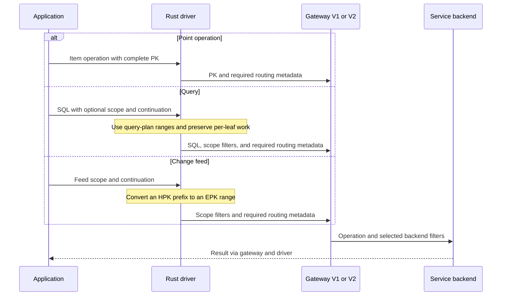

<!-- cspell:ignore partialpartitionkey PKRID -->
# Query Routing and Backend Filtering

Define the headers the Rust Cosmos DB driver sends to route point operations,
queries, and change feed requests without redundant backend EPK range filtering.

**Status:** Draft | **Date:** 2026-11-20 | **Crate:** `azure_data_cosmos_driver`

## Executive summary

- Routing chooses a physical partition; filtering determines which documents
   it returns. Removing a filter must not remove required Gateway V2 routing.
- Prefer a complete partition key over a partial hierarchical key, and either
   over a redundant EPK range filter.
- Complete PK and backend EPK filtering are mutually exclusive. PPK may
   accompany start/end EPK filtering.
- Physical PKRID is required on every point and feed-execution request,
   independently of backend filters or Gateway V2 proxy-routing metadata.
- Queries can rely on SQL for filtering; change feed has no SQL and still needs
   EPK range filtering for a partial hierarchical key.
- Keep range boundaries that prevent duplicate results or preserve independent
   continuation progress, including after splits and merges.
- A necessary filter covering one EPK stays a start/end range. Incomplete
   existing wire headers do not acquire new client-side rejection rules.

## User and problem

An application asks for one item, query results, or changes within a chosen
scope. The driver must reach the right partitions without adding an EPK range
filter already enforced by the partition key, physical partition, or SQL.
For example, `WHERE c.tenantId = "abc"` can filter through the partition-key
path index rather than through an additional EPK range filter.

The optimization must also preserve the work assigned to each request: SQL
alone does not separate independently paged slices on the same partition.

## Scope and non-goals

This is the Rust driver contract for Gateway V1 and Gateway V2, including point
operations, queries, query-plan requests, change feed, and their range handling
during pagination and topology recovery. Direct mode is out of scope and is
not implemented by the Rust SDK. Java and .NET are precedents, not normative
contracts for Rust.

## Key decisions and unresolved questions

The decisions are to remove only redundant backend filtering, keep proxy
routing independent, and preserve existing incomplete-header transmission
behavior. A complete PK takes precedence over PPK; PPK is a query filter, not
a change-feed filter (yet). These decisions apply even where Rust implementation
gaps remain.

- **[OPEN QUESTION]** What exact live service result and status do requests
   with only one range bound or with missing range key type produce? The
   compatibility tests must identify these outcomes and then update this spec;
   for now, this document does not invent them.
- **[OPEN QUESTION]** For several fresh query ranges on one physical partition,
   which permitted strategy will the planner use: one execution or separate
   range-filtered executions? Both remain allowed; neither may duplicate work.

## End-to-end flow

A **complete partition key (PK)** identifies one logical partition. A
**partial partition key (PPK)** is a non-empty prefix of a hierarchical
partition key (HPK). An **effective partition key (EPK)** is its routing-space
representation; a **FeedRange** selects an EPK interval. **PKRID** identifies
a physical partition-key range. A request *leaf* in cross-partition queries
or change feed executes against one physical partition.

Gateway V1 includes the Routing Gateway and Compute Gateway: both expose the
same HTTP request-header contract to the SDK. Gateway V2 is the thin-client
proxy path. It carries an RNTBD request frame inside an HTTP request body;
only a small set of proxy-dispatch headers remains in outer HTTP headers.
The RNTBD frame has its own request metadata and payload. The header/token
reference and transport projection below distinguish that metadata from
outer HTTP headers and from the backend filters.

Every point-operation request and every feed-execution request, including
queries and change feed, must include the resolved physical PKRID. This applies to every leaf, page,
resume, and retry, including complete-PK requests and requests with Gateway V2
proxy-routing EPKs or hashes. It preserves existing SDK behavior: the physical
partition selected from the client's topology must remain explicit so stale
topology produces routing feedback, such as a `410`, and triggers a refresh.
The SDK must include PKRID even if the gateway or backend could route without
it or would not reject its omission. This is a client topology-cache correctness
requirement, not a claim that the backend always enforces PKRID presence.
After topology refresh, use the newly resolved PKRID. PKRID does not replace
the PK, PPK, or necessary EPK range filter. Query-plan requests are the separate
exception; they do not carry a data-partition route.

For an HPK container, the difference is concrete: a point request uses the full
key, a query for tenant `abc` can use PPK `["abc"]` or SQL, and change feed for
the same prefix uses an EPK range. The requirements below define the filters
and the exceptions; protocol encodings are at the end.

## Functional requirements by user goal

### Point operations (exactly one document)

Point operations require a complete PK and do not fan out. Partial PK,
FeedRange, and WHERE scope are not supported for their routing. The request
must contain PK and physical PKRID, and must not contain PPK, backend EPK range
filtering, or its read-key-type selector. For Gateway V2 the
client independently derives the complete-PK routing EPK and sends it in the
`x-ms-effective-partition-key` to the Gateway V2 Proxy. This header is
mandatory in Gateway V2 for performance reasons.

### Query the selected documents

Queries support optional full PK, partial HPK, or FeedRange scopes via request
options; physical PKRID and full-container targeting are also covered.
They support WHERE filtering and cross-partition fan-out. The backend applies
SQL together with the selected scope. Every executed query leaf must carry
physical PKRID, including complete-PK and full-container queries:

- **No scope or full container:** SQL alone supplies document filtering.
- **Complete PK or partial HPK:** emit PK or PPK respectively, alongside SQL.
- **EPK FeedRange:** enforce the range alongside SQL, subject to the redundancy
   rules below.
- **Whole physical partition:** PKRID supplies the physical scope; SQL filters
   within it.

These combinations apply whether the SQL contains no PK predicate, matching
full-key equality, matching HPK prefix, a narrower predicate, or a disjoint
predicate. The query plan may reduce contacted partitions; the routing layer
must consume that plan rather than independently parse SQL. **Synthesizing PK or
PPK headers from SQL values is not required.**

When no explicit or correctness-required range needs enforcement, prefer SQL
filtering over an EPK range filter. For example, a WHERE-only tenant equality
uses the plan to find partitions and SQL to filter documents. Internally
combined PK/PPK and explicit FeedRange inputs must also follow the business
rules below.

### Read changes within a scope

The Change feed API supports complete PK, partial HPK scope, explicit FeedRange,
whole physical partition, or full container, with fan-out when needed. It has
no SQL predicate (yet).

- A complete PK uses the PK filter and the resolved PKRID.
- Currently, a partial HPK must become an EPK range, not a PPK header. Assert
   equivalent scoped results and the range headers; query PPK use instead
   asserts the query scope and PPK header. There is ongoing work to also
   add support for the PPK header in the changefeed API in the service. Once
   this change is deployed globally, the SDK should switch to that model.
- Full-container and whole-physical-partition reads use PKRID per leaf
   without backend EPK filtering for full-partition leaves. Splits and merges
   must still be handled without missing or duplicate data.
- Strict slices, including a necessary one-EPK scope, use PKRID and an EPK
   range filter.

### Continue without duplicating or rereading work

Query plans for SQL statements with `IN` or `OR` can assign several
non-overlapping ranges to one PKRID. The planner must either execute once per
query, semantic scope, and PKRID, or keep a distinct EPK range filter on
every leaf. It must never execute the same query unfiltered multiple times
against that partition.

On query or change-feed resume and topology recovery, retain the EPK filters
for strict saved slices. Independently continued slices and fresh gaps must
remain separate even when a merge places them on one PKRID with different
progress. SQL does not enforce these saved work boundaries.

**Takeaway:** filter removal must preserve both the requested documents and
the work remaining for each leaf.

## Business rules

Select the semantic filter in this order: complete PK, PPK, EPK range. If both
PK and PPK are available, emit PK and omit PPK rather than rejecting the input.
Retain an additional EPK range needed for correctness or a narrower scope
with PPK or PKRID, not alongside a complete PK filter.

The backend rejects `x-ms-documentdb-partitionkey` together with
`x-ms-start-epk` / `x-ms-end-epk`, regardless of their range relationship.
This is different from the Gateway V2 PK-derived proxy-routing EPK, which
accompanies PK but is not a backend EPK filter. PPK may coexist with backend
start/end EPK filters. PKRID is required alongside PK, PPK, an EPK range, PPK
plus an EPK range, and requests without a backend filter. Its presence does
not depend on whether the service needs it to locate the logical scope.

For the comparison below, `S` is a backend-enforced PK, PPK, or PKRID;
`F` is an additional explicit EPK range filter. A query-plan range used only
for routing is not `F`. Protect independent leaf boundaries before evaluating
redundancy, and evaluate redundancy before the one-EPK case.

| Relationship                         | Physical route    | Backend decision and outcome                                                                  |
| ------------------------------------ | ----------------- | --------------------------------------------------------------------------------------------- |
| `F == S`, or `S` strictly inside `F` | Partitions of `S` | Keep PK, PPK, or PKRID; omit redundant start/end and key type. Results are unchanged.         |
| `F` strictly inside `S`              | Overlap           | For PPK or PKRID, retain the EPK range; return the narrower scope.                            |
| Partial overlap                      | Overlap           | For PPK or PKRID, retain the EPK range; return the intersection.                              |
| Disjoint                             | Partitions of `S` | For PPK or PKRID, send both constraints; no documents match, but an aggregate may emit a row. |
| Necessary `F` covers one EPK         | Owning partition  | Keep PKRID and the narrow start/end range with range key type; retain PPK if applicable.      |

The last four rows do not authorize PK plus backend start/end EPK. For an
existing raw or internally staged request that retains both, the backend
rejects the combination; do not promise a successful intersection or an empty
result. Pin that rejection in protocol tests rather than introducing a new
client-side validation rule or a customer-facing feature flag.

The one-EPK case is reserved for an application explicitly constructing an EPK
`FeedRange` for a single logical partition; whenever the Rust API creates a
`FeedRange` from a `PartitionKey`, it must preserve the original PK value so it
can recover the `PartitionKey` and prefer the partition-key header instead.

Every necessary one-EPK filter remains a range rather than becoming an equality
filter. PKRID alone suffices only for the whole physical partition, not a
strict slice of it.

**[ASSUMPTION] Example values only:** physical partition `7` owns `[20, 80)`;
short EPK values below illustrate relationships, not real hashes.

- PK hashing to `40` plus `[20, 80)` needs PK and routing metadata, not
   start/end or key type. A raw request carrying both PK and disjoint
   `[90, A0)` is rejected by the backend, not evaluated as an empty scope.
- PPK `["abc"]` covering `[30, 30FF)` makes a containing range redundant;
   a strict `[3040, 3050)` still needs PPK and the range filter.
- FeedRange `[20, 80)` needs only PKRID `7` for backend scope; `[30, 50)`
   needs PKRID `7` plus start/end and range key type. Gateway V2 routing remains
   present in both cases.
- `[40, successor(40))`, after width-aware normalization, remains a range
   filter with PKRID `7` when it is not redundant.

## Edge cases and error behavior

### Contradictory scopes are not all the same

If request-option scope and SQL scope are disjoint, route the request-option
scope and let SQL evaluate the contradiction. Do not eliminate every leaf:
zero matching documents can still produce an aggregate row.

For a WHERE-only contradiction, existing planner rules remain valid: an
ordinary projection may drain without I/O when emptiness is proven, while
aggregates, GROUP BY, and hybrid search must retain their zero-input semantics.

### Incomplete headers preserve compatibility

Typed ranges have two bounds, and SDK-generated filters use the complete
header set. For existing staged/raw requests with only one bound or without
range key type, preserve current transmission behavior; do not introduce new
client-side rejection. Pin the live service result and status rather than
assuming an error response.

An empty minimum is a valid bound, not a missing one. Its permitted wire
representation must not cause rejection as an incomplete logical range; the
gateway-specific encoding is defined under Implementation details.

### Query planning is not data execution

Query-plan requests accept SQL and optional PK, PPK, or FeedRange input, but
must omit data PKRID and proxy range routing. They have no data fan-out or
one-EPK filter conversion.

## Implementation details

### Ordered selection algorithm

For every data request, apply these steps in order (query-plan processing
applies to queries):

1. Derive caller scope: PK, PPK, explicit FeedRange, physical PKRID, or full
    container.
2. Obtain query routing ranges from the selected query plan; do not parse SQL
    independently in routing.
3. Intersect compatible ranges for routing. For disjoint option/SQL scopes,
    retain request-option routing and service evaluation as specified above.
4. Resolve each point request or feed leaf to one physical partition and include
   its PKRID on every execution attempt. Re-resolve it after topology refresh.
5. Select the semantic filter: PK, then PPK, then EPK range.
6. Preserve correctness-required boundaries of independent fresh/resumed leaves.
7. Remove other EPK filters only when another backend constraint fully enforces
   them; overlap alone is insufficient. Do not generate PK plus backend EPK
   range filtering; PPK plus a necessary EPK range is permitted.
8. Retain `[X, successor(X))` for a necessary one-EPK range filter.
9. Project routing to the chosen gateway independently of backend filtering.

### Range encoding and normalization

**EPK-R** means a half-open filter interval `[minInclusive, maxExclusive)`.
A closed query-plan equality `[X, X]` becomes `[X, successor(X))`.
Every retained EPK range uses start/end plus
`ReadFeedKeyType::EffectivePartitionKeyRange`. Do not replace a one-EPK filter
with `ReadFeedKeyType::EffectivePartitionKey` (`2`).

| Partitioning model | Successor calculation                                         |
| ------------------ | ------------------------------------------------------------- |
| Hash V1            | Increment the variable-width encoded EPK in big-endian order. |
| Hash V2            | Right-pad to 16 bytes with zeroes, then increment.            |
| HPK / MultiHash    | Right-pad to `16 * path_count` bytes, then increment.         |

A half-open range represents one EPK only when the upper bound is the
container-definition-aware successor of the lower bound. `[AA, AB)` qualifies
only at the correct encoded width; raw hexadecimal subtraction is insufficient
for trimmed Hash V2 or HPK bounds. A partial HPK prefix `P` covers
`[P, P + FF)`, not one EPK.

### Header and token reference

**TC-R** means Gateway V2 proxy range routing, never backend document
filtering. RNTBD IDs below are the Gateway V2 projection of the named headers;
`String`, `Bytes`, and `Byte` are wire types. HTTP values are textual; an
RNTBD `Byte` value is not a numeric string in an HTTP header.

The use columns describe the data-request contract above, including the
resolved PKRID. **Use** means interpreting metadata to route a request,
validate its destination, or filter documents. Receiving or forwarding a
backend header unchanged does not make the gateway/proxy a consumer of that
filter. Query-plan requests retain their separate no-data-route rules.

| Header or token                                          | Wire form                   | Gateway / Proxy use          | Backend use                             | Function and constraint                                                               |
| -------------------------------------------------------- | --------------------------- | ---------------------------- | --------------------------------------- | ------------------------------------------------------------------------------------- |
| `x-ms-documentdb-partitionkey`                           | HTTP; RNTBD `0x002B` String | No: forward unchanged        | Yes: complete-PK filter                 | Prefer over PPK. Backend rejects combination with start/end EPK.                      |
| `x-ms-documentdb-partialpartitionkey`                    | HTTP; RNTBD `0x0108` String | No: forward unchanged        | Yes: HPK-prefix query filter            | Backend rejects non-HPK use. May accompany start/end EPK.                             |
| `x-ms-documentdb-partitionkeyrangeid`                    | HTTP; RNTBD `0x002C` String | Yes: V1/V2 physical routing  | Yes: validate target physical partition | Required on every point/feed execution request, independent of backend enforcement.   |
| `x-ms-effective-partition-key`                           | HTTP; RNTBD `0x005A` Bytes  | Yes: V2 proxy point routing  | No, in this contract                    | Complete-PK routing EPK; accompanies PK, not a backend EPK filter.                    |
| `x-ms-start-epk`, `x-ms-end-epk`                         | HTTP                        | No: forward unchanged        | Yes: EPK range filter                   | SDK-generated EPK-R filters use both bounds and range key type.                       |
| RNTBD `StartEpk`, `EndEpk`                               | `0x0062`, `0x0063` Bytes    | No: forward unchanged        | Yes: EPK range filter                   | UTF-8 EPK hex filter text, derived only from public start/end headers.                |
| `x-ms-read-key-type`                                     | HTTP; RNTBD `0x0064` Byte   | No: forward unchanged        | Yes: select EPK filtering mode          | HTTP value `EffectivePartitionKeyRange`; RNTBD byte value `3`.                        |
| `x-ms-thinclient-range-min`, `x-ms-thinclient-range-max` | Outer Gateway V2 HTTP       | Yes: V2 proxy range dispatch | No                                      | Literal `true` flags announcing TC-R in the frame; not EPK values or backend filters. |
| RNTBD `StartEpkHash`, `EndEpkHash`                       | `0x00D2`, `0x00D3` Bytes    | Yes: V2 proxy range routing  | No                                      | Hex-decoded routing bounds; may use physical-range fallback.                          |

`x-ms-thinclient-pkrange-min` / `x-ms-thinclient-pkrange-max` are Rust SDK
staging inputs, not service wire headers in this contract. Neither a gateway/
proxy nor the backend consumes them directly. The SDK's V2 serializer converts
them to fallback `StartEpkHash`/`EndEpkHash` routing tokens, whose consumer is
the proxy as listed above. They must not become backend `StartEpk`/`EndEpk`
filter tokens.

The backend filter combinations are explicit below. Every valid set must also
include `x-ms-documentdb-partitionkeyrangeid` for the selected physical
partition, including the set with no backend filter. Proxy-routing metadata
is selected separately and never replaces PKRID.

| Backend header set                                                     | Contract                                                                                  |
| ---------------------------------------------------------------------- | ----------------------------------------------------------------------------------------- |
| `x-ms-documentdb-partitionkey`                                         | Complete logical partition; omit PPK and backend start/end EPK.                           |
| `x-ms-documentdb-partialpartitionkey`                                  | HPK prefix for queries; omit PK.                                                          |
| `x-ms-start-epk` + `x-ms-end-epk` + `x-ms-read-key-type`               | Required EPK range; omit PK.                                                              |
| `x-ms-documentdb-partialpartitionkey` + start/end EPK + range key type | Valid HPK query intersection; retain both constraints when the range is not redundant.    |
| No PK, PPK, or EPK filter                                              | Whole physical partition; SQL may still filter a query.                                   |
| `x-ms-documentdb-partitionkey` + `x-ms-start-epk` / `x-ms-end-epk`     | Backend-rejected combination, even with PKRID; not a successful combined-filter strategy. |

PPK is not a filter for non-HPK containers; the backend rejects that use.
These are existing service constraints, not requirements to add new
client-side validation or a feature flag. Supplying PK and PPK internally
still selects PK and omits PPK. A proxy-routing `EffectivePartitionKey` token
does not select backend `ReadFeedKeyType::EffectivePartitionKey` (`2`);
backend equality-by-EPK filtering is not used by this contract.

### Transport projection

Gateway V1 sends the selected backend HTTP headers using the common Routing
Gateway / Compute Gateway HTTP contract. Gateway V2 retains existing outer
proxy headers and independently emits routing and backend tokens in the RNTBD
frame. Both paths must carry physical PKRID on every point and feed-execution
request: the HTTP header on Gateway V1 and RNTBD token `0x002C` on Gateway V2.
The requirements below supplement, rather than replace, that mandatory carrier:

- **Complete PK without EPK-R:** use proxy `EffectivePartitionKey` and backend
   `PartitionKey` plus PKRID, not TC-R or backend start/end. The client computes
   the proxy EPK; it does not require backend `ReadFeedKeyType`.
- **Partial HPK query:** send backend `PartialPartitionKey` and PKRID with
   proxy `StartEpkHash`/`EndEpkHash`. Retain backend start/end and range key
   type only for an additional required EPK-R. Change feed currently uses
   EPK-R instead of `PartialPartitionKey`.
- **Whole physical partition:** send PKRID and proxy `StartEpkHash`/
   `EndEpkHash`, without backend start/end.
- **Required EPK-R, including one EPK:** Gateway V1 sends start/end, range key
   type, and PKRID. Gateway V2 sends routing hashes and PKRID plus backend
   `StartEpk`, `EndEpk`, and range key type; no backend `PartitionKey`.
   Suppress proxy `EffectivePartitionKey`: point EPK routing and range routing
   hashes are mutually exclusive.
- **SQL-only query leaf:** route with TC-R, not the PK-derived proxy EPK.
   SQL filters the backend; independent work-boundary requirements still apply.

For requests originating in either an SDK or Compute Gateway, the thin-client
proxy uses proxy-routing metadata to choose the destination and forwards the
backend request metadata unchanged. It must not add, remove, or rewrite backend
filter headers or RNTBD tokens. Proxy-only dispatch/routing metadata is consumed
by the proxy, not reinterpreted as a backend filter. In particular, receiving
TC-R must never synthesize backend `x-ms-start-epk`/`x-ms-end-epk` or RNTBD
`StartEpk`/`EndEpk`; explicitly supplied backend filters remain unchanged.
The SDK-to-proxy framing and the proxy-to-backend request are distinct protocol
hops; RNTBD metadata is not another set of outer HTTP headers.

Continue emitting outer `x-ms-thinclient-range-min/max` flags where the existing
Gateway V2 transport requires them, including whole-partition range-routed
queries. Never remove this routing metadata merely because backend EPK filters
were removed. Change-feed range leaves likewise retain TC-R and PKRID; the
complete-PK case uses the derived proxy EPK and resolved PKRID.

For an empty minimum bound, Gateway V1 may send an empty HTTP value. Gateway V2
encodes routing `StartEpkHash` as zero bytes and may omit the empty backend
`StartEpk` text token. PKRID disambiguates the physical route; this permitted
omission must not be rejected as an incomplete logical range.

### Implementation gaps and related designs

This contract remains normative where current Rust differs:

- Rust does not yet emit the PPK HTTP header or RNTBD token `0x0108`.
- Query leaves currently emit narrow start/end filters for many planner-derived
   ranges.
- Gateway V2 currently prefers public start/end headers for routing hashes;
   those hashes must survive removal of redundant backend filters.

Related designs: `0007-partition-key-range-cache.md`, `0011-gateway-v2.md`,
`0012-feed-operations-and-dataflow.md`, and `0013-query-engine.md`.
The .NET `RequestInvokerHandler` partial-key/exact-range behavior and Java
`FeedRangeEpkImpl` and thin-client range tests provide precedents. Keeping
one-EPK feed filters in range form matches current Rust, Java, and .NET.
