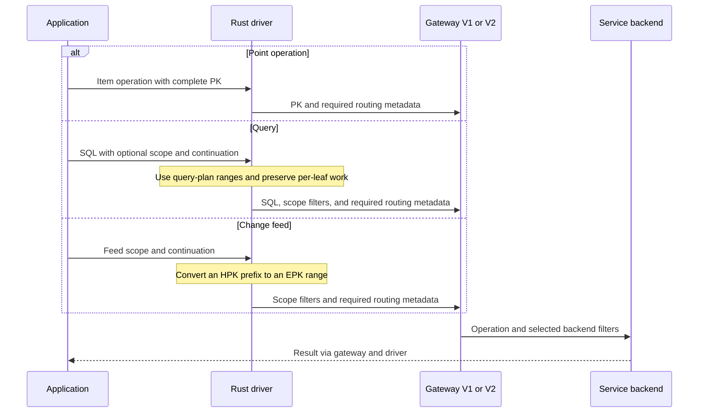

<!-- cspell:ignore partialpartitionkey PKRID -->
# Query Routing and Backend Filtering

Define the headers the Rust Cosmos DB driver sends to route point operations,
queries, and change feed requests without redundant backend EPK range filtering.

**Status:** Draft | **Date:** 2026-11-17 | **Crate:** `azure_data_cosmos_driver`

## Executive summary

- Routing chooses a physical partition; filtering determines which documents
   it returns. Removing a filter must not remove required Gateway V2 routing.
- Prefer a complete partition key over a partial hierarchical key, and either
   over a redundant EPK range filter.
- Queries can rely on SQL for filtering; change feed has no SQL and still needs
   EPK range filtering for a partial hierarchical key.
- Keep range boundaries that prevent duplicate results or preserve independent
   continuation progress, including after splits and merges.
- A necessary filter covering one EPK stays a start/end range. Incomplete
   existing wire headers do not acquire new client-side rejection rules.

## User and problem

An application asks for one item, query results, or changes within a chosen
scope. The driver must reach the right partitions without adding an EPK range
filter already enforced by the partition key, physical partition, or SQL.
For example, `WHERE c.tenantId = "abc"` can filter through the partition-key
path index rather than through an additional EPK range filter.

The optimization must also preserve the work assigned to each request: SQL
alone does not separate independently paged slices on the same partition.

## Scope and non-goals

This is the Rust driver contract for Gateway V1 and Gateway V2, including point
operations, queries, query-plan requests, change feed, and their range handling
during pagination and topology recovery. Direct mode is out of scope and is
not implemented by the Rust SDK. Java and .NET are precedents, not normative
contracts for Rust.

## Key decisions and unresolved questions

The decisions are to remove only redundant backend filtering, keep proxy
routing independent, and preserve existing incomplete-header transmission
behavior. A complete PK takes precedence over PPK; PPK is a query filter, not
a change-feed filter (yet). These decisions apply even where Rust implementation
gaps remain.

- **[OPEN QUESTION]** What exact live service result and status do requests
   with only one range bound or with missing range key type produce? The
   compatibility tests must identify these outcomes and then update this spec;
   for now, this document does not invent them.
- **[OPEN QUESTION]** For several fresh query ranges on one physical partition,
   which permitted strategy will the planner use: one execution or separate
   range-filtered executions? Both remain allowed; neither may duplicate work.

## End-to-end flow

A **complete partition key (PK)** identifies one logical partition. A
**partial partition key (PPK)** is a non-empty prefix of a hierarchical
partition key (HPK). An **effective partition key (EPK)** is its routing-space
representation; a **FeedRange** selects an EPK interval. **PKRID** identifies
a physical partition-key range. A request *leaf* in cross partition queries
or change feed executes against one physical partition.

For an HPK container, the difference is concrete: a point request uses the full
key, a query for tenant `abc` can use PPK `["abc"]` or SQL, and change feed for
the same prefix uses an EPK range. The requirements below define the filters
and the exceptions; protocol encodings are at the end.

## Functional requirements by user goal

### Point operations (exactly one document)

Point operations require a complete PK and do not fan out. Partial PK,
FeedRange, and WHERE scope are not supported for their routing. The request
must contain PK and must not contain PPK, backend EPK range filtering, or its
read-key-type selector. Physical PKRID is optional; Gateway V2 independently
derives the complete-PK routing EPK.

### Query the selected documents

Queries support optional full PK, partial HPK, or FeedRange scopes via request
options; physical PKRID and full-container targeting are also covered.
They support WHERE filtering and cross-partition fan-out. The backend applies
SQL together with the selected scope:

- **No scope or full container:** SQL alone supplies document filtering.
- **Complete PK or partial HPK:** emit PK or PPK respectively, alongside SQL.
- **EPK FeedRange:** enforce the range alongside SQL, subject to the redundancy
   rules below.
- **Whole physical partition:** PKRID supplies the physical scope; SQL filters
   within it.

These combinations apply whether the SQL contains no PK predicate, matching
full-key equality, matching HPK prefix, a narrower predicate, or a disjoint
predicate. The query plan may reduce contacted partitions; the routing layer
must consume that plan rather than independently parse SQL. **Synthesizing PK or
PPK headers from SQL values is not required.**

When no explicit or correctness-required range needs enforcement, prefer SQL
filtering over an EPK range filter. For example, a WHERE-only tenant equality
uses the plan to find partitions and SQL to filter documents. Internally
combined PK/PPK and explicit FeedRange inputs must also follow the business
rules below.

### Read changes within a scope

The Change feed API supports complete PK, partial HPK scope, explicit FeedRange,
whole physical partition, or full container, with fan-out when needed. It has
no SQL predicate (yet).

- A complete PK uses the PK filter; physical PKRID is optional.
- Currently, A partial HPK must become an EPK range, not a PPK header. Assert
   equivalent scoped results and the range headers; query PPK use instead
   asserts the query scope and PPK header. There is ongoing work to also
   add support for the PPK header in the changefeed API in the service. Once
   this change is deployed globally, the SDK should switch to that model.
- Full-container and whole-physical-partition reads can use PKRID per leaf
   backend EPK filtering for full-partition leaves - but splits and merges
   need to be handled correctly without missing/duplicate data.
- Strict slices, including a necessary one-EPK scope, use PKRID and an EPK
   range filter.

### Continue without duplicating or rereading work

Query plans for SQL statements wit `IN` or `OR` can assign several
non-overlapping ranges to one PKRID. The planner must either execute once per
query, semantic scope, and PKRID, or keep a distinct EPK range filter on
every leaf. It must never execute the same query unfiltered multiple times
against that partition.

On query or change-feed resume and topology recovery, retain the EPK filters
for strict saved slices. Independently continued slices and fresh gaps must
remain separate even when a merge places them on one PKRID with different
progress. SQL does not enforce these saved work boundaries.

**Takeaway:** filter removal must preserve both the requested documents and
the work remaining for each leaf.

## Business rules

Select the semantic filter in this order: complete PK, PPK, EPK range. If both
PK and PPK are available, emit PK and omit PPK rather than rejecting the input.
Retain any additional EPK range needed for correctness or a narrower scope.

For the comparison below, `S` is a backend-enforced PK, PPK, or physical scope;
`F` is an additional explicit EPK range filter. A query-plan range used only
for routing is not `F`. Protect independent leaf boundaries before evaluating
redundancy, and evaluate redundancy before the one-EPK case.

| Relationship                         | Physical route    | Backend decision and outcome                                                          |
| ------------------------------------ | ----------------- | ------------------------------------------------------------------------------------- |
| `F == S`, or `S` strictly inside `F` | Partitions of `S` | Keep PK, PPK, or PKRID; omit redundant start/end and key type. Results are unchanged. |
| `F` strictly inside `S`              | Overlap           | Keep semantic filter and EPK range; return the narrower scope.                        |
| Partial overlap                      | Overlap           | Keep semantic filter and EPK range; return the intersection.                          |
| Disjoint                             | Partitions of `S` | Send both constraints; zero documents match, but SQL aggregates may still emit a row. |
| Necessary `F` covers one EPK         | Owning partition  | Keep semantic filter and the narrow start/end range with range key type.              |

The one-EPK case is reserved for an application explicitly constructing an EPK
`FeedRange` for a single logical partition; whenever the Rust API creates a
`FeedRange` from a `PartitionKey`, it must preserve the original PK value so it
can recover the `PartitionKey` and prefer the partition-key header instead.

Every necessary one-EPK filter remains a range rather than becoming an equality
filter. PKRID alone suffices only for the whole physical partition, not a
strict slice of it.

**[ASSUMPTION] Example values only:** physical partition `7` owns `[20, 80)`;
short EPK values below illustrate relationships, not real hashes.

- PK hashing to `40` plus `[20, 80)` needs PK and routing metadata, not
   start/end or key type. With disjoint `[90, A0)`, retain PK and the range;
   no documents match.
- PPK `["abc"]` covering `[30, 30FF)` makes a containing range redundant;
   a strict `[3040, 3050)` still needs PPK and the range filter.
- FeedRange `[20, 80)` needs only PKRID `7` for backend scope; `[30, 50)`
   needs PKRID `7` plus start/end and range key type. Gateway V2 routing remains
   present in both cases.
- `[40, successor(40))`, after width-aware normalization, remains a range
   filter with PKRID `7` when it is not redundant.

## Edge cases and error behavior

### Contradictory scopes are not all the same

If request-option scope and SQL scope are disjoint, route the request-option
scope and let SQL evaluate the contradiction. Do not eliminate every leaf:
zero matching documents can still produce an aggregate row.

For a WHERE-only contradiction, existing planner rules remain valid: an
ordinary projection may drain without I/O when emptiness is proven, while
aggregates, GROUP BY, and hybrid search must retain their zero-input semantics.

### Incomplete headers preserve compatibility

Typed ranges have two bounds, and SDK-generated filters use the complete
header set. For existing staged/raw requests with only one bound or without
range key type, preserve current transmission behavior; do not introduce new
client-side rejection. Pin the live service result and status rather than
assuming an error response.

An empty minimum is a valid bound, not a missing one. Its permitted wire
representation must not cause rejection as an incomplete logical range; the
gateway-specific encoding is defined under Implementation details.

### Query planning is not data execution

Query-plan requests accept SQL and optional PK, PPK, or FeedRange input, but
must omit data PKRID and proxy range routing. They have no data fan-out or
one-EPK filter conversion.

## Implementation details

### Ordered selection algorithm

For every data request, apply these steps in order (query-plan processing
applies to queries):

1. Derive caller scope: PK, PPK, explicit FeedRange, physical PKRID, or full
    container.
2. Obtain query routing ranges from the selected query plan; do not parse SQL
    independently in routing.
3. Intersect compatible ranges for routing. For disjoint option/SQL scopes,
    retain request-option routing and service evaluation as specified above.
4. Resolve each leaf to one physical partition and retain its PKRID.
5. Select the semantic filter: PK, then PPK, then EPK range.
6. Preserve correctness-required boundaries of independent fresh/resumed leaves.
7. Remove other EPK filters only when another backend constraint fully enforces
    them; overlap alone is insufficient.
8. Retain `[X, successor(X))` for a necessary one-EPK range filter.
9. Project routing to the chosen gateway independently of backend filtering.

### Range encoding and normalization

**EPK-R** means a half-open filter interval `[minInclusive, maxExclusive)`.
A closed query-plan equality `[X, X]` becomes `[X, successor(X))`.
Every retained EPK range uses start/end plus
`ReadFeedKeyType::EffectivePartitionKeyRange`. Do not replace a one-EPK filter
with `ReadFeedKeyType::EffectivePartitionKey` (`2`).

| Partitioning model | Successor calculation                                         |
| ------------------ | ------------------------------------------------------------- |
| Hash V1            | Increment the variable-width encoded EPK in big-endian order. |
| Hash V2            | Right-pad to 16 bytes with zeroes, then increment.            |
| HPK / MultiHash    | Right-pad to `16 * path_count` bytes, then increment.         |

A half-open range represents one EPK only when the upper bound is the
container-definition-aware successor of the lower bound. `[AA, AB)` qualifies
only at the correct encoded width; raw hexadecimal subtraction is insufficient
for trimmed Hash V2 or HPK bounds. A partial HPK prefix `P` covers
`[P, P + FF)`, not one EPK.

### Header and token reference

**TC-R** means Gateway V2 proxy range routing, never backend document
filtering. RNTBD IDs below are the Gateway V2 projection of the named headers;
`String`, `Bytes`, and `Byte` are wire types.

| Header or token                                              | Wire form                   | Consumer        | Function and constraint                                                                  |
| ------------------------------------------------------------ | --------------------------- | --------------- | ---------------------------------------------------------------------------------------- |
| `x-ms-documentdb-partitionkey`                               | HTTP; RNTBD `0x002B` String | Backend         | Complete PK filter; takes precedence over PPK.                                           |
| `x-ms-documentdb-partialpartitionkey`                        | HTTP; RNTBD `0x0108` String | Backend         | HPK-prefix query filter; omit when PK is present.                                        |
| `x-ms-documentdb-partitionkeyrangeid`                        | HTTP; RNTBD `0x002C` String | Gateway/backend | Physical routing; may accompany one semantic backend filter.                             |
| `x-ms-effective-partition-key`                               | HTTP; RNTBD `0x005A` Bytes  | Proxy           | PK-derived routing EPK, not a backend filter; accompanies PK when EPK-R is not retained. |
| `x-ms-start-epk`, `x-ms-end-epk`                             | HTTP                        | Backend         | SDK-generated EPK-R filters use both bounds and range key type.                          |
| RNTBD `StartEpk`, `EndEpk`                                   | `0x0062`, `0x0063` Bytes    | Backend         | UTF-8 EPK hex filter text, derived only from public start/end headers.                   |
| `x-ms-read-key-type`                                         | HTTP; RNTBD `0x0064` Byte   | Backend         | Feed/query range filtering uses `3`, `EffectivePartitionKeyRange`.                       |
| `x-ms-thinclient-range-min`, `x-ms-thinclient-range-max`     | Outer Gateway V2 HTTP       | Proxy only      | Literal `true` flags announcing TC-R in the frame; not EPK values or backend filters.    |
| RNTBD `StartEpkHash`, `EndEpkHash`                           | `0x00D2`, `0x00D3` Bytes    | Proxy only      | Hex-decoded routing bounds; may use physical-range fallback.                             |
| `x-ms-thinclient-pkrange-min`, `x-ms-thinclient-pkrange-max` | Internal Rust HTTP staging  | V2 serializer   | Fallback TC-R bounds; must not become backend `StartEpk`/`EndEpk` tokens.                |

### Transport projection

Gateway V1 sends the selected backend HTTP headers. Gateway V2 retains existing
outer proxy headers and independently emits routing and backend tokens:

- **Complete PK without EPK-R:** use proxy `EffectivePartitionKey` and backend
   `PartitionKey`, not TC-R or backend start/end. The proxy EPK does not require
   `ReadFeedKeyType`.
- **Whole physical partition:** send PKRID and proxy `StartEpkHash`/
   `EndEpkHash`, without backend start/end.
- **Required EPK-R, including one EPK:** Gateway V1 sends start/end, range key
   type, and PKRID. Gateway V2 sends routing hashes and PKRID plus backend
   `StartEpk`, `EndEpk`, and range key type. Suppress proxy
   `EffectivePartitionKey`, even when PK is known: point EPK routing and range
   routing hashes are mutually exclusive.
- **SQL-only query leaf:** route with TC-R, not the PK-derived proxy EPK.
   SQL filters the backend; independent work-boundary requirements still apply.

Continue emitting outer `x-ms-thinclient-range-min/max` flags where the existing
Gateway V2 transport requires them, including whole-partition range-routed
queries. Never remove this routing metadata merely because backend EPK filters
were removed. Change-feed range leaves likewise retain TC-R and PKRID; the
complete-PK case uses the derived proxy EPK and optional PKRID.

For an empty minimum bound, Gateway V1 may send an empty HTTP value. Gateway V2
encodes routing `StartEpkHash` as zero bytes and may omit the empty backend
`StartEpk` text token. PKRID disambiguates the physical route; this permitted
omission must not be rejected as an incomplete logical range.

### Implementation gaps and related designs

This contract remains normative where current Rust differs:

- Rust does not yet emit the PPK HTTP header or RNTBD token `0x0108`.
- Query leaves currently emit narrow start/end filters for many planner-derived
   ranges.
- Gateway V2 currently prefers public start/end headers for routing hashes;
   those hashes must survive removal of redundant backend filters.

Related designs: `0007-partition-key-range-cache.md`, `0011-gateway-v2.md`,
`0012-feed-operations-and-dataflow.md`, and `0013-query-engine.md`.
The .NET `RequestInvokerHandler` partial-key/exact-range behavior and Java
`FeedRangeEpkImpl` and thin-client range tests provide precedents. Keeping
one-EPK feed filters in range form matches current Rust, Java, and .NET.
